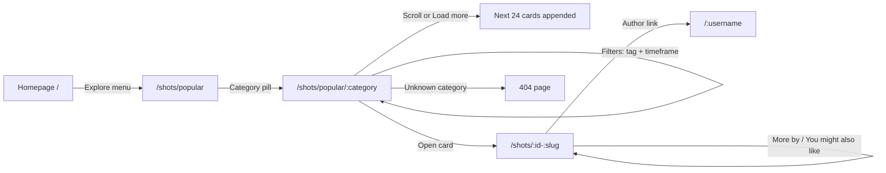
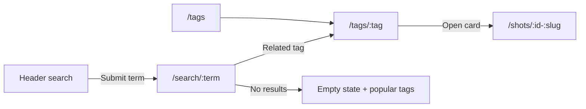
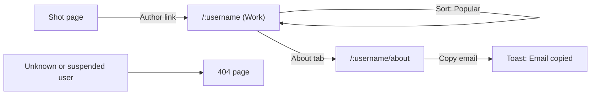
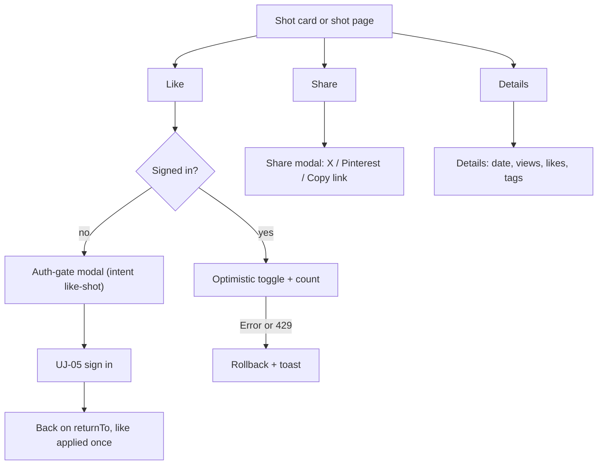
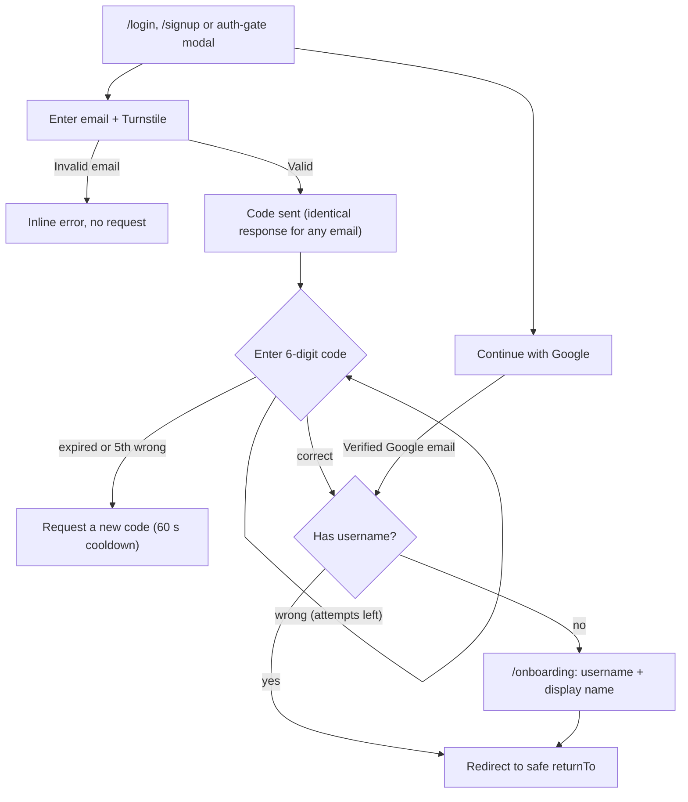
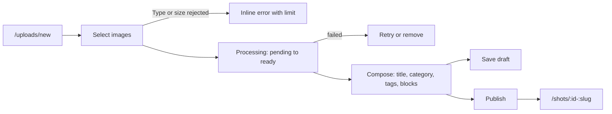

# User Journeys with Acceptance Scenarios (P01-04)

**Task:** P01-04 · **Owner:** TPM / QA Lead (Product Manager / Requirements Analyst role) · **Last updated:** 2026-11-12 · **Status:** Awaiting Review (user walkthrough at P01-07)
**Companion documents:** [REQUIREMENTS_SPECIFICATION.md](REQUIREMENTS_SPECIFICATION.md) · [BUSINESS_RULES.md](BUSINESS_RULES.md) · [USER_ROLES.md](USER_ROLES.md) · [FEATURE_INVENTORY.md](FEATURE_INVENTORY.md)
**Sources:** reverse-engineering [04-user-journeys.md](../reverse-engineering/04-user-journeys.md) (journeys 1–4, 7, 8 rewritten for the clone), [TESTING_PROGRESS.md](../TESTING_PROGRESS.md) (suite T-25 E2E).

---

## 1. Conventions

- **UJ-xx** are clone journeys. They are rewritten from the reference journeys, use the clone's routes and names, and apply the business rules (BR-xx). Behaviour after sign-in was never observed on the reference product (doc 10); here it is **specified** for the clone, not described as reference behaviour.
- Every scenario is written as **Given / When / Then** and names its planned Playwright test **E2E-xx**. E2E-xx IDs belong to suite **T-25**; they are **Test planned** and none has been executed. R1 journeys run fully at 1440 px and 390 px (workflow §8).
- Each R1 journey has at least 1 happy-path and at least 2 failure scenarios.
- **Test doubles** (workflow §8): email goes to a test inbox adapter that exposes the last code, Google uses a mocked provider, Turnstile uses its documented always-pass/always-fail test keys, and time-dependent cases use a controllable test clock.
- Mermaid labels that contain `/ : ? & + ( )` are quoted.

| Journey | Release | Reference journey | E2E scenarios |
|---|---|---|---|
| UJ-01 Discover a design | R1 | Journey 1 | E2E-01…E2E-09 |
| UJ-02 Search and browse tags | R1 | Journey 1 (search/tag branch) | E2E-10…E2E-15 |
| UJ-03 Discover a designer | R1 (R2 extensions) | Journey 2 | E2E-16…E2E-19 (R2: E2E-85) |
| UJ-04 Interact with a design | R1 | Journey 3 | E2E-20…E2E-28 |
| UJ-05 Authentication and onboarding | R1 | Journey 4 | E2E-29…E2E-44 |
| UJ-06 Upload a shot | R2 | — (uploader not observable) | E2E-50…E2E-56 |
| UJ-07 Save to a collection | R2 | Journey 3 (save) | E2E-57…E2E-60 |
| UJ-08 Follow a designer | R2 | Journey 2 (follow) | E2E-61…E2E-63 |
| UJ-09 Comment on a shot | R2 | Journey 3 (comments) | E2E-64…E2E-68 |
| UJ-10 Job seeker finds and applies | R2 | Journey 7 | E2E-69…E2E-71 |
| UJ-11 Employer posts a free job | R2 | Journey 8 | E2E-72…E2E-76 |
| UJ-12 Team publishing | R2 | — | E2E-77…E2E-79 |
| UJ-13 Manage account | R2 | — | E2E-80…E2E-82 |
| UJ-14 Report content (proposal) | R2 | — | E2E-83, E2E-84 |
| R2 extensions of R1 journeys | R2 | — | E2E-85…E2E-87 |
| R3 journeys (outline) | R3 | Journeys 2, 3, 9 | E2E-90…E2E-97 |

---

## 2. R1 journeys

### UJ-01 — Discover a design

**Actor:** visitor (also member). **Goal:** find an inspiring shot and its designer. **Requirements:** FR-01, FR-21–FR-25, FR-27, FR-37, FR-38, FR-41, FR-42, FR-05, FR-87. **Rules:** BR-32–BR-37, BR-42, BR-43, BR-89.

| ID | Type | Given | When | Then | E2E |
|---|---|---|---|---|---|
| UJ-01-S1 | Happy | the seeded catalogue and a visitor on `/` | they open Explore › Popular, pick the "Branding" pill, open the first card, then click the author's name | `/shots/popular/branding` shows only branding shots with the pill marked active (`aria-current`); the shot page shows title, author, content blocks, "More by" (≤ 4) and "You might also like" (≤ 12); the author link opens `/:username` | E2E-01 |
| UJ-01-S2 | Happy | a feed with more than 48 eligible shots | the visitor scrolls to the bottom twice, then to the end of the list | 24 cards are appended each time, no shot ID appears twice, a polite live region announces the new count, and the last page shows "You've reached the end" (BR-35) | E2E-02 |
| UJ-01-S3 | Happy | `/shots/popular` | the visitor opens Filters, enters tag `dashboard`, picks timeframe "This past month", then switches the sort to Recent | the URL holds `tag=dashboard&timeframe=month`; only shots tagged `dashboard` published in the last 30 days appear, ordered by likes (BR-34); on Recent the timeframe control is hidden and the parameter dropped | E2E-03 |
| UJ-01-F1 | Failure | a visitor | they open `/shots/popular/not-a-category` | the 404 page renders with status 404, a search box and a link home (BR-36, FR-05) | E2E-04 |
| UJ-01-F2 | Failure | a shot that is hidden by moderation, plus a non-existent ID | the visitor opens either URL | both return the 404 page with status 404 (BR-37, BR-42) | E2E-05 |
| UJ-01-F3 | Failure | a filter combination that matches nothing (tag `zzz-none`, timeframe week) | the visitor applies it | an empty state explains that nothing matches and offers "Clear filters", which restores the unfiltered feed | E2E-06 |
| UJ-01-F4 | Failure | the next-page request is forced to fail (network stub) | the visitor reaches the bottom of the feed | already-loaded cards stay; an inline error with a "Retry" button appears; Retry loads the page with no duplicates | E2E-07 |
| UJ-01-E1 | Edge | a shot whose slug changed | the visitor opens `/shots/{id}-old-slug` or `/shots/{id}` | a 308 redirect leads to the canonical URL, and the page has a matching `<link rel="canonical">` (BR-42, FR-87) | E2E-08 |
| UJ-01-E2 | Accessibility | a keyboard-only visitor on a feed | they Tab through the cards to the end of the list | a visible "Load more" button loads the next page; focus moves to the first new card; the footer remains reachable (NFR-27) | E2E-09 |

### UJ-02 — Search and browse tags

**Actor:** visitor. **Goal:** find shots by keyword or tag. **Requirements:** FR-01, FR-31–FR-34. **Rules:** BR-38–BR-41.

| ID | Type | Given | When | Then | E2E |
|---|---|---|---|---|---|
| UJ-02-S1 | Happy | seeded shots with "dashboard" in titles and tags | a visitor types "  Dashboard " in the header search and presses Enter | they land on `/search/dashboard`; the heading names the term; results include title matches first at equal popularity (BR-39); up to 8 related tags are shown | E2E-10 |
| UJ-02-S2 | Happy | `/tags` | the visitor picks a popular tag | `/tags/:tag` shows the full-number headline ("1,234 shots tagged …") and a popular-ordered feed of that tag | E2E-11 |
| UJ-02-F1 | Failure | no shot matches "zzqxnonexistent" | the visitor searches for it | an empty state with suggestions of popular tags appears, status 200, and the page has `noindex` (NFR-33) | E2E-12 |
| UJ-02-F2 | Failure | the header search box | the visitor submits only spaces, then a 150-character term | the empty submit does not navigate and shows a hint; the long term is truncated to 100 characters in the canonical URL (BR-38) | E2E-13 |
| UJ-02-F3 | Failure | a visitor | they search for `"design*`, `AND OR`, `(-)` and `^:` | each request returns 200 with results or the empty state; no request returns a 5xx (BR-38) | E2E-14 |
| UJ-02-F4 | Failure | a tag with no eligible shots and a tag that does not exist | the visitor opens either `/tags/...` URL | the 404 page is returned (BR-41) | E2E-15 |

### UJ-03 — Discover a designer

**Actor:** visitor. **Goal:** learn about a designer from their work. In R1, designers are reached from shots, search results and links; designer search and the hire directory come in R2/R3. **Requirements:** FR-54, FR-55, FR-09. **Rules:** BR-25, BR-28, BR-78.

| ID | Type | Given | When | Then | E2E |
|---|---|---|---|---|---|
| UJ-03-S1 | Happy | a seeded designer with 30 shots and a public contact email | a visitor opens their profile from a shot, switches the sort to Popular, then opens About and clicks the email | the Work tab shows 24 shots and loads more on scroll; the order changes to popularity; About shows bio, location, member since, skills, languages and links; clicking the email copies it and shows "Email copied" (BR-78) | E2E-16 |
| UJ-03-F1 | Failure | no account named `nobody-here` | the visitor opens `/nobody-here` | the 404 page is returned | E2E-17 |
| UJ-03-F2 | Failure | a seeded designer with no published shots | the visitor opens their profile | the Work tab shows an empty state ("No shots yet"), not an error | E2E-18 |
| UJ-03-F3 | Failure | a designer suspended through the admin script (BR-68) | the visitor opens their profile and the popular feed | the profile returns 404, and none of the designer's shots appear in feeds, search or related lists (BR-25, BR-37) | E2E-19 |

### UJ-04 — Interact with a design

**Actor:** member (visitor for gated cases). **Goal:** like, share and inspect a shot. **Requirements:** FR-24, FR-29, FR-39, FR-40, FR-42, FR-45, FR-15. **Rules:** BR-15, BR-26–BR-31, BR-44–BR-47, BR-76, BR-77.

| ID | Type | Given | When | Then | E2E |
|---|---|---|---|---|---|
| UJ-04-S1 | Happy | a signed-in member and someone else's shot with 41 likes | they like it on its card, reload, then unlike it on the shot page | the count shows 42 within 100 ms and still after reload; unliking returns it to 41 (BR-46, BR-47) | E2E-20 |
| UJ-04-S2 | Happy | a visitor on a shot page | they open Share, press "Copy link", then press Escape | the clipboard holds the canonical URL with `utm_source=share&utm_medium=copy_link&utm_campaign=shot`; a "Link copied" toast appears; the X and Pinterest links are intent URLs opening in a new tab; Escape closes the modal and focus returns to the Share button (BR-44) | E2E-21 |
| UJ-04-S3 | Happy | a shot with tags | a visitor opens Details and clicks a tag | the modal shows posted date, views and likes (no saves/comments in R1, BR-45); the tag link opens `/tags/:tag` | E2E-22 |
| UJ-04-S4 | Happy | a shot with N views and a signed-in member who is not the author | the member opens the shot page twice on the same UTC day, then once on the next day (test clock) | the view count becomes N+1 after the first day and N+2 after the next day; the author opening their own shot adds nothing (BR-29, BR-30) | E2E-23 |
| UJ-04-F1 | Failure | a visitor | they press Like on a card, then press Escape in the modal | the auth-gate modal explains "To like this shot, sign in or create an account"; focus is trapped inside; Escape closes it and returns focus; no like is recorded | E2E-24 |
| UJ-04-F2 | Failure | a signed-in member and a like request forced to return 500 | they press Like | the icon and count change, then revert, and an error toast appears (BR-47) | E2E-25 |
| UJ-04-F3 | Failure | a member who has used up `RL-SOCIAL` (test limit lowered) | they press Like | the server returns 429 with `Retry-After`; the UI reverts and the toast says when to try again (BR-77) | E2E-26 |
| UJ-04-F4 | Failure | a member viewing their own shot | the card and shot page render | no Like control is shown; a direct like request returns 403 `CANNOT_LIKE_OWN` (BR-46) | E2E-27 |
| UJ-04-F5 | Failure | R1 build | a member views a card and a shot page | Save, Follow, Comments and Get in touch are not rendered (BR-45) | E2E-28 |

### UJ-05 — Authentication and onboarding

**Actor:** visitor becoming a member. **Goal:** sign up or sign in with an email code or Google, choose a username, and return to where they were. **Requirements:** FR-10–FR-17, FR-20, FR-04, FR-14. **Rules:** BR-01–BR-25.

| ID | Type | Given | When | Then | E2E |
|---|---|---|---|---|---|
| UJ-05-S1 | Happy | a new email address | the visitor uses `/signup`, enters the email, passes Turnstile, enters the code from the test inbox, accepts the suggested username and enters a display name | the account is created; `/onboarding` validates the username live; on submit they land on `/` signed in, and the header shows their avatar menu (BR-09, BR-16, BR-21) | E2E-29 |
| UJ-05-S2 | Happy | an existing onboarded member on `/tags/branding` | they click "Log in", complete the email code | they return to `/tags/branding` signed in (BR-14) | E2E-30 |
| UJ-05-S3 | Happy | the mocked Google provider with a verified new email, then one matching an existing account | the visitor chooses "Continue with Google" | the new user goes to `/onboarding` with the display name pre-filled; the existing email is linked and signed in without onboarding (BR-11) | E2E-31 |
| UJ-05-S4 | Happy | a visitor on a shot page who presses Like (auth gate) | they sign in inside the modal with an email code | they are back on the same shot, which is now liked exactly once; repeating the flow on an already-liked shot leaves it liked (BR-15) | E2E-32 |
| UJ-05-S5 | Happy | a signed-in member | they choose "Sign out" in the avatar menu, then reuse the old session cookie (API request) | they are signed out, and the old cookie is rejected with 401 (BR-13) | E2E-33 |
| UJ-05-F1 | Failure | the sign-in form | the visitor submits it empty, then with `name@` | inline errors "Enter your email address" and "Enter a valid email address" appear with `aria-invalid`, and no network request is sent (BR-10) | E2E-34 |
| UJ-05-F2 | Failure | a code has been sent | the visitor enters 5 wrong codes | each error states the attempts left; after the 5th the code is invalid even if the correct one is entered next, and the UI offers "Send a new code" (BR-04) | E2E-35 |
| UJ-05-F3 | Failure | a code was sent 10 minutes and 1 second ago (test clock) | the visitor enters the correct code | an "expired" message appears with "Send a new code" (BR-03) | E2E-36 |
| UJ-05-F4 | Failure | a code was just sent | the visitor tries to resend at once, and then exceeds 5 sends in an hour (test clock) | resend is disabled with a 60 s countdown; the 6th send returns 429 and the UI shows when to retry (BR-05, BR-06) | E2E-37 |
| UJ-05-F5 | Failure | Turnstile configured with the always-fail test key | the visitor requests a code | an error asks them to retry the check, and the test inbox receives nothing (BR-08) | E2E-38 |
| UJ-05-F6 | Failure | login links with `returnTo=https://evil.example`, `//evil.example` and `/\evil.example` | the visitor signs in through each | each time they land on `/`, never on another origin (BR-14) | E2E-39 |
| UJ-05-F7 | Failure | a visitor, and a signed-in account without a username | the visitor opens `/onboarding`; the pending member opens `/tags` | the visitor is redirected to `/login?returnTo=%2Fonboarding`; the pending member is redirected to `/onboarding?returnTo=%2Ftags` (BR-16, BR-17) | E2E-40 |
| UJ-05-F8 | Failure | onboarding | the user tries `Ab` (too short), `shots` (reserved), `seed-designer` (taken) and `a--b` (invalid) | each shows a specific inline error and submission is blocked; a valid alternative is suggested (BR-18–BR-21) | E2E-41 |
| UJ-05-F9 | Failure | the mocked Google provider configured to cancel, then to return an unverified email | the visitor chooses "Continue with Google" | they stay on `/login` with a message to try again or use email, and no account is created (BR-11) | E2E-42 |
| UJ-05-F10 | Failure | a suspended account | the user requests and enters a valid code | sign-in is refused with "This account is unavailable", and no session is created (BR-25) | E2E-43 |
| UJ-05-E1 | Legal | the sign-up form and the footer | the visitor follows the Terms and Privacy links | both pages load with status 200 and are reachable by keyboard (FR-04) | E2E-44 |

---

## 3. R2 journeys

### UJ-06 — Upload a shot

**Requirements:** FR-61–FR-64, FR-43. **Rules:** BR-61–BR-66.

| ID | Type | Given | When | Then | E2E |
|---|---|---|---|---|---|
| UJ-06-S1 | Happy | an onboarded member | they upload two JPEGs, add a text block, title, category and 3 tags, and publish | the shot page shows the blocks in order; the shot appears first in `/shots/recent` and on their Work tab; derivatives carry no EXIF | E2E-50 |
| UJ-06-S2 | Happy | a composed shot | the member saves it as a draft, signs out and in, and publishes it from their drafts | the draft is invisible to others (404) until published; `published_at` is set at publish (BR-65) | E2E-51 |
| UJ-06-F1 | Failure | the composer | the member selects an SVG, a GIF and a PDF renamed to `.png` | all three are rejected by content, with the accepted types listed (BR-61) | E2E-52 |
| UJ-06-F2 | Failure | the composer | the member selects a 25 MB JPEG and a 300×200 PNG | both are rejected with the size and dimension limits (BR-62) | E2E-53 |
| UJ-06-F3 | Failure | processing forced to fail | the member uploads an image | the block shows "Processing failed" with Retry and Remove; publishing is blocked until resolved (BR-63) | E2E-54 |
| UJ-06-F4 | Failure | the composer | the member publishes without title or category | inline errors are shown and nothing is published (BR-64) | E2E-55 |
| UJ-06-F5 | Failure | a published shot with likes | the author deletes it | the URL returns 404; the shot leaves feeds; their shot count drops by 1 (BR-65) | E2E-56 |

### UJ-07 — Save to a collection

**Requirements:** FR-46, FR-47, FR-56. **Rules:** BR-53–BR-55, BR-15.

| ID | Type | Given | When | Then | E2E |
|---|---|---|---|---|---|
| UJ-07-S1 | Happy | a member on a shot | they press Save, create "Dashboards" in the picker and save | the shot is in the new collection, the saves count rises by 1, and the collection appears on their Collections tab | E2E-57 |
| UJ-07-F1 | Failure | a private collection | another member and a visitor open its URL | both get 404, and the collection is not listed on the owner's profile (BR-54) | E2E-58 |
| UJ-07-F2 | Failure | a visitor | they press Save and sign in through the gate | they return to the shot and the collection picker opens; nothing is saved without a choice (BR-15, `save-shot`) | E2E-59 |
| UJ-07-F3 | Failure | a shot already in a collection, and a collection at the 1,000-shot limit (seeded) | the member saves the shot again, then tries the full collection | the duplicate save is a no-op with no count change; the full collection is refused with a message (BR-53, BR-55) | E2E-60 |

### UJ-08 — Follow a designer

**Requirements:** FR-48. **Rules:** BR-56, BR-15.

| ID | Type | Given | When | Then | E2E |
|---|---|---|---|---|---|
| UJ-08-S1 | Happy | a member on a designer's profile | they press Follow, then Unfollow | the button shows "Following" and the follower count +1, then reverts | E2E-61 |
| UJ-08-F1 | Failure | a member on their own profile | the page renders, and a follow-self request is sent directly | no Follow button; the request returns 400 `CANNOT_FOLLOW_SELF` | E2E-62 |
| UJ-08-F2 | Failure | a visitor | they press Follow and sign in through the gate | they return to the profile and are following, exactly once | E2E-63 |

### UJ-09 — Comment on a shot

**Requirements:** FR-49, FR-50. **Rules:** BR-48–BR-52.

| ID | Type | Given | When | Then | E2E |
|---|---|---|---|---|---|
| UJ-09-S1 | Happy | a member on someone's shot | they post a comment, and another member replies to it and to the reply | the comment shows with author and time; both replies sit under the top-level comment, the second prefixed with `@username`; the comment count rises by 3 | E2E-64 |
| UJ-09-F1 | Failure | the composer | the member submits blank text, then 2,001 characters | submission is blocked with a message each time (BR-48) | E2E-65 |
| UJ-09-F2 | Failure | the author disabled comments | a member opens the shot | existing comments are visible; the composer is hidden; a direct request returns 403 `COMMENTS_DISABLED` (BR-51) | E2E-66 |
| UJ-09-F3 | Failure | a comment with replies | its author deletes it | a "Comment removed" placeholder keeps the replies visible (BR-50) | E2E-67 |
| UJ-09-F4 | Failure | `RL-COMMENT` lowered for the test | the member posts too fast | 429 with a retry time; the draft text is kept | E2E-68 |

### UJ-10 — Job seeker finds and applies

**Requirements:** FR-67, FR-68. **Rules:** BR-73–BR-75.

| ID | Type | Given | When | Then | E2E |
|---|---|---|---|---|---|
| UJ-10-S1 | Happy | active seeded jobs | a visitor filters by "Product Design" and "Open to remote", opens a job and presses Apply | the list shows only matching jobs, newest first; Apply opens the employer URL in a new tab with `noopener` (BR-74, BR-75) | E2E-69 |
| UJ-10-F1 | Failure | no job matches the keyword "zzqx" | the visitor searches | an empty state with "Clear filters" appears | E2E-70 |
| UJ-10-F2 | Failure | a job past its 30 days | the visitor opens its URL | the page shows "No longer accepting applications", has no Apply button and is `noindex`; the job is not on the board (BR-73) | E2E-71 |

### UJ-11 — Employer posts a free job

**Requirements:** FR-69, FR-70. **Rules:** BR-71–BR-73, BR-15.

| ID | Type | Given | When | Then | E2E |
|---|---|---|---|---|---|
| UJ-11-S1 | Happy | an onboarded member | they complete the wizard (details → company → preview) and publish | the job is live on `/jobs` with a blank location shown as "Remote"; they can edit or close it | E2E-72 |
| UJ-11-F1 | Failure | step 1 | the member presses Continue with required fields empty | each required field shows an error and focus moves to the first one (BR-71) | E2E-73 |
| UJ-11-F2 | Failure | the description editor and apply field | the member pastes `<script>` and an `onclick` link, and enters `javascript:alert(1)` as the apply URL | the published description contains no script or event handler; the apply URL is rejected (BR-71, BR-72) | E2E-74 |
| UJ-11-F3 | Failure | a member with 3 active free jobs | they try to publish a 4th | publishing is refused with the limit explained (BR-73) | E2E-75 |
| UJ-11-F4 | Failure | a visitor on `/jobs/new` | they press Continue | the auth gate opens with intent `post-job`; after sign-in they return to the wizard | E2E-76 |

### UJ-12 — Team publishing

**Requirements:** FR-58. **Rules:** BR-57–BR-60.

| ID | Type | Given | When | Then | E2E |
|---|---|---|---|---|---|
| UJ-12-S1 | Happy | a member who creates team "studio-x" | they invite member B, B accepts in Settings › Teams, and B publishes a shot for the team | the shot shows "B for Studio X" and appears on both Work tabs; the Members tab lists both | E2E-77 |
| UJ-12-F1 | Failure | B was removed from the team | B tries to publish for the team, and opens an older team shot | publishing for the team is refused (403); the older shot keeps its attribution (BR-59, BR-60) | E2E-78 |
| UJ-12-F2 | Failure | the team owner | they try to leave the team and to delete their account | both are refused until ownership is transferred (BR-24, BR-58) | E2E-79 |

### UJ-13 — Manage account

**Requirements:** FR-18, FR-19, FR-59. **Rules:** BR-22–BR-24.

| ID | Type | Given | When | Then | E2E |
|---|---|---|---|---|---|
| UJ-13-S1 | Happy | a member | they edit headline, bio, location, skills and a public email | the profile and About tab show the changes | E2E-80 |
| UJ-13-F1 | Failure | a member who changed username 10 days ago | they try again, and another user tries to claim the old name | both attempts are refused (BR-23) | E2E-81 |
| UJ-13-S2 | Happy | a member with likes and a public profile | they delete their account and confirm with a fresh code | they are signed out; the profile is 404; liked shots' counts drop (BR-24) | E2E-82 |

### UJ-14 — Report content (moderation proposal, OQ-04)

**Requirements:** FR-90. **Rules:** BR-68, BR-69.

| ID | Type | Given | When | Then | E2E |
|---|---|---|---|---|---|
| UJ-14-S1 | Happy | a member and a moderator | the member reports a shot as spam; the moderator hides it from `/admin/reports` | the shot returns 404 for everyone except moderators; an audit row exists | E2E-83 |
| UJ-14-F1 | Failure | a member who already reported the shot, and their own shot | they report it again, and try to report their own shot | the repeat is acknowledged without creating a report; reporting their own content is not offered | E2E-84 |

### R2 extensions of R1 journeys

| ID | Type | Given | When | Then | E2E |
|---|---|---|---|---|---|
| UJ-03-R2 | Happy | the header search set to "Designers" | a visitor searches "logo" | designer results by name, username and skills appear; autocomplete offers at most 8 suggestions from 2 characters (FR-35) | E2E-85 |
| UJ-01-R2 | Happy | a shot within a designer's Work list | the visitor uses Next and Previous | they move through that designer's shots in Work-tab order (FR-44) | E2E-86 |
| UJ-04-R2 | Failure | member A and member B | B opens `/A/likes`; a visitor opens it | B gets 404; the visitor is redirected to login; A sees their liked shots (FR-57, BR-17) | E2E-87 |

---

## 4. R3 journeys (outline)

Detailed Given/When/Then scenarios are written before G4-R3 (P06-07). The planned E2E IDs are reserved now.

| Journey | Summary | Rules | E2E |
|---|---|---|---|
| Notifications | A like, comment, follow or save creates an in-app notification for the owner; reading clears the unread count | BR-83 | E2E-90 |
| Block a user | A blocked user can no longer follow, comment on or message the blocker | BR-81 | E2E-91 |
| Get in touch | A member messages a designer from a shot or profile; the designer replies; polling shows new messages | BR-82 | E2E-92 |
| Animated shots | An animated shot plays its teaser on card hover and falls back to the poster when processing failed | BR-86 | E2E-93 |
| Hire directory and services | A visitor filters designers on `/hire`, opens a service, and "Request service" opens a message | BR-84 | E2E-94 |
| Colour search | A visitor enters `#3366ff` in Filters and sees shots with near colours; an invalid hex shows an error | BR-80 | E2E-95 |
| Cookie consent | No analytics cookie is set before consent; withdrawing consent removes it | BR-85 | E2E-96 |
| Custom 404 | The colour-mosaic 404 renders from the clone's own shots | FR-08 | E2E-97 |
