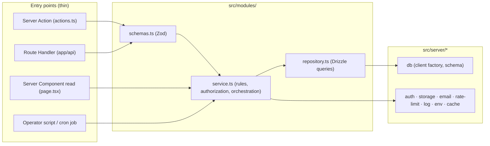

# Backend Architecture

| Field | Value |
|---|---|
| Task | P02-04 (feeds G2 via P02-13) |
| Version | **1.1 (as built)**; 1.0 was the design for the architecture review (T-04) |
| Date | 2026-11-13 |
| Inputs | [SYSTEM_ARCHITECTURE](SYSTEM_ARCHITECTURE.md) · [ARCHITECTURE_DECISIONS](ARCHITECTURE_DECISIONS.md) ADR-001…004 · [BUSINESS_RULES](../01-requirements/BUSINESS_RULES.md) · D-11, D-12, D-17, D-22 · F-03, F-05, F-06, F-13 |
| Companions | [FRONTEND_ARCHITECTURE](FRONTEND_ARCHITECTURE.md) · [SECURITY_ARCHITECTURE](SECURITY_ARCHITECTURE.md) · [DATA_FLOW_DIAGRAM](DATA_FLOW_DIAGRAM.md) |

## 0. Version 1.1: what was built, and what changed from 1.0

The R1 backend now exists and is wired to pages. The design below still holds; these are the differences, each recorded in the [DECISION_LOG](../DECISION_LOG.md):

| Area | v1.0 design | As built (v1.1) | Decision |
|---|---|---|---|
| Client-initiated reads and mutations | Server Actions (`actions.ts`, ADR-007) | **Route Handlers** under `src/app/api/**` for every client call; pages still read services directly. No Server Actions in R1 | A-20 (user directive: "Backend: Next.js Route Handlers") |
| CSRF for mutations | Built into Server Actions | `assertSameOrigin()` in `src/server/route.ts` (Origin/Referer must be the app origin → 403 `ORIGIN_REJECTED`) + SameSite=Lax cookie | A-20 |
| Route Handler plumbing | — | `route()` wrapper: request id, problem-details mapping, `readJson`, `queryOf`; `jsonPage()` list envelope | — |
| Bot check on code requests | Turnstile in the auth `before` hook | Removed; per-email (1/60 s, 5/h, 10/day) + per-IP Better Auth limits | A-18 |
| Media | R2 presigned PUT + stored derivatives | `lib/media.mediaUrl` by provider: `local` seed files in dev, **ImageKit** URL transforms in prod; uploads (R2 release) via server-signed ImageKit uploads | A-18, A-19 |
| Cron | four routes | one route `/api/cron/:job` with `popularity`, `cleanup`, `reconcile`, `daily` | — |
| Data cache (`"use cache"`, tags, `/api/internal/revalidate`) | Designed | **Not yet enabled**: all reads are uncached, dynamic renders | Deferred to R1 hardening (BACKEND_IMPLEMENTATION_PLAN §5) |
| Nonce CSP in `proxy.ts` | Designed (ADR-006) | `src/proxy.ts` sets request id, `x-pathname` and baseline security headers; nonce CSP deferred | Deferred |
| Env validation | at import | production-only rules skipped during `next build` (`NEXT_PHASE`), enforced at server start | — |
| Reference data | — | `src/server/db/reference-data.ts` (8 categories) used by seed and tests | — |
| Lint rules L-01…L-08 | ESLint | **Not configured yet**; layering followed by convention and reviewed by hand | P08-03 |

File map (as built):

```
src/server/          env · db/{client,schema,migrations,migrate,reference-data} · auth · email · rate-limit · log
                     errors · http · route · cursor · action-result (kept for future Server Actions)
src/modules/<m>/     service.ts · repository.ts · schemas.ts (Zod) · types.ts — auth, users, shots, media, feed,
                     search, likes, views, moderation, platform
src/app/api/**       15 Route Handlers (API_SPECIFICATION E-01…E-19)
src/app/(site|auth)  R1 pages; src/app/_viewer.ts (per-request viewer, 404 mapping)
src/components/      design-system-class components and client islands
scripts/             migrate · reset-db · seed · moderate
tests/               unit · integration (Vitest, fresh DB per file) · e2e (Playwright, next start + seeded DB)
```

## 0b. Version 1.2 (2026-11-13): R2 backend

| Addition | Where | Notes |
|---|---|---|
| Modules | `follows`, `collections`, `comments`, `teams`, `composer` (write side of shots), `jobs`, `account` (settings orchestration), `media/uploads.ts`, `moderation/reports.ts` | Acyclic: `platform` → (`account`, `composer`, `feed`, `search`, `moderation`) → (`teams`, `jobs`, `comments`, `collections`, `follows`, `likes`, `views`) → `shots` → (`media`, `users`) → `auth` |
| Idempotent creates | `src/server/idempotency.ts` (`idempotency_keys`) | `Idempotency-Key` header, 24 h replay (API conventions §5) |
| Validation helper | `src/server/validation.ts` | Zod failure → `AppError('VALIDATION', { fields })` inside services. **Patch schemas never use `.partial()` on fields with defaults** (Zod 4 keeps the defaults) |
| Storage | `src/server/storage/index.ts` (`local` / `imagekit`), `storage/image.ts` (magic bytes, limits, palette, Lab) | ImageKit: server-signed direct upload + read-back verification (A-29). Local: PUT to the app, variants rendered like the seed |
| HTML sanitising | `src/server/sanitize.ts` (`sanitize-html` 2.18.1) | BR-72 allow-list |
| Eligibility for raw SQL | `src/server/db/eligibility.ts` | Third copy of BR-37 (with `shots/repository.eligible` and search's); change all together |
| Quotas | `rate-limit.quota()` | Window quotas answer 422 `QUOTA_EXCEEDED` with `retryAfter` |
| Statement-builder exceptions (§2.2 rule 2) | follows → `profiles` counters; collections → `shots.saves_count`; comments → `shots.comments_count`; composer writes `shots`/blocks/tags/colours; shots repo reads a `comments` count for popularity | Each is one atomic batch with its source row, reconciled nightly |
| Jobs | `/api/cron/purge` + `daily` | Purges soft-deleted shots and accounts after 30 days (with stored objects); cleanup removes unattached uploads, expired idempotency keys and username holds |

## 1. Overview

The backend is the server half of the Next.js app. Requests enter through three **entry points**: Server Actions, Route Handlers and Server Component reads. Operator scripts and cron are entry points too. Every entry point calls a **service**. Services hold the business rules and call **repositories**, which are the only code that builds Drizzle queries.



## 2. Layering and import rules

### 2.1 Layers and responsibilities

| Layer | Files | Does | Does not |
|---|---|---|---|
| Entry | `src/app/**/page.tsx`, `src/app/api/**/route.ts`, `src/modules/*/actions.ts`, `scripts/*` | Parse input with the module's Zod schema, resolve the session, call **one** service function, map the result to HTTP / `ActionResult` / JSX, invalidate cache tags | Query the DB, contain business rules, call two services in sequence for one use case (a use case that spans modules gets its own service function) |
| Service | `src/modules/*/service.ts` (may be split into `service/*.ts`) | Authorization, business rules (BR-xx), rate limiting, orchestration of repositories and infrastructure, deciding batch vs transaction | Import Next.js request APIs (`headers()`, `cookies()`), build SQL, return Drizzle rows to the entry layer (returns DTOs) |
| Repository | `src/modules/*/repository.ts` | Drizzle queries and statement builders for **its own module's tables**; returns typed rows or prepared statements for a batch | Business rules, authorization, calling other repositories |
| Infrastructure | `src/server/*` | DB client, auth instance, storage, email, rate limiter, logger, env, cache helpers | Import from `src/modules/*` |
| Shared lib | `src/lib/*` | Pure isomorphic helpers (formatting, slugs, cursor codec types) | Import server code, do I/O |

### 2.2 Rules

1. **Dependency direction:** entry → service → repository → infrastructure. No upward imports.
2. **Cross-module access goes through services.** `modules/feed/service.ts` may import `modules/shots/service.ts`; it may not import `modules/shots/repository.ts`. Exception: a service may receive **statement builders** from another module's *service* (e.g. `shots.service.counterIncrementStatement(...)`) to compose one atomic `db.batch` (§5.2).
3. **Table ownership:** a table is written only by its owning module's repository (SYSTEM_ARCHITECTURE §4).
4. **No cycles** between modules. The R1 module graph is acyclic: `platform` → (`feed`, `search`) → `shots` → (`media`, `users`); `likes` → `shots`; `views` → `shots`; `moderation` → (`users`, `shots`); `auth` ← `users` (users reads the session through `auth`).
5. **Everything under `src/modules/*/{service,repository}*` and `src/server/*` starts with `import 'server-only'`.**

### 2.3 Lintable import rules

Implemented with ESLint's built-in **`no-restricted-imports`** in the flat config, scoped with `files` overrides. No extra plugin (TECHNOLOGY_STACK §3). Path aliases: `@/app`, `@/modules`, `@/server`, `@/lib`, `@/components`.

| Rule ID | `files` (applies to) | Forbidden import patterns | Message |
|---|---|---|---|
| L-01 | `src/app/**`, `src/components/**` | `@/modules/*/repository*`, `@/server/db/**`, `drizzle-orm*`, `@libsql/*` | Pages and components call services or actions, never the DB |
| L-02 | `src/modules/*/repository*.ts` | `@/modules/*/service*`, `@/modules/*/actions*`, `next/*`, `@/server/auth/**`, `@/server/rate-limit/**` | Repositories only build queries |
| L-03 | `src/modules/*/service*.ts` | `next/headers`, `next/navigation`, `next/cache`, `@/modules/*/actions*` | Services are framework-free; cache invalidation is done by the entry layer |
| L-04 | `src/modules/<a>/**` | `@/modules/<b>/repository*` for every `b ≠ a` (generated per module in the config) | Cross-module access goes through services |
| L-05 | `src/server/**` | `@/modules/**`, `@/app/**` | Infrastructure does not depend on features |
| L-06 | `src/lib/**` | `@/server/**`, `@/modules/**`, `server-only`, `node:*` | `lib` is isomorphic |
| L-07 | Files containing `"use client"` (convention: `*.client.tsx` and `src/components/**`) | `@/server/**`, `@/modules/*/service*`, `@/modules/*/repository*` | Client code may import actions and `lib` only |
| L-08 | everything except `src/modules/search/repository.ts`, `src/modules/platform/repository.ts`, `src/server/db/migrations/**` | `sql.raw(...)` calls, via the built-in `no-restricted-syntax` rule (selector `CallExpression[callee.object.name='sql'][callee.property.name='raw']`) | Raw SQL only where §5.4 allows |

`server-only` adds a build-time guard for L-07: importing a server module into a client bundle fails `next build`. CI runs `eslint` with `--max-warnings 0` (P08-03). A test file under `src/__tests__/architecture/` checks that each module folder has the expected files and that no module imports another module's repository (a second, independent check of L-04).

## 3. Module catalogue: services and repositories

R1 modules are listed with their function signatures (DTO names are finalised in P04). R2 and R3 modules are listed at file level; their signatures are written in P04 at "signature level" (G2 criterion).

### 3.1 R1 modules

| Module | Service functions | Repository functions (tables) | Entry points |
|---|---|---|---|
| `auth` | `getSession(headers)`, `requireMember(headers)` (onboarded, not suspended), `requirePending(headers)`, `revokeAllSessions(userId)`; Better Auth hooks: `sendVerificationOTP` → `EmailService`, `before` hook → email validation + per-email send limits (Turnstile removed, A-18) | Better Auth's own adapter (`user`, `session`, `account`, `verification`, `rate_limit`); `sessionsRepo.deleteByUser(userId)` | `/api/auth/[...all]` |
| `users` | `getPublicProfile(username)`, `checkUsername(name)`, `suggestUsername(email)` (BR-21), `completeOnboarding(userId, { username, displayName })`, `suspend(userId, actor, reason)` / `unsuspend` (via moderation) | `profilesRepo.findByUsername`, `findByUserId`, `insertProfile`, `isUsernameTaken`, `setSuspended`; `reservedRepo.isReserved` (`profiles`, `user_social_links`, `reserved_usernames`) | `/onboarding` actions, profile pages |
| `shots` | `getDetail(id, viewer)`, `listByAuthor(userId, sort, cursor)`, `isEligible(id)` (BR-37), statement builders `likeCounterStatement(id, ±1)`, `viewCounterStatement(id, n)`, `hide(id, actor)` / `unhide` | `shotsRepo.findDetail`, `listByAuthor`, `findEligibleIds`, `updateCounters`, `setHidden`; `blocksRepo.listByShot` (`shots`, `content_blocks`, `shot_colors`, `categories`) | shot detail, profile Work tab |
| `media` | `urlFor(key, variant)` (custom loader target), `describe(mediaId)` | `mediaRepo.findByShot` (`media`) | used by `shots`, `users` |
| `feed` | `homepage()`, `list({ sort, category, tag, timeframe, cursor, limit })` (BR-32…BR-35), `moreBy(shotId)`, `related(shotId)` (BR-43), `recomputePopularity(now)` (BR-33, cron) | `feedRepo.popular`, `recent`, `byTimeframe`, `moreBy`, `related`, `writePopularityScores` (read model over `shots`; writes only `shots.popularity_score` via a `shots` service statement builder) | feed pages, `loadMore` action, cron |
| `search` | `shots(term, cursor)` (BR-38, BR-39), `relatedTags(term)` (FR-32), `tagIndex()`, `tagPage(tag, cursor)` (BR-41), `normaliseTerm(raw)` | `searchRepo.match(ftsQuery, cursor)` (**raw FTS5 SQL**, ADR-001), `tagsRepo.top`, `alphaIndex`, `findBySlug`, `shotsForTag` (`tags`, `shot_tags`, `shots_fts`) | search, tag pages |
| `likes` | `setLike(viewer, shotId, liked)` → `{ liked, likesCount }` (BR-46, idempotent), `isLiked(viewer, shotIds[])` | `likesRepo.insertStatement`, `deleteStatement`, `findForViewer` (`likes`) | `toggleLike` action |
| `views` | `record({ shotId, viewerKey, userId?, ua })` (BR-29…BR-31), `viewerKey(ip, ua, day)` (HMAC, daily secret) | `viewsRepo.dedupInsertStatement`, `dailyUpsertStatement`, `purgeDedup(before)` (`view_dedup`, `shot_view_daily`) | `/api/views` |
| `moderation` | `suspendUser(actor, userId, reason)`, `hideShot(actor, shotId, reason)` and inverses, each writing an audit row (FR-09, BR-68) | `moderationRepo.insertAction` (`moderation_actions`) | `scripts/moderate.ts` (R1); staff actions (R2) |
| `platform` | `health()`, `cleanup(now)` (BR-79), `reconcileCounters()` (BR-27), `orphanCheck()` (ADR-002), `revalidate(tags)` | `maintenanceRepo.*` (deletes by age across owned-by-infra tables; counter recompute statements built by owning modules) | `/api/health`, `/api/cron/*`, `/api/internal/revalidate` |

`platform.cleanup` and `reconcileCounters` touch tables owned by other modules. They do so by calling those modules' services (`views.purgeDedup`, `shots.reconcileCountersStatements`, Better Auth's own expired-verification cleanup), so the table-ownership rule (§2.2.3) still holds.

### 3.2 R2 and R3 modules (file level)

| Module | Release | Files | Main service functions (names only) |
|---|---|---|---|
| `shots` (composer) | R2 | `service/compose.ts`, `repository.ts` | `createDraft`, `updateShot`, `publish`, `deleteShot` |
| `media` (uploads) | R2 | `service/upload.ts`, `processing.ts` | `presign`, `finalise` (size + magic-byte check, sharp derivatives, palette), `deleteObjects` |
| `users` (edit) | R2 | `service/settings.ts` | `updateProfile`, `changeUsername`, `requestDeletion` |
| `collections` | R2 | `service.ts`, `repository.ts` | `create`, `rename`, `addShot`, `removeShot`, `setPrivacy` |
| `follows` | R2 (block R3) | `service.ts`, `repository.ts` | `follow`, `unfollow`, `block`, `unblock` |
| `comments` | R2 | `service.ts`, `repository.ts` | `create`, `edit`, `remove`, `like` |
| `teams` | R2 | `service.ts`, `repository.ts` | `create`, `invite`, `accept`, `removeMember`, `setRole` |
| `jobs` | R2 | `service.ts`, `repository.ts` | `post`, `edit`, `close`, `list`, `get` |
| `moderation` (reports) | R2 | `service/reports.ts` | `report`, `listQueue`, `resolve` |
| `notifications` | R3 | `service.ts`, `repository.ts` | `emit` (from `after()`), `list`, `markRead` |
| `messaging` | R3 | `service.ts`, `repository.ts` | `startThread`, `send`, `poll`, `markRead` |
| `hire` / `services` | R3 | `service.ts`, `repository.ts` | `listDesigners`, `createListing`, `updateListing` |
| `platform` (SEO, analytics, consent) | R3 | `service/sitemaps.ts`, `analytics.ts` | `sitemapIndex`, `sitemapPage`, `recordEvent` |

## 4. Validation and error model

### 4.1 Validation (D-22)

- Every entry point parses its input with a **Zod 4** schema from the module's `schemas.ts`. Services trust their typed input but still check **authorization and state** (never trusts client claims such as `ownerId`).
- Schemas are shared with forms for client-side hints; the server result is authoritative.
- Path and search params are parsed with Zod too (IDs, category slugs, cursors, timeframes). Unknown values → 404 for pages, 400 for APIs.

### 4.2 Error type

Services throw or return a single error type:

```ts
class AppError extends Error {
  constructor(
    public code: ErrorCode,          // e.g. 'NOT_FOUND', 'FORBIDDEN', 'CANNOT_LIKE_OWN', 'RATE_LIMITED', 'VALIDATION', 'CONFLICT', 'INVALID_CURSOR', 'EMAIL_UNAVAILABLE', 'INTERNAL'
    public status: 400 | 401 | 403 | 404 | 409 | 422 | 429 | 500 | 503,
    public details?: { fields?: Record<string, string>; retryAfter?: number },
  ) { super(code) }
}
```

| Entry point | Mapping |
|---|---|
| Route Handler | **Problem details** (RFC 9457) JSON: `{ type, title, status, code, detail?, retryAfter? }` with the HTTP status; `429` adds `Retry-After` (BR-77) |
| Server Action | Returns `ActionResult<T> = { ok: true, data: T } \| { ok: false, code, fields?, retryAfter? }`. Server Actions cannot set an HTTP status, so BR-77's "429" is carried as `code: 'RATE_LIMITED'` + `retryAfter` (recorded in [ADR-007](ARCHITECTURE_DECISIONS.md#adr-007-server-actions-for-internal-mutations-route-handlers-for-url-contracts)) |
| Page (Server Component) | `NOT_FOUND` → `notFound()`; `FORBIDDEN` on a page → `notFound()` (no existence leak, IDOR); unauthenticated on a protected page → `redirect('/login?returnTo=…')`; anything else → thrown to `error.tsx` |

Unexpected errors are logged with a request ID and reported to Sentry; the client sees `INTERNAL` with the request ID only. No stack traces, SQL or internal messages reach the client.

## 5. Data access

### 5.1 DB client (ADR-002)

`src/server/db/client.ts` creates **one** `@libsql/client` per process (URL + token from env; `file:` locally), runs `PRAGMA foreign_keys = ON`, asserts it is 1, then exposes the Drizzle instance. Remote (HTTP) FK behaviour is re-verified by T-06b; until then the nightly `orphanCheck` runs.

### 5.2 Batches and transactions

| Situation | Use | Example |
|---|---|---|
| Several writes that must succeed together, none depends on a value read in the same unit | **`db.batch([...])`** (atomic, one round trip, F-03/F-13) | like insert + `likes_count + 1`; view de-dup insert + daily upsert + `views_count + n` |
| A write depends on a value read first and the check cannot be expressed in SQL | **`db.transaction()`**, short, no network calls inside (5 s write lock, F-05) | R2: accept a team invitation (read role, then insert membership) |
| Pure reads for one page | **`db.batch` of selects** (one round trip, NFR-09) | shot detail + author + tags + blocks |

Idempotency in SQL rather than in code: `INSERT … ON CONFLICT DO NOTHING` + counter update guarded by `changes()`-equivalent sub-selects, so a duplicate like changes nothing (BR-26, BR-46). The exact statement pattern is fixed in P03-03 and tested in T-23 (concurrency cases).

### 5.3 IDs, time and conventions

- Primary keys: integer autoincrement for shots (numeric IDs in URLs, BR-42); text IDs from Better Auth for `user`; other tables decided in P03-01.
- Timestamps: integer milliseconds UTC (`timestamp_ms` mode), as in the auth schema (ADR-003). Day buckets for views are UTC dates (BR-30).
- Repositories return plain typed objects; services map them to DTOs. DTOs never contain emails except the owner's own (BR-78).

### 5.4 Raw SQL policy

Raw SQL is allowed only in: FTS5 custom migrations and `search/repository.ts` (ADR-001), migration files, and counter reconciliation statements in `platform`. Every raw statement uses bound parameters. User text reaches `MATCH` only after `search.normaliseTerm` + quoting (ADR-001 §5).

### 5.5 Migrations

`drizzle-kit generate` + `drizzle-kit migrate` only; **`push` forbidden** on any persistent DB (ADR-001, F-12). A CI test runs all migrations on a fresh DB, asserts FTS triggers exist, inserts a shot and finds it by search. Migrations run in the deploy pipeline before the new build receives traffic (P08/P12).

## 6. Background work (D-11)

| Work | Mechanism | Schedule | Failure handling |
|---|---|---|---|
| View recording | `after()` in `/api/views` | per request | Dropped silently, logged without PII (BR-31) |
| Cache invalidation after mutation | in the Server Action, after the write | per request | Logged; data-cache life bounds staleness |
| Popularity recompute (BR-33) | Vercel Cron → `/api/cron/popularity` | daily on Hobby (D-09); hourly on Pro | Alert if not run for 26 h (Sentry cron monitor) |
| Cleanup (BR-79: OTPs, rate-limit rows, view de-dup > 48 h, expired sessions) | Cron → `/api/cron/cleanup` | daily | Idempotent; resumes next day |
| Counter reconciliation (BR-27) | Cron → `/api/cron/reconcile` | daily, after cleanup | Reports drift count; fixes it |
| Orphan check (ADR-002) | Cron → `/api/cron/orphans` | daily | Alert on any orphan |
| Moderation (FR-09) | `scripts/moderate.ts` run by an operator (`npm run moderate -- suspend <username> --reason …`) using the prod DB URL from a local secret | on demand | Writes audit row in the same batch; then calls `/api/internal/revalidate` |
| Account deletion on request (BR-24, R1) | `scripts/delete-account.ts` run by an operator; calls `users`/`auth` services (revoke sessions, delete personal data, anonymise or remove shots per BR-24) | on request, within 30 days | Audit row; then `/api/internal/revalidate` |
| Seed (FR-06) | `scripts/seed.ts` | on demand / CI | Idempotent upserts by seed key |

Cron handlers check `Authorization: Bearer ${CRON_SECRET}` (Vercel's convention) and process work in **bounded chunks** (e.g. 500 rows per statement) so one run stays inside the function timeout and the 5 s write lock. A queue (QStash/Inngest) is added only in R3 (D-11).

## 7. Rate limiter (D-12, BR-76)

- **Auth classes** (`RL-AUTH-SEND`, `RL-AUTH-VERIFY`, `RL-AUTH-OAUTH`): Better Auth's database limiter with custom rules per path, plus per-email limits for the send path implemented in the `before` hook (Better Auth keys by IP and path). The client-IP source is the trusted proxy header configured for Vercel (ADR-003 §3).
- **Other classes** (`RL-ACCOUNT`, `RL-SOCIAL`, `RL-VIEW`, `RL-MODERATION`, R2+ classes): `src/server/rate-limit/` implements a **fixed-window counter** in a Turso table `rate_limits(key, window_start, count)` with one upsert per check (`INSERT … ON CONFLICT DO UPDATE SET count = count + 1 RETURNING count`). Key = `class:subject:window`. One write per limited request; cleanup removes rows 24 h after their window (BR-79).
- API: `await limit('RL-SOCIAL', subject)` → throws `AppError('RATE_LIMITED', 429, { retryAfter })`. The check happens **before** any side effect (BR-77).
- `RL-VIEW` over-limit requests return 204 and do nothing (BR-76).
- Write-quota impact (NFR-10) is estimated in P11-05; if it is too high, the fallback is Upstash (D-12 alternative), behind the same `limit()` interface.

## 8. Logging and observability (D-17)

- Logger: a small structured JSON logger (`src/server/log.ts`) writing to stdout (Vercel log drain). Fields: `ts`, `level`, `requestId`, `route`, `module`, `event`, `durationMs`, `userId` (hashed), `code`.
- **Never logged:** emails, OTP codes, tokens, cookies, raw IPs, full user agents, request bodies (BR-79). A unit test feeds a log call with these fields and asserts they are redacted.
- Sentry: errors and traces from server and client, `sendDefaultPii: false`, `beforeSend` scrubs the same fields; cron monitors for each job.
- Request ID: generated in `proxy.ts` (`x-request-id`), passed to handlers and returned in error responses.

## 9. Configuration

`src/server/env.ts` parses `process.env` with Zod at startup and exports a typed, frozen object. Required in every non-test environment (v1.1: Turnstile and R2 variables removed, A-18/A-19; `.env.example` is the authoritative list): `DATABASE_URL`, `DATABASE_AUTH_TOKEN` (remote only), `BETTER_AUTH_SECRET`, `BETTER_AUTH_URL`, `GOOGLE_CLIENT_ID`/`SECRET`, `RESEND_API_KEY`, `EMAIL_FROM`, `NEXT_PUBLIC_MEDIA_PROVIDER` (`local`|`imagekit`), `NEXT_PUBLIC_MEDIA_BASE_URL`, `IMAGEKIT_PUBLIC_KEY`/`IMAGEKIT_PRIVATE_KEY` (uploads, R2 release), `VIEW_HMAC_SECRET`, `CURSOR_HMAC_SECRET`, `CRON_SECRET`, `INTERNAL_SECRET`, `SENTRY_DSN`. Secret handling: [SECURITY_ARCHITECTURE §8](SECURITY_ARCHITECTURE.md#8-secrets-and-configuration).

## 10. Testing per layer

| Layer | Test type | Plan ID |
|---|---|---|
| `lib`, Zod schemas, cursor codec, slug, count formatting | Unit (Vitest) | T-22 |
| Services + repositories against a real libSQL file DB (migrated, seeded per test file) | Integration (Vitest) | T-23 |
| Import rules L-01…L-08 | Lint in CI + architecture test | P08-03 |
| Server Actions and Route Handlers (auth, limits, error mapping) | Integration via direct calls / `next start` | T-23, T-28 |
| Concurrency (double like, parallel views) | Integration with parallel calls | T-23 |
