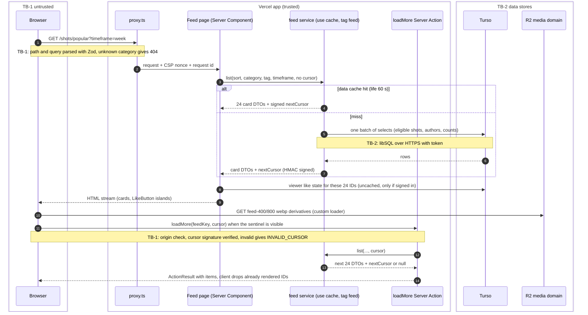
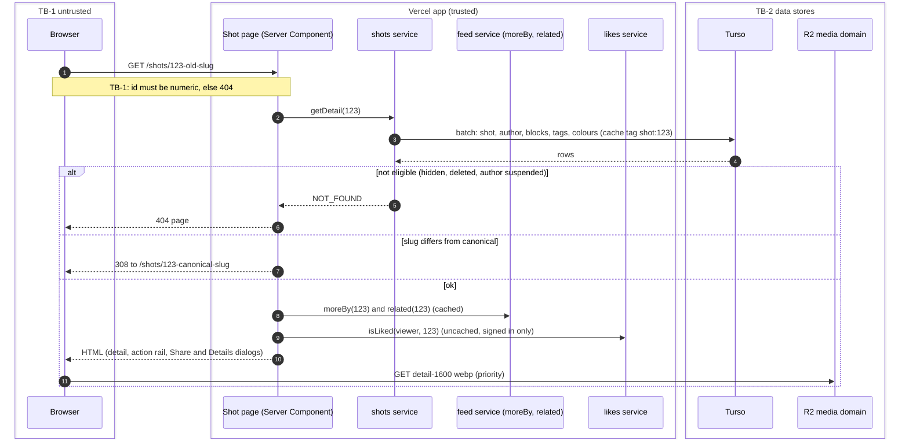
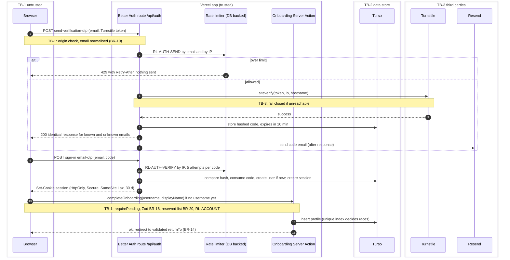
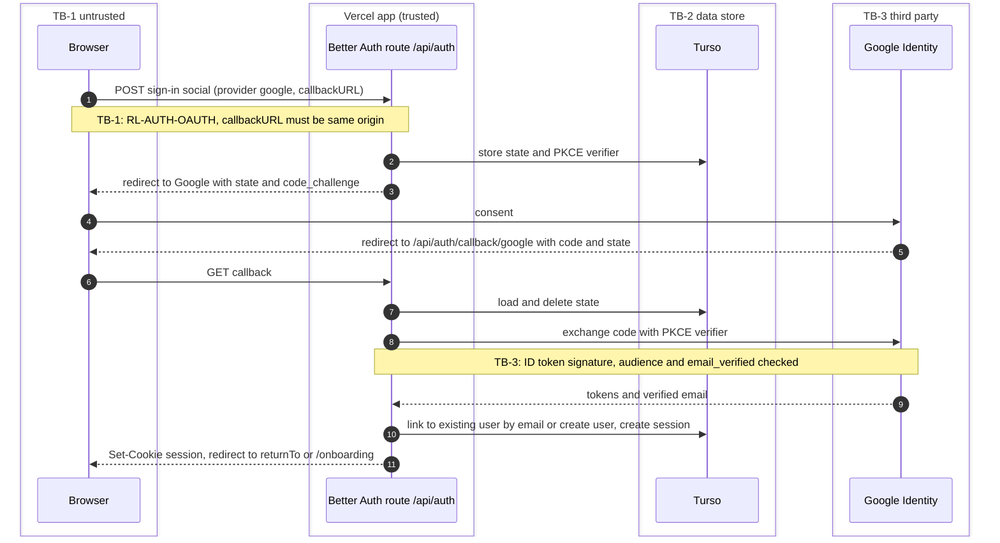
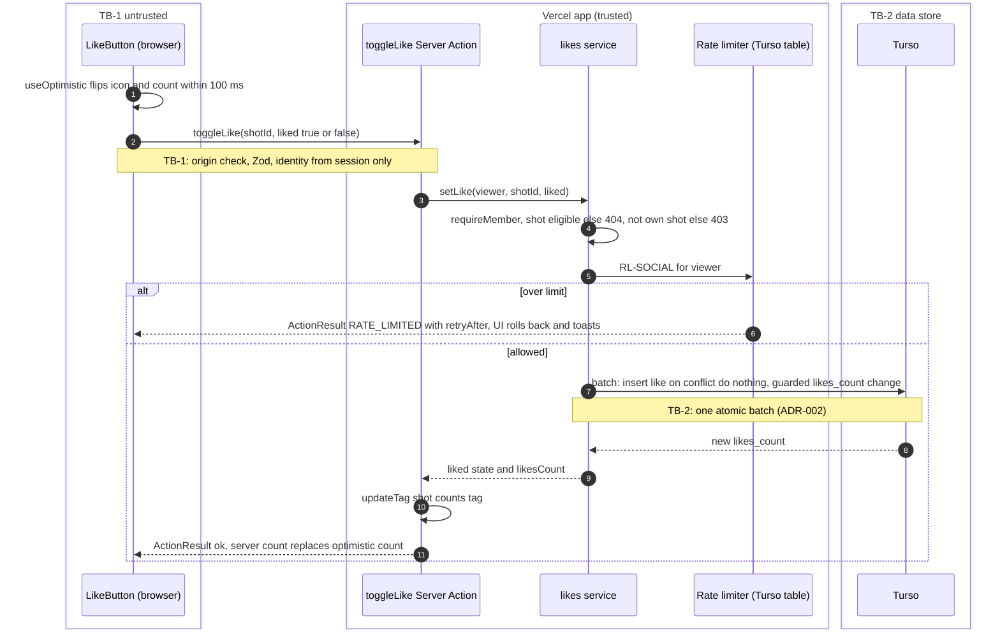
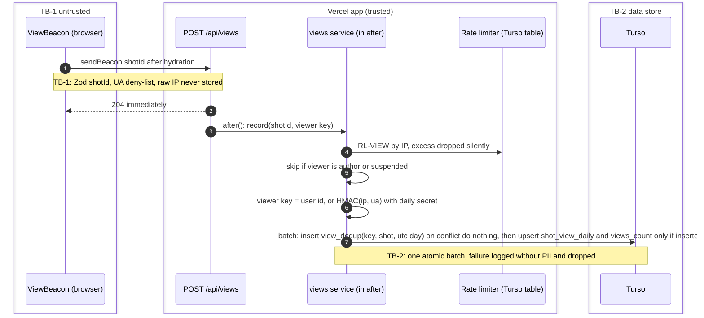
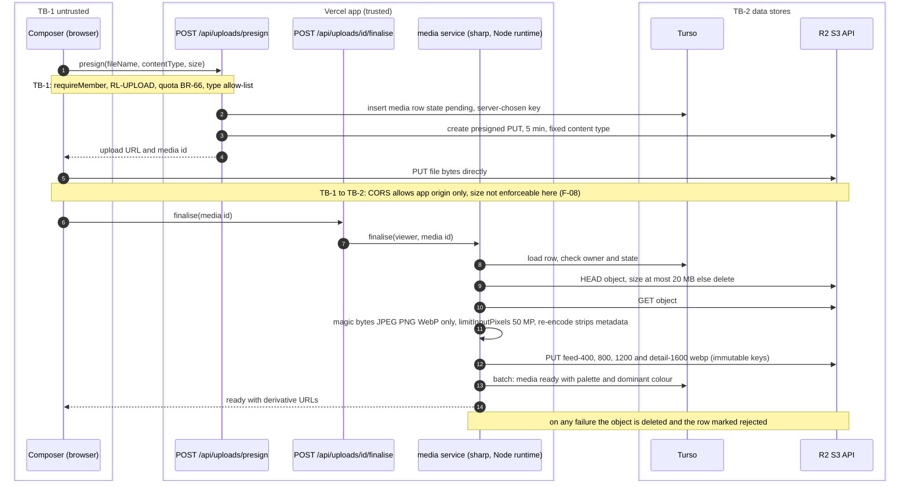
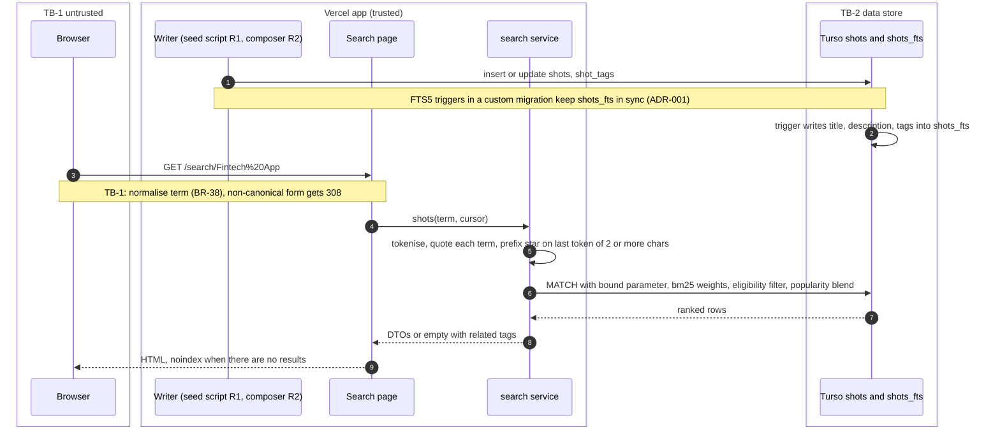
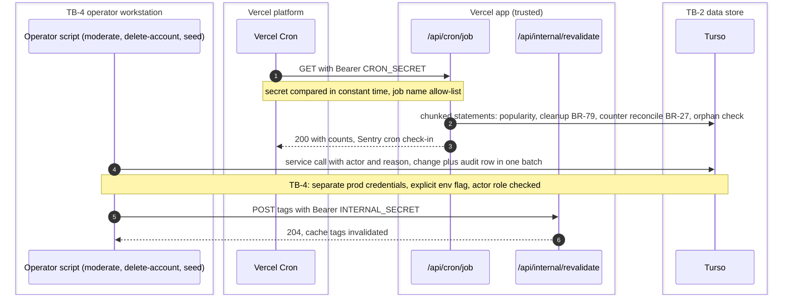

# Data Flow Diagrams

| Field | Value |
|---|---|
| Task | P02-06 (feeds G2 via P02-13) |
| Version | 1.0, for the architecture review (T-04) |
| Date | 2026-11-13 |
| Inputs | [FRONTEND_ARCHITECTURE](FRONTEND_ARCHITECTURE.md) · [BACKEND_ARCHITECTURE](BACKEND_ARCHITECTURE.md) · [SECURITY_ARCHITECTURE](SECURITY_ARCHITECTURE.md) · ADR-001…004 |
| Validation | Every diagram is parsed with the Mermaid parser (T-04 check) |

## Conventions

- **Trust boundaries** are drawn as `box` groups. The boundary IDs are defined in [SECURITY_ARCHITECTURE §1](SECURITY_ARCHITECTURE.md#1-scope-assets-and-trust-boundaries):
  - **TB-1** separates the untrusted browser from the app.
  - **TB-2** separates the app from its data stores (Turso, R2).
  - **TB-3** separates the app from third parties.
  - **TB-4** separates the operator workstation from production.
- A note `TB-n` on an arrow marks the place where the data crosses that boundary and is validated.
- "App" means the Next.js functions on Vercel: proxy, Server Components, Server Actions and Route Handlers, plus the module layer.
- Arrows with `-->>` are responses.

| # | Flow | Release | Requirements |
|---|---|---|---|
| DF-1 | Feed read and infinite scroll | R1 | FR-21…FR-25, BR-32…BR-37 |
| DF-2 | Shot detail | R1 | FR-37…FR-42, BR-42, BR-43 |
| DF-3 | Sign-in with an email code, then onboarding | R1 | FR-10…FR-12, FR-17, FR-20 |
| DF-4 | Continue with Google | R1 | FR-13, BR-11 |
| DF-5 | Like / unlike | R1 | FR-45, BR-46, BR-47 |
| DF-6 | View counting (beacon, de-dup, aggregate) | R1 | FR-29, BR-29…BR-31 |
| DF-7 | Upload to R2 and derivative processing | R2 (designed now) | FR-61…FR-64, BR-61, BR-66 |
| DF-8 | Search indexing and query | R1 | FR-31…FR-34, BR-38, BR-39 |
| DF-9 | Scheduled jobs and operator scripts | R1 | FR-09, FR-27, BR-27, BR-79 |

## DF-1 Feed read and infinite scroll

## DF-2 Shot detail

## DF-3 Sign-in with an email code, then onboarding

## DF-4 Continue with Google

## DF-5 Like / unlike

## DF-6 View counting

## DF-7 Upload to R2 and derivative processing (R2 release)

## DF-8 Search indexing and query

## DF-9 Scheduled jobs and operator scripts

