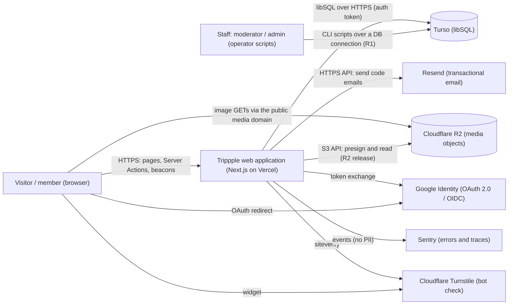
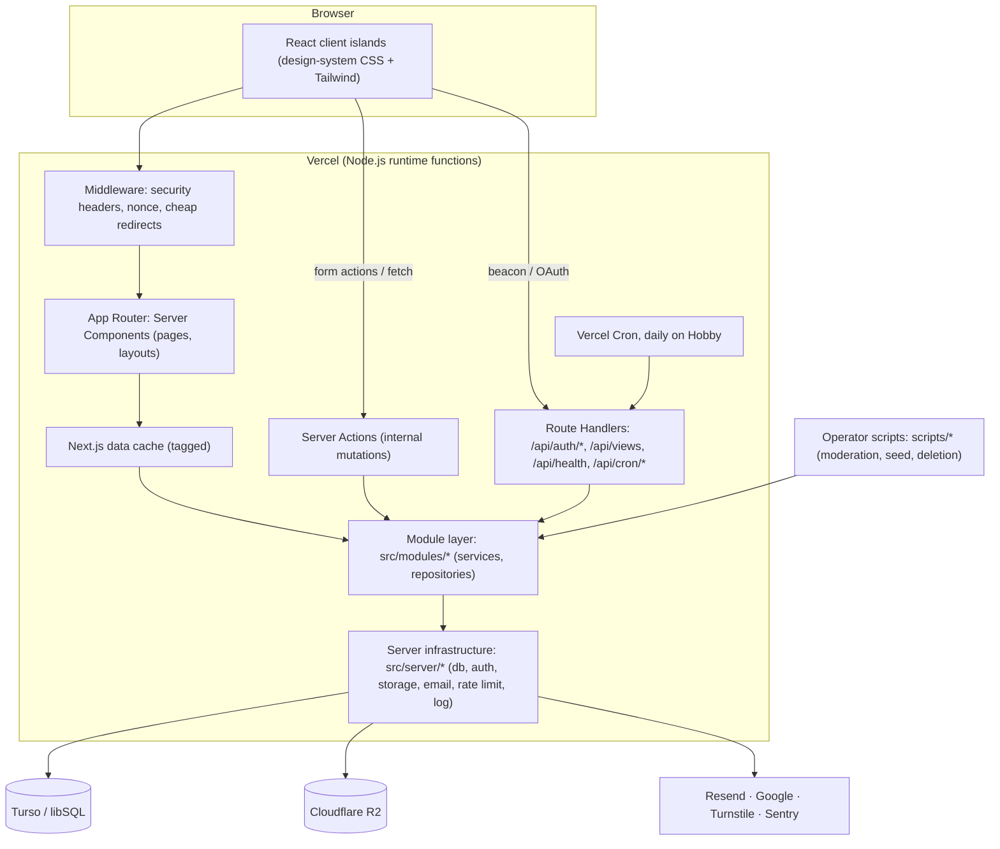

# System Architecture

| Field | Value |
|---|---|
| Task | P02-01 (feeds G2 via P02-13) |
| Version | 1.0, for the architecture review (T-04) |
| Date | 2026-11-13 |
| Inputs | [DECISION_LOG](../DECISION_LOG.md) A-01…A-14, D-02…D-24, F-01…F-15 · [ARCHITECTURE_DECISIONS](ARCHITECTURE_DECISIONS.md) ADR-001…005 (spikes) · [REQUIREMENTS](../01-requirements/REQUIREMENTS_SPECIFICATION.md) · [INFORMATION_ARCHITECTURE](../06-ui-ux/INFORMATION_ARCHITECTURE.md) |
| Companions | [TECHNOLOGY_STACK](TECHNOLOGY_STACK.md) · [FRONTEND_ARCHITECTURE](FRONTEND_ARCHITECTURE.md) · [BACKEND_ARCHITECTURE](BACKEND_ARCHITECTURE.md) · [SECURITY_ARCHITECTURE](SECURITY_ARCHITECTURE.md) · [DATA_FLOW_DIAGRAM](DATA_FLOW_DIAGRAM.md) |

## 1. Architectural summary

Trippple is **one Next.js application** that serves both the UI and the backend:
- **Server Components** render pages.
- **Server Actions** perform internal mutations.
- **Route Handlers** expose HTTP endpoints where a URL contract is needed: auth callbacks, the view beacon, health, cron and, later, uploads.

Business logic lives in a **server-only module layer** (`src/modules/*`) built on shared **server infrastructure** (`src/server/*`): the DB client, auth, storage, email, rate limiting and logging.

Persistent data is in **Turso (libSQL)** through **Drizzle**. Media binaries are in **Cloudflare R2**. Transactional email goes through **Resend**. The app is deployed on **Vercel (Node runtime)**.

There is no separate API server and no message broker in R1 (A-01, D-11).

Architectural drivers, from the NFRs:

| Driver | Consequence |
|---|---|
| SEO-critical public pages (NFR-30…, FR-87) | Server-rendered HTML for every public route |
| CSP with nonces, no `unsafe-inline` (NFR-22) | **All HTML is rendered dynamically.** Next.js nonces need per-request rendering, so speed comes from the **data cache** (tagged, revalidated on mutation) instead of static/ISR pages ([ADR-006](ARCHITECTURE_DECISIONS.md#adr-006-dynamic-rendering-with-a-tagged-data-cache-nonce-csp)) |
| ≤ 3 DB round trips per page, ≤ 200 rows per feed page (NFR-09) | Batched reads (`db.batch`), denormalised counters, no N+1, cached read models |
| Every query is a network round trip, with no embedded replicas on serverless (F-06) | DB region co-located with the Vercel function region; data cache in front of hot reads |
| Atomic multi-statement writes (F-03, F-05, F-13) | `db.batch()` by default; short interactive transactions only when a later statement depends on an earlier read |
| Turso write quota (NFR-10) | View de-duplication and rate-limit writes are bounded; cleanup jobs (BR-79) |
| WCAG 2.2 AA, 40/30/30 identity (A-07, A-12) | `design-system/` CSS is the only source of visual values (FRONTEND_ARCHITECTURE §6) |

## 2. Context view (C4 level 1)

External dependencies and their decisions:

| Dependency | Purpose | Decision | Status |
|---|---|---|---|
| Turso | Primary database | A-02, D-14 (account and plan) | Approved; **account not yet created** (B-15) |
| Cloudflare R2 | Media storage | A-03, D-10, D-16, D-19 | Approved; **account not yet created** (B-11). R1 seed media is also served from R2 (D-19) |
| Resend | OTP and later notification email | D-08 | Approved; account not created (B-09) |
| Google Identity | "Continue with Google" | D-03 | Approved; OAuth client not created (B-16) |
| Cloudflare Turnstile | Bot check on code requests | D-20 | Approved (pricing to verify at P08) |
| Vercel | Hosting, cron, preview deployments | D-09 | Approved; Hobby for dev and preview, **Pro before commercial launch**; account not created (B-10) |
| Sentry | Error reporting and tracing | D-17 | Approved |

## 3. Container view (C4 level 2)

**Runtime rule:** every function runs on the **Node.js runtime**, because libSQL, Better Auth's DB adapter, sharp and the AWS S3 SDK need Node APIs (ADR-003, ADR-004). **Middleware** only sets headers and nonces and does cheap redirects. It never touches the database.

## 4. Module map and placement

Every module from the workflow module map (MASTER_PROJECT_WORKFLOW §6) is placed below. A module is a folder `src/modules/<name>/` with server-only services and repositories, its Server Actions and Zod schemas, and any UI that belongs only to it. Cross-module calls go **through services**, never through another module's repository ([BACKEND_ARCHITECTURE §2](BACKEND_ARCHITECTURE.md#2-layering-and-import-rules)).

| Module | Release | Containers it runs in | Data owned (tables, P03) | Talks to |
|---|---|---|---|---|
| `auth` | R1 | RH (`/api/auth/*`), SA (onboarding), MW (none) | Better Auth tables (`user`, `session`, `account`, `verification`, `rate_limit`) | Resend, Google, Turnstile |
| `users` (profiles) | R1 (edit R2) | RSC, SA | `profiles`, `user_social_links`, `reserved_usernames` (seed) | auth, media |
| `shots` (content) | R1 (composer R2) | RSC, SA (R2) | `shots`, `content_blocks`, `shot_colors`, `categories` | media, search, moderation |
| `media` | R1 seed read; uploads R2 | RSC (URLs), RH `/api/uploads/*` (R2) | `media` | R2 |
| `feed` (discovery) | R1 | RSC | read model over `shots` (+ `popularity_score`) | shots, likes |
| `search` / `tags` | R1 | RSC | `tags`, `shot_tags`, FTS5 `shots_fts` (custom migration, ADR-001) | shots |
| `likes` | R1 | SA | `likes` + `shots.likes_count` | shots, rate limit |
| `views` | R1 | RH `/api/views` (beacon) | `view_dedup`, `shot_view_daily` + `shots.views_count` | shots, rate limit |
| `moderation` | R1 (scripts), R2 (reports) | CLI, SA (staff, R2) | `moderation_actions`, `reports` (R2), `users.suspended_at`, `shots.hidden_at` | users, shots |
| `collections` | R2 | RSC, SA | `collections`, `collection_items` | shots |
| `follows` (+ block R3) | R2 / R3 | RSC, SA | `follows`, `blocks` | users |
| `comments` | R2 | RSC, SA | `comments`, `comment_likes` | shots, moderation |
| `teams` | R2 | RSC, SA | `team_memberships`, team profile fields | users |
| `jobs` | R2 | RSC, SA | `companies`, `jobs`, `job_specialties`, `specialties` | — |
| `notifications` | R3 | RSC, SA, `after()` | `notifications` | likes, follows, comments |
| `messaging` | R3 | RSC, SA, RH (poll) | `message_threads`, `thread_participants`, `messages` | users, follows (block) |
| `hire` / `services` | R3 | RSC, SA | `services`, `service_tags` | users |
| `platform` | R1 (health, legal pages, 404); R3 (SEO, analytics, consent) | RSC, RH (`/api/health`, sitemaps) | `analytics_events` (R3) | all (read) |

Module ownership rule: a table is **written** only by its owning module. Other modules read it through that module's service or a published read model (e.g. `feed` reads shots via `shots` service queries).

## 5. Environments

| Environment | URL / host | Database | Media | Email | Auth providers | Purpose |
|---|---|---|---|---|---|---|
| **Local** | `http://localhost:3000` | libSQL **file** (`file:local.db`), migrated with Drizzle Kit; seeded (FR-06) | R2 dev bucket (D-10), or the local seed fallback in `public/seed/` only until R2 exists ([ADR-010](ARCHITECTURE_DECISIONS.md#adr-010-r1-seed-media-and-environment-fallbacks)) | Console email adapter (logs "code sent", **never the code**) plus Mailpit optional | Google test client (B-16) | Development, unit and integration tests |
| **CI** | GitHub Actions (user's repo) | libSQL file per job (`file::memory:` for unit tests) | Stubbed `StorageService` | Captured in memory | Stubbed | Lint, typecheck, tests, build, Playwright against `next start` |
| **Preview** | Vercel preview deployments | Turso **dev** database (branch per preview optional later) | R2 `media-dev` | Resend test mode / sandbox domain | Google test client | Pull-request review, G4/G6 demos |
| **Production** | Vercel production + custom domain (P12) | Turso **prod** database, same region as functions | R2 `media-prod` behind the public media domain | Resend verified domain | Google production client | Live service |

Configuration is read once through a **validated env module** (`src/server/env.ts`, Zod). The app fails at boot if a required variable is missing (SECURITY_ARCHITECTURE §8). No secret is exposed to the client bundle. Only variables prefixed `NEXT_PUBLIC_` reach the browser, and those are non-secret (e.g. the Turnstile site key).

## 6. Rendering and caching strategy (summary)

| Route family | Rendering | Data source | Cache / invalidation |
|---|---|---|---|
| `/`, `/shots/popular[/:category]`, `/shots/recent[/:category]` | Dynamic (nonce CSP) | `feed` service | Data cache, tag `feed:*`, revalidated on like (popularity changes daily via cron), shot publish/hide; TTL 60 s backstop |
| `/shots/:id-:slug` | Dynamic | `shots` + `feed` (related) | Tag `shot:<id>`; counts read through a short-TTL cache (≤ 30 s); like state per viewer uncached |
| `/search/:term`, `/tags`, `/tags/:tag` | Dynamic | `search` (FTS5) | Tag `search` with 120 s TTL; zero-result pages `noindex` |
| `{profile}`, `{profile}/about` | Dynamic | `users` + `shots` | Tag `user:<id>` |
| `/login`, `/signup`, `/onboarding` | Dynamic, never cached | `auth` | none |
| Legal pages (`/terms`, `/privacy`, `/cookies`, `/about`, `/contact`) | Dynamic shell, static content (MD/MDX compiled at build) | Files | Build-time content |
| `/api/*` | Route Handlers | per handler | `no-store` |

Details and per-route data sources: [FRONTEND_ARCHITECTURE §3](FRONTEND_ARCHITECTURE.md#3-r1-route-map-rendering-mode-and-data-source).

## 7. NFR traceability (architecture-level)

| NFR | Architectural mechanism | Verified by |
|---|---|---|
| NFR-01…03 (LCP, CLS/INP, TTFB) | Server rendering, data cache, image derivatives sized by srcset, ≤ 180 KB initial JS (Server Components by default) | T-29 |
| NFR-04/05 (feed/search p95) | Indexed queries (P03), counters, FTS5 (ADR-001: p95 31 ms local at 10k rows) | T-29, T-05b |
| NFR-06 (mutation p95, optimistic < 100 ms) | Server Action + `db.batch` + `useOptimistic` | T-24, T-29 |
| NFR-09 (≤ 3 round trips) | `db.batch` read groups per page; repository functions return composed read models | T-23 row counters |
| NFR-10/11/12 (quota) | Bounded writes (view de-dup, rate-limit windows), cleanup jobs, counters | P11-05 model |
| NFR-14 (hot counters) | `UPDATE … SET likes_count = likes_count + 1` inside the like batch; idempotent insert | T-23 concurrency |
| NFR-15…18 (availability, errors, jobs, degradation) | Sentry alerts, health route, cron with alerting, per-dependency fallbacks (FRONTEND §8) | T-31 |
| NFR-19 (backup) | Turso point-in-time restore (plan-dependent), R2 versioning off (immutable keys) | T-32 |
| NFR-20…24 (security) | [SECURITY_ARCHITECTURE](SECURITY_ARCHITECTURE.md) | T-28 |
| NFR-25…29 (a11y, responsive) | `design-system/` + component guidelines | T-27, T-26 |

## 8. Key risks carried into P03/P08

1. **Remote FK enforcement and remote FTS5 are unverified** (T-05b, T-06b blocked on the Turso account). Mitigation: app-level reference checks and a nightly orphan check (ADR-002); search stays behind `SearchService` (ADR-001).
2. **Vercel Hobby cron runs daily only**, so popularity recompute and cleanup run once a day in dev and preview. Pro (before launch) allows higher frequency (D-09).
3. **Dynamic rendering everywhere** (ADR-006) moves load to the data cache and the DB. NFR-03 and NFR-09 must be measured early (P11-05).
4. **Root-level `/:username`** routes need a strict reserved-word list and route precedence (FRONTEND_ARCHITECTURE §4).
