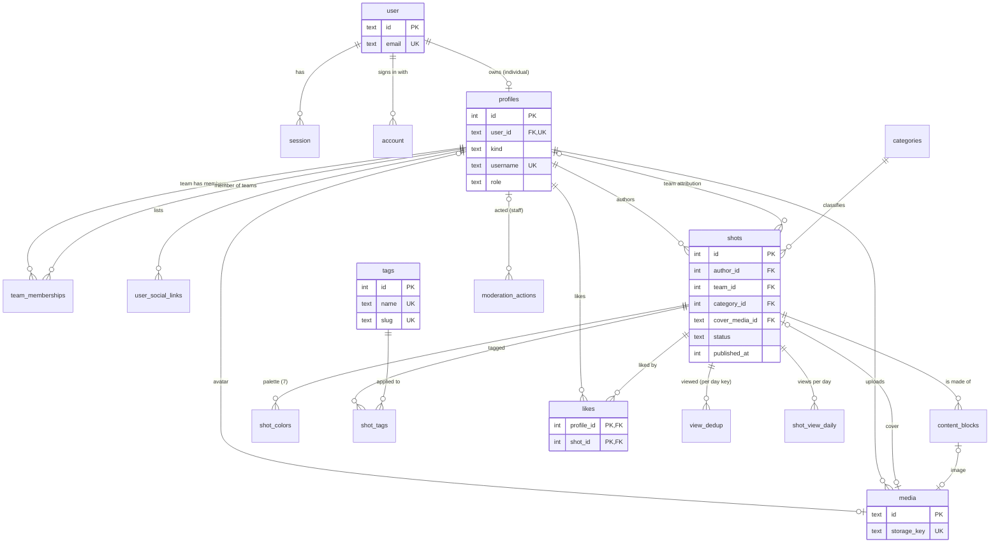
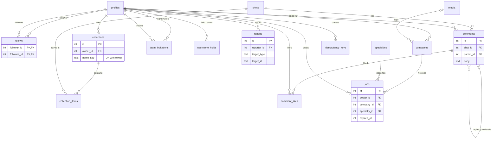

# Database Design

| Field | Value |
|---|---|
| Task | P03-01 + P03-02 (ERD), written from the implemented R1 schema |
| Version | 1.1 · 2026-11-13 (R2 implemented: migration `0002_r2_social_content`) |
| Database | Turso / libSQL (SQLite dialect) through `@libsql/client` + Drizzle ORM 0.45 (A-02) |
| Sources | [RE doc 06](../reverse-engineering/06-database-design.md) (functional entity model) · [RE doc 05 §7](../reverse-engineering/05-api-inventory.md) (shot data contract) · [BUSINESS_RULES](../01-requirements/BUSINESS_RULES.md) · ADR-001 (FTS5), ADR-002 (FKs, batches), ADR-003 (auth tables) |
| Companions | [DATABASE_SCHEMA.md](DATABASE_SCHEMA.md) (column-level reference) · [REVERSE_ENGINEERING_TO_BACKEND_MAPPING](../07-development/REVERSE_ENGINEERING_TO_BACKEND_MAPPING.md) |

## 1. Principles

1. **Derived from the reverse engineering, re-expressed for SQLite.** RE doc 06 proposed PostgreSQL types (`citext`, `tsvector`, enums, GIN). Each is replaced by a SQLite equivalent (§6). Entities, relationships and constraints are kept.
2. **Only what the current release needs is migrated.** R1 (migrations 0000–0001) created the R1 tables; R2 (migration 0002) adds 12 tables and 6 columns, **add-only** (no table rebuild, so the FTS5 triggers on `shots` are untouched, F-12). R3 entities are designed in §5.5 but have no migration yet.
3. **The database enforces integrity**, not only the code: foreign keys (enforced per connection and asserted at start-up, ADR-002), `CHECK` constraints for non-negative counters, lower-case usernames, published-has-date and block shape, and unique indexes for every natural key.
4. **Identity is split from profile.** Better Auth owns `user/session/account/verification/rate_limit` (ADR-003). The product's public identity is `profiles`, so a team (which has no credentials, BR-57) is a profile without a `user_id`.
5. **Counters are caches.** `likes_count`, `views_count`, `shots_count`, `likes_received_count`, `tags.shots_count` are updated in the same atomic batch as their source rows and rebuilt nightly from source (BR-26, BR-27).
6. **Binaries never go in the database** (A-03). `media` stores a storage key; URLs come from configuration (ImageKit in production, A-19; local seed files in development).
7. **Time is integer milliseconds UTC** (`timestamp_ms`). View days are UTC `YYYY-MM-DD` strings (BR-30).

## 2. Entity relationship diagram (R1, implemented)

Not shown: `verification`, `rate_limit` (Better Auth), `app_rate_limits` (our limiter), and the FTS5 virtual table `shots_fts` (an external-content index over `shots`, kept in sync by three triggers, ADR-001).

## 3. Tables and their purpose

| Table | Owner module | Purpose | Requirement |
|---|---|---|---|
| `user` | auth (Better Auth) | Credential identity: email (unique, lower-cased, BR-10), verified flag | A-01, BR-09 |
| `session` | auth | Session tokens (30 days, renewed daily, BR-13); deleted on suspension (BR-25) | A-03 |
| `account` | auth | Sign-in providers per user (Google, B-16) | A-02, BR-11 |
| `verification` | auth | **Hashed** email codes, 10 min, 5 attempts (BR-01…04) | A-01 |
| `rate_limit` | auth | Better Auth's database rate limiter (per IP/path) | BR-06, BR-07, D-12 |
| `profiles` | users | Public identity of an individual (with `user_id`) or a team (no `user_id`): username, display name, about fields, role, featured flag, suspension, counters | P-01, P-02, P-05, BR-16…22, BR-25, BR-57, BR-67 |
| `user_social_links` | users | One link per platform per profile | P-02 |
| `team_memberships` | users | Team ↔ member with role owner/admin/member (read in R1, managed in R2) | P-05, BR-57, BR-58 |
| `media` | media | Image object metadata: storage key, size, dominant colour, status | C-01, C-02, A-03 |
| `categories` | shots | Exactly 8 fixed categories (reference data, seeded everywhere) | BR-36 |
| `shots` | shots | The shot: author, optional team, title/slug/description, category, cover, status/published date, counter caches, popularity score, moderation/soft-delete flags, denormalised search columns | SD-01, D-01, BR-32…37, BR-42, BR-59, BR-65 |
| `content_blocks` | shots | Ordered image/text blocks of a shot (RE doc 05 §7 `contentBlocks`) | SD-01, BR-64 |
| `shot_colors` | shots | 7-colour palette per shot, with CIELAB for colour search (R3) | SD-03, D-05, BR-80 |
| `tags` | search | Tag vocabulary (lower-case, unique name and slug) with eligible-count cache | D-07, BR-40, BR-41 |
| `shot_tags` | search | Shot ↔ tag | D-07 |
| `likes` | likes | One like per profile per shot (set semantics) | S-01, BR-46 |
| `view_dedup` | views | Per-viewer/shot/UTC-day keys (HMAC for visitors, no raw IP); purged after 48 h | D-10, BR-30, BR-31 |
| `shot_view_daily` | views | Daily view aggregate per shot (source of truth for `views_count`) | D-10, BR-27 |
| `app_rate_limits` | platform (infra) | Window counters for non-auth rate-limit classes | BR-76, BR-77, D-12 |
| `moderation_actions` | moderation | Append-only audit log (reason ≥ 10 chars) | NX-05, FR-09, BR-67, BR-68 |
| `shots_fts` (virtual) | search | FTS5 index: title, description, tags, author (weights 3/1/2/1 at query time) | D-06, BR-39, ADR-001 |

## 4. Relationships, ownership and integrity

### 4.1 Foreign keys and delete behaviour

| Child → parent | On delete | Why |
|---|---|---|
| `session`, `account` → `user` | cascade | Credentials die with the user |
| `profiles.user_id` → `user` | set null | Keeps the public profile row for audit and later anonymisation (BR-24) |
| `shots.author_id` → `profiles` | cascade | A purged profile's shots go with it |
| `shots.team_id` → `profiles` | set null | Team removal keeps the shot with its individual author (BR-60) |
| `content_blocks`, `shot_colors`, `shot_tags`, `likes`, `view_dedup`, `shot_view_daily` → `shots` | cascade | Owned detail rows |
| `shots.cover_media_id`, `content_blocks.media_id`, `profiles.avatar_media_id` → `media` | set null | A lost image never deletes content |
| `shots.category_id` → `categories` | restrict (default) | Categories are fixed |
| `likes.profile_id`, `team_memberships.*`, `user_social_links` → `profiles` | cascade | Owned by the profile |
| `moderation_actions.actor_profile_id` → `profiles` | set null | The audit row outlives the actor |

Soft deletes (`deleted_at`) are used for profiles and shots so public reads can hide them at once while the purge job (R2, BR-65) removes them later.

### 4.2 Constraints that encode business rules

| Constraint | Rule |
|---|---|
| `profiles_username_lower`: `username = lower(username)`; `username` UNIQUE | BR-19 case-insensitive uniqueness |
| `profiles_team_no_user`: `kind = 'individual' OR user_id IS NULL` | BR-57 teams have no credentials |
| `profiles_counters_nonneg`, `shots_counters_nonneg`, `tags_count_nonneg` | BR-27 counters never negative |
| `shots_title_len`: 1–100 | BR-64 |
| `shots_published_has_date`: draft or `published_at` set | BR-65 |
| `content_blocks_shape`: image ⇒ `media_id`; text ⇒ `text_body` | BR-64 |
| `content_blocks_shot_pos_uq` (shot, position) | Ordered blocks |
| `likes` PK (profile, shot) | BR-46 one like per shot |
| `view_dedup` PK (viewer_key, shot, day) | BR-30 one view per viewer per day |
| `social_links_profile_platform_uq` | One link per platform |
| `moderation_reason_len` ≥ 10 | BR-68 |

### 4.3 Eligibility (BR-37)

A shot is public only when `status = 'published' AND published_at <= now AND hidden_at IS NULL AND deleted_at IS NULL` **and** its author (and team, if any) is neither suspended nor deleted. The predicate is written once (`shots/repository.ts: eligible()`, plus the raw-SQL twin in `search/repository.ts`) and used by every list, count, search, tag page and mutation check.

### 4.4 Atomic writes

| Operation | Statements in one `db.batch` (atomic, one round trip) |
|---|---|
| Like / unlike | insert-or-ignore (or delete) like → `shots.likes_count ± 1 WHERE changes() = 1` → `profiles.likes_received_count ± 1 WHERE changes() = 1` → read count |
| View | insert-or-ignore dedup key → daily upsert `WHERE changes() = 1` → `views_count + 1 WHERE changes() = 1` |
| Detail read | head + blocks + palette + tags in one batch of selects (NFR-09) |

Repeats change nothing because each counter statement only runs if the previous statement changed a row. Verified by the concurrency tests (8 members × 2 parallel likes → exactly 8).

## 5. R2 entities (implemented, migration 0002)

### 5.1 ERD (R2 additions)

### 5.2 Tables

| Table | Owner module | Purpose | Requirement |
|---|---|---|---|
| `follows` | follows | Follow graph; PK (follower, followee); `CHECK follower <> followee`; indexes by followee and by follower (newest first) | S-03, BR-56 |
| `collections` | collections | Name 1–60 (CHECK), unique per owner case-insensitively via `name_key = lower(name)`; description ≤ 300 (CHECK); `is_private`; `shots_count` cache (≥ 0); `hidden_at` | S-02, BR-53, BR-54 |
| `collection_items` | collections | PK (collection, shot): a shot appears once per collection; indexes by shot (saves) and by save time | BR-55 |
| `comments` | comments | `parent_id` → comments (one level, enforced by the service); body 1–2,000 unless deleted (CHECK); `likes_count` cache; `edited_at`, `hidden_at`, `deleted_at` (placeholder) | S-04, BR-48…BR-50 |
| `comment_likes` | comments | PK (profile, comment) | BR-52 |
| `team_invitations` | teams | Role admin/member; status pending/accepted/declined/revoked; `expires_at` (14 days); **partial unique index** (team, invitee) WHERE status = 'pending' | BR-58 |
| `username_holds` | users | Old username → profile until `expires_at` (30 days); PK username | BR-23 |
| `specialties` | jobs (reference) | 9 fixed rows, seeded by `ensureReferenceData` | BR-71 |
| `companies` | jobs | One per (poster, `name_key`); name 1–80 (CHECK); https website; optional logo media | BR-71 |
| `jobs` | jobs | Title 5–100 (CHECK); sanitised `description_html` + `description_text`; workplace/employment enums; `published_at`, `expires_at` (+30 days), `closed_at`, `hidden_at`, `deleted_at`; exactly one specialty | J-01…J-03, BR-71…BR-75 |
| `reports` | moderation | Unique (reporter, target_type, target_id); reason enum; note ≤ 500 (CHECK); status open/hidden/suspended/dismissed; queue index (status, created_at) | BR-69 |
| `idempotency_keys` | platform (infra) | PK (actor, scope, key); stored result; 24 h | API conventions §5 |

Columns added: `media.purpose` (shot/avatar/logo/seed), `media.provider_file_id`, `media.palette` (JSON hex list), `media.failure_reason`; `profiles.username_changed_at`, `profiles.intents` (JSON). New index `likes_profile_recent_idx` (Liked tab).

### 5.3 Counters (BR-26, BR-27)

| Counter | Changed in the same batch as | Reconciled by |
|---|---|---|
| `profiles.followers_count`, `following_count` | follow insert/delete (`changes() = 1` guard) | `follows.reconcile` |
| `shots.saves_count`, `collections.shots_count` | collection item insert/delete | `collections.reconcile` |
| `shots.comments_count` (visible comments, replies included) | comment insert, delete, hide/unhide | `comments.reconcile` |
| `comments.likes_count` | comment-like insert/delete | `comments.reconcile` |
| `profiles.shots_count` (author and team) | publish, delete, team detach | `shots.reconcileShotsCount` |
| `tags.shots_count` | publish, tag edits, delete (recount of the affected tags) | `search.reconcileTagCounts` |

### 5.4 Lifecycle (BR-24, BR-65, BR-66)

| Event | Immediately | Later (daily job) |
|---|---|---|
| Shot deleted | `deleted_at`; likes, saves, comments removed with counters; profile/team `shots_count` −1 | After 30 days (`purge`): row removed (blocks, colours, tags cascade); media rows and stored objects deleted |
| Account deleted | `profiles.deleted_at`; sessions deleted; likes, follows, collections, comments removed with counters | After 30 days (`purge`): stored objects deleted; profile row removed (shots, media, links, memberships cascade); credential `user` row removed; username released |
| Upload not attached | — | After 24 h (`cleanup`): object and row deleted |
| Username changed | Old name held for this profile | After 30 days (`cleanup`): hold released |

### 5.5 Planned entities (R3, designed, not migrated)

| Table | Key columns / constraints | Notes |
|---|---|---|
| `blocks` | PK (blocker_id, blocked_id) | BR-81 |
| `message_threads`, `thread_participants`, `messages` | | BR-82 |
| `notifications` | recipient, type, actor, target, read_at | BR-83 |
| `services` | price in integer cents, delivery days, revisions | BR-84 |
| `analytics_events` | first-party only | X-03, BR-85 |

Not planned (need payment approval, B-19): orders, reviews, subscriptions, boosts, briefs, proposals.

## 6. Deviations from RE doc 06 (and why)

| RE doc 06 | This design | Reason |
|---|---|---|
| PostgreSQL 16 + Prisma | Turso/libSQL + Drizzle | A-02, A-09 |
| One `users` table with credentials and profile | `user` (Better Auth) + `profiles` | Library-owned auth tables (ADR-003); teams without credentials (BR-57) |
| `citext` username/email | `CHECK (username = lower(username))` + unique index; emails normalised before storage (BR-10) | SQLite has no citext |
| Native enums | `TEXT` with Drizzle enum typing (validated by Zod at the edge) | SQLite |
| `tsvector` + GIN | FTS5 external-content table + triggers in a hand-written migration | ADR-001 (spike-verified) |
| `user_skills`, `user_languages` tables | JSON arrays on `profiles` | Read-only display lists in R1–R3; no query filters on them |
| `shot_views` raw table + Redis | `view_dedup` (48 h) + `shot_view_daily` | X-3: no Redis; bounded storage |
| `is_select` ("Select" badge) | `is_featured_studio` | X-10: no reference branding |
| `is_pro`, `pro_tier`, `available_for_work` | Not modelled | Pro is "Later" (payments); availability label excluded (D-25d, A-26) |
| `job_specialties` (N–M) | `jobs.specialty_id` | BR-71: exactly one specialty per job |
| `jobs.plan`, `pending_payment` status | Not modelled | Paid tiers are Later |
| `comments.parent_id` at any depth | One level, enforced in the service | BR-49 |
| `bigint` identity everywhere | integer autoincrement for shots/profiles/tags (numeric URLs, BR-42); text ids for Better Auth and media | Same behaviour; media ids are opaque |

## 7. Indexes (query → index)

| Query | Index |
|---|---|
| Recent feed (all / category) | `shots_recent_idx (status, published_at, id)`, `shots_cat_recent_idx` |
| Popular feed (all / category) | `shots_popular_idx (status, popularity_score)`, `shots_cat_popular_idx` |
| Profile Work tab | `shots_author_idx (author_id, published_at)`, `shots_team_idx` |
| Tag page / related | `shot_tags_tag_idx (tag_id, shot_id)` + PK |
| Liked state for a page of cards | `likes` PK (profile_id, shot_id) |
| Likes per shot | `likes_shot_idx (shot_id, created_at)` |
| Dedup purge | `view_dedup_created_idx` |
| Rate-limit purge | `app_rate_limits_expires_idx` |
| Sessions by user (revocation) | `session_user_id_idx` |
| Full-text search | `shots_fts` (FTS5, prefix 2/3) |
| Followers / following lists | `follows_followee_idx`, `follows_follower_idx` |
| Collections tab, collection shots, saves | `collections_owner_idx`, `collection_items_recent_idx`, `collection_items_shot_idx` |
| Comment thread | `comments_thread_idx (shot_id, parent_id, created_at)` |
| Liked tab | `likes_profile_recent_idx` |
| Job board | `jobs_board_idx (expires_at, published_at)`, `jobs_specialty_idx`, `jobs_poster_idx` |
| Moderation queue | `reports_queue_idx (status, created_at)` |
| Pending invitations | `team_invitations_pending_uq` (partial), `team_invitations_invitee_idx` |

## 8. Data lifecycle and retention (BR-79)

| Data | Retention | Job |
|---|---|---|
| Sign-in codes | deleted within 24 h of expiry | `platform.cleanup` (daily cron) |
| Sessions | deleted 7 days after expiry; immediately on suspension | cleanup; `auth.revokeAllSessions` |
| View dedup keys | 48 h | cleanup |
| Rate-limit rows | 24 h after their window | cleanup |
| Counters | rebuilt from source nightly | `platform.reconcileCounters` |
| Popularity score | recomputed (BR-33, R2 formula) | `/api/cron/popularity` or `daily` |
| Idempotency keys | 24 h | cleanup |
| Username holds | 30 days | cleanup |
| Unattached uploads | 24 h | cleanup |
| Deleted shots / accounts | 30 days | purge |

## 9. Seed data (FR-06, BR-87)

`npm run db:seed` loads 12 people, 2 teams, 64 shots (8 per category), 89 generated images, tags, likes and daily views, then rebuilds counters and popularity. All names and copy are original; all artwork is generated flat shapes (no gradients, A-17), so it is licence-free by construction. It is deterministic and refuses to run twice on one database.
