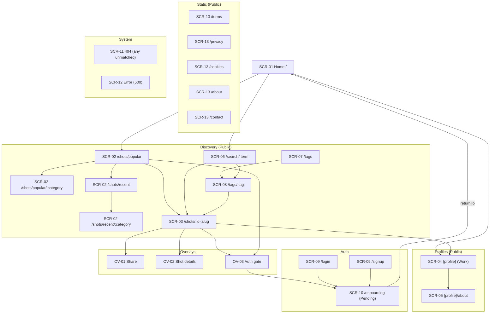
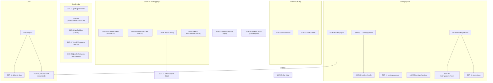
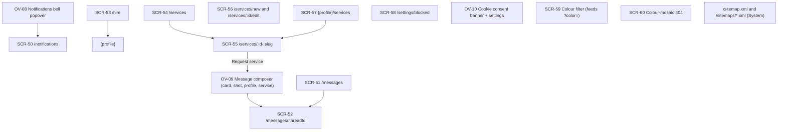

# Application Sitemap (P06-02)

| Field | Value |
|---|---|
| Task | P06-02 — Application sitemap |
| Owner | Designer (UI/UX, information architecture) |
| Version | 1.0 — draft for review |
| Date | 2026-11-12 |
| Status | Awaiting Review (proposed) |
| Depends on | P06-01 [INFORMATION_ARCHITECTURE](INFORMATION_ARCHITECTURE.md) |
| Acceptance criterion | Every route in [FEATURE_INVENTORY](../01-requirements/FEATURE_INVENTORY.md) appears once with a release (checked in [§7](#7-traceability-feature-inventory-routes)) |
| Tests / validation | T-03 traceability (input) |
| Companion documents | [WIREFRAME_SPECIFICATION](WIREFRAME_SPECIFICATION.md) · [RESPONSIVE_DESIGN](RESPONSIVE_DESIGN.md) |

**Notation.** `{profile}` = `/:username` (OQ-02 Option A, default) or `/@:username` (Option B); see [INFORMATION_ARCHITECTURE §1](INFORMATION_ARCHITECTURE.md). Component IDs Cxx are from [DESIGN_SYSTEM](../05-design-system/DESIGN_SYSTEM.md); that catalogue covers R1 only, so R2/R3 rows name the reusable Cxx components plus **new** components to be catalogued in the R2/R3 design-system increments. **Access** values as in IA §1: Public · Auth · Owner · Pending · Staff · System.

**Screen ID scheme.** SH-xx = global shell surfaces · OV-xx = overlays (modals, popovers) · SCR-01…SCR-13 = R1 pages · SCR-20…SCR-39, SCR-41, SCR-42 = R2 · SCR-50…SCR-61 = R3 · L-xx = Later (not planned).

---

## 1. R1 sitemap

### 1.1 Diagram

### 1.2 Global shell and overlays

| ID | Surface | Where | Purpose | Primary components | Auth | FR |
|---|---|---|---|---|---|---|
| SH-01 | Site header | All standard pages (not auth/onboarding) | Reach discovery, search, auth or account from anywhere | C02, C03, C04, C05, C09, C40, C41, C45 (C07 when signed in) | Public (variant per session) | FR-01 |
| SH-02 | Explore menu | Header ≥ lg | Popular, Recent, 8 categories, All tags | C05, C49, C50 | Public | FR-01 |
| SH-03 | Mobile navigation drawer | Header < lg | Same destinations as the header, plus account block | C06, C09, C40, C41, C45, C50 | Public | FR-01 |
| SH-04 | Account menu | Header (member) | View profile, Sign out (R1) | C07, C49, C45, C37 | Auth | FR-01, FR-14 |
| SH-05 | Site footer | All standard pages | Secondary and legal links | C08, C04, C50 | Public | FR-02 |
| SH-06 | Toast region | Global | Confirmations and non-blocking errors | C38 | Public | FR-03 |
| OV-01 | Share modal | Shot detail | Share via X, Pinterest, copy link, native share | C48, C22, C30, C40, C41, C38 | Public | FR-39 |
| OV-02 | Shot details modal | Shot detail | Posted date, views, likes, tags | C48, C23, C15 | Public | FR-40 |
| OV-03 | Auth-gate modal | Any gated control (R1: Like) | Sign in without losing context (`intent`, `returnTo`) | C48, C32, C29 (compact), C30, C31, C40, C51, C39 | Visitor only | FR-15, FR-10…FR-13, FR-20 |

### 1.3 R1 pages

| ID | Page | Route(s) | Purpose | Primary components | Auth | FR | Wireframe |
|---|---|---|---|---|---|---|---|
| SCR-01 | Homepage | `/` | Introduce the product and lead into discovery; hero search (V-2) | C01, C03 (no header search), C09 (hero, `--control-h-lg`), C15, C16, C17, C18, C20, C40, C45, C34–C36 | Public | FR-21, FR-23, FR-24, FR-45 | [WF §3](WIREFRAME_SPECIFICATION.md#3-scr-01-homepage) |
| SCR-02 | Explore feed | `/shots/popular[/:category]`, `/shots/recent[/:category]` (+ `?tag=&timeframe=`) | Browse all eligible shots by sort, category, tag, timeframe | C10, C11, C12, C13, C14, C15, C16, C17, C18, C20, C42, C34–C37 | Public | FR-22, FR-23, FR-24, FR-25, FR-45 | [WF §4](WIREFRAME_SPECIFICATION.md#4-scr-02-explore-feed) |
| SCR-03 | Shot detail | `/shots/:id-:slug` | Present one shot in full; like, share, inspect; related work | C19, C20, C21, C22, C23, C24, C25, C32, C45, C46, C38, C35, C36 | Public (hidden: Staff) | FR-37, FR-38, FR-39, FR-40, FR-41, FR-42, FR-45, FR-29 | [WF §5](WIREFRAME_SPECIFICATION.md#5-scr-03-shot-detail-and-overlays) |
| SCR-04 | Profile — Work | `{profile}` (`?sort=popular`) | A designer's or team's portfolio | C26, C27, C11, C16, C17, C18, C45, C46, C34–C36 | Public | FR-54 | [WF §6](WIREFRAME_SPECIFICATION.md#6-scr-04-scr-05-profile) |
| SCR-05 | Profile — About | `{profile}/about` | Who the designer is; contact email | C26, C27, C28, C15, C50, C38 | Public | FR-55 | [WF §6](WIREFRAME_SPECIFICATION.md#6-scr-04-scr-05-profile) |
| SCR-06 | Search results | `/search/:term` | Shots matching a keyword; related tags; empty state | C09, C15, C16, C17, C18, C34, C35, C36 | Public | FR-31, FR-32 | [WF §7](WIREFRAME_SPECIFICATION.md#7-scr-06-search-results) |
| SCR-07 | Tags index | `/tags` | Browse all topics: most-used 50 + A–Z | C15, C50, C34, C36 | Public | FR-33 | [WF §8](WIREFRAME_SPECIFICATION.md#8-scr-07-scr-08-tags) |
| SCR-08 | Tag page | `/tags/:tag` | All shots for one tag, popular order | C15, C16, C17, C18, C34, C36 | Public | FR-34 | [WF §8](WIREFRAME_SPECIFICATION.md#8-scr-07-scr-08-tags) |
| SCR-09 | Log in / Sign up | `/login`, `/signup` (`?returnTo=&intent=&target=`) | Email code (request → verify → resend) or Google; Turnstile | C29, C30, C31, C39, C40, C51, C04, C50, C37 | Public (signed-in → redirect) | FR-10, FR-11, FR-12, FR-13, FR-16, FR-20 | [WF §9](WIREFRAME_SPECIFICATION.md#9-scr-09-log-in-and-sign-up) |
| SCR-10 | Choose username | `/onboarding` (`?returnTo=`) | Claim username and display name before using the product | C33, C30, C40, C39, C15, C04, C50 | Pending | FR-17 | [WF §10](WIREFRAME_SPECIFICATION.md#10-scr-10-choose-username) |
| SCR-11 | Not found | any unmatched route, unknown entity | Recover from missing content | C35, C09, C04, C40 | Public | FR-05 | [WF §11](WIREFRAME_SPECIFICATION.md#11-scr-11-scr-12-not-found-and-error) |
| SCR-12 | Error | server error (500), section boundaries | Recover from server errors; request ID | C35, C40 | Public | FR-05, FR-07 | [WF §11](WIREFRAME_SPECIFICATION.md#11-scr-11-scr-12-not-found-and-error) |
| SCR-13 | Legal / static page | `/terms`, `/privacy`, `/cookies`, `/about`, `/contact` | Launch legal needs; deletion request route (BR-24) | C01, C03, C08, C50 | Public | FR-04 | [WF §12](WIREFRAME_SPECIFICATION.md#12-scr-13-legal-and-static-pages) |

**R1 totals:** 13 pages, 6 shell surfaces, 3 overlays.

R1 requirements with **no screen of their own** (no user interface, or shown inside another screen): FR-06 seed (data), FR-07 server foundation (`/api/health`, error page SCR-12), FR-09 moderation (script/admin-only action, no public UI; the moderator view of a hidden shot is a state of SCR-03), FR-27 popularity score (ordering only), FR-29 view logging (counts shown on C16 and OV-02), FR-87 metadata (per-page titles in [IA §4.3](INFORMATION_ARCHITECTURE.md)).

---

## 2. R2 sitemap

Wireframes for R2 screens are **deferred to the R2 design cycle** (P06-06 prototypes, approved at G4-R2 in P07-07). This section fixes their place in the structure, their purpose and the components they reuse.

### 2.1 Diagram

### 2.2 R2 pages and overlays

| ID | Page / overlay | Route | Purpose | Primary components (reused + new) | Auth | FR |
|---|---|---|---|---|---|---|
| SCR-20 | New shot (composer) | `/uploads/new` | Upload images, compose blocks, title, category, tags, team; draft or publish | C30, C40, C41, C13, C15, C39, C38; **new:** Dropzone/uploader, BlockEditor, ProgressItem, CategorySelect | Auth | FR-61, FR-62, FR-63, FR-64 |
| SCR-21 | Edit shot | `/shots/:id/edit` | Edit a draft or published shot; delete | As SCR-20 + C48 (delete confirm) | Owner | FR-63, FR-64 |
| SCR-22 | Shot detail additions | `/shots/:id-:slug` | Comments entry on rail, Save, Follow, "for {Team}", palette, Previous/Next, owner menu (disable comments) | C19–C21 + **new:** PaletteRow, PrevNextNav, OwnerMenu | Public | FR-43, FR-44, FR-50, FR-58 |
| SCR-23 | Profile Work additions | `{profile}` | Followers/following stats, Follow, Edit profile (owner), drafts area (owner) | C26, C27 + **new:** FollowButton, DraftsStrip | Public / Owner | FR-48, FR-54, FR-64 |
| SCR-24 | Profile — Collections | `{profile}/collections` | List public collections (owner also sees private) | C27, C18 + **new:** CollectionCard (mosaic) | Public | FR-56 |
| SCR-25 | Collection detail | `{profile}/collections/:id-:slug` | Curator header, Share, shot grid; owner edit/delete | C16–C18, C22 (share), C48 + **new:** CollectionHeader | Public / Owner (private) | FR-46, FR-56 |
| SCR-26 | Profile — Liked shots | `{profile}/likes` | Owner's liked shots, newest first | C27, C16–C18, C34 | Owner | FR-57 |
| SCR-27 | Profile — Members | `{profile}/members` | Team members list | C27, C45 + **new:** MemberRow | Public (teams) | FR-58 |
| SCR-28 | Followers / Following | `{profile}/followers`, `{profile}/following` | Public follower lists, 24 per page | C45, C18 (load more) + **new:** PersonRow, FollowButton | Public | FR-48 |
| SCR-29 | Full onboarding | `/onboarding` (steps after username) | Avatar, headline, location, intent, skills; Skip | C33, C30, C40 + **new:** Stepper, AvatarUpload | Pending → Auth | FR-18 |
| SCR-30 | Settings — Profile | `/settings/profile` | Edit public profile, "available for work" | C30, C43, C40, C15 + **new:** SettingsNav, AvatarUpload | Auth | FR-59 |
| SCR-31 | Settings — Account | `/settings/account` | Change username (BR-23), email (code), delete account (code) | C30, C31, C40, C48, C39 | Auth | FR-19 |
| SCR-32 | Settings — Sessions | `/settings/sessions` | List sessions; sign out other sessions | C40 + **new:** SessionRow | Auth | FR-19 |
| SCR-33 | Settings — Teams | `/settings/teams` | My teams, pending invitations (accept/decline), create team | C40, C45 + **new:** InvitationRow | Auth | FR-19, FR-58 |
| SCR-34 | Team administration | `/settings/teams/:team` | Team profile, invite by username, roles, remove, transfer, delete | C30, C40, C48, C49 + **new:** MemberRow (admin) | Auth (owner/admin) | FR-58 |
| SCR-35 | Create a team | `/teams/new` | Team username + name | C33 (username pattern), C30, C40 | Auth | FR-58 |
| SCR-36 | Settings — Jobs | `/settings/jobs` | My jobs with status/expiry; Edit, Close | C40, C46 + **new:** JobRow (owner) | Auth | FR-70 |
| SCR-37 | Job board | `/jobs` | Keyword + sidebar filters; active jobs newest first | C09, C30, C40, C46, C34 + **new:** JobRow, JobFilters (checkbox group) | Public | FR-67 |
| SCR-38 | Job detail | `/jobs/:id-:slug` | Description, company card, Apply (new tab), share; expired notice | C40, C22 (share), C39 + **new:** CompanyCard, RichText | Public | FR-68 |
| SCR-39 | Post / edit a job | `/jobs/new`, `/jobs/:id/edit` | 3 steps: details (rich text), company, preview & publish; gate on Continue for visitors | C30, C40, C32 (`post-job`) + **new:** Stepper, RichTextEditor, LogoUpload | Public form / Auth submit / Owner edit | FR-69, FR-70 |
| SCR-41 | Report queue | `/admin/reports` | Hide, Dismiss, Suspend with reason | C40, C48, C30 + **new:** ReportRow | Staff | FR-90, FR-09 |
| SCR-42 | Designer search results | `/search/:term?type=designers` (proposal, IA G-10) | Designers matching name, username, skills | C09 (type switch), C45 + **new:** PersonRow | Public | FR-35 |
| OV-04 | Comments panel | Side panel (≥ md) / sheet (< md) on SCR-03 | Read, post, reply, edit (15 min), delete, like comments | C48 (sheet), C30, C40, C20 (compact) + **new:** CommentItem, Composer | Public read / gate write | FR-49, FR-50 |
| OV-05 | Save-to-collection picker | Popover from Save on card/shot | Add/remove from collections; "New collection" | C49 + **new:** CheckboxRow | Gate (`save-shot`) / Auth | FR-46, FR-47 |
| OV-06 | Report dialog | Menus of shot, comment, profile, collection, job | Reason + optional note | C48, C30, C40 | Gate / Auth | FR-90 |
| OV-07 | Search type switch + autocomplete | SH-01, SH-03 | Shots / Designers; up to 8 suggestions | C09, C49 (combobox) | Public | FR-35 |

R2 additions to the shell: header "Jobs ▾" and "Share work"; avatar menu + Share work, Liked shots, Settings (+ Report queue for staff); footer + Jobs ([IA §3](INFORMATION_ARCHITECTURE.md)).

---

## 3. R3 sitemap

Wireframes for R3 screens are **deferred to the R3 design cycle** (P06-07, approved at G4-R3).

### 3.1 Diagram

### 3.2 R3 pages and overlays

| ID | Page / overlay | Route | Purpose | Primary components (reused + new) | Auth | FR |
|---|---|---|---|---|---|---|
| SCR-50 | Notifications | `/notifications` | List; mark one/all read | C40, C45, C34 + **new:** NotificationRow | Auth | FR-51 |
| SCR-51 | Messages inbox | `/messages` | Threads with unread state | C45, C34 + **new:** ThreadRow | Auth | FR-53 |
| SCR-52 | Conversation | `/messages/:threadId` | Read and reply (polling ≤ 15 s) | C30, C40 + **new:** MessageBubble | Auth (participant) | FR-53 |
| SCR-53 | Designer directory | `/hire` | Designer cards with filters; Message | C12 (pattern), C40, C45, C15 + **new:** DesignerCard | Public | FR-73 |
| SCR-54 | Services listing | `/services` | Service cards with filters | C12, C40 + **new:** ServiceCard | Public | FR-75 |
| SCR-55 | Service detail | `/services/:id-:slug` | Description, price "from", delivery; Request service (opens message) | C40, C45 + **new:** PriceBox | Public / gate | FR-75 |
| SCR-56 | Create / edit service | `/services/new`, `/services/:id/edit` | Seller listing CRUD | C30, C40, C13, C15 + **new:** PriceField | Auth / Owner | FR-75 |
| SCR-57 | Profile — Services tab | `{profile}/services` | Seller's active listings (tab hidden when none) | C27 + **new:** ServiceRow | Public | FR-60 |
| SCR-58 | Settings — Blocked members | `/settings/blocked` | Unblock | C40, C45 | Auth | FR-52 |
| SCR-59 | Colour filter (feed state) | Feeds `?color=` | Hex input + ~20 swatches in Filters | C12 + **new:** ColourFilter | Public | FR-26, FR-36 |
| SCR-60 | Colour-mosaic 404 | any unmatched | Mosaic "404" from own shots, hue slider, search | C35, C09 + **new:** HueSlider, Mosaic | Public | FR-08 |
| SCR-61 | Video teaser (card state) | All grids | Teaser on hover/focus; motion indicator | C16 + **new:** MotionBadge | Public | FR-30, FR-65 |
| OV-08 | Notifications popover | Header bell | Latest notifications + "See all" | C49 + NotificationRow | Auth | FR-51 |
| OV-09 | Message composer | "Message" on cards, shots, profiles, services | Start a conversation | C48, C30, C40, C32 (`message-user`) | Gate / Auth | FR-53 |
| OV-10 | Cookie consent | Banner (first visit after a non-essential cookie exists) + dialog from footer | Accept / Reject (equal) / Settings | C48, C40, C43 | Public | FR-86 |
| — | Block action | Profile menu | Block with confirmation | C49, C48 | Gate / Auth | FR-52 |

R3 additions to the shell: header "Hire ▾" and notifications bell; avatar menu + Notifications, Messages; footer + Find designers, Services, Cookie settings. FR-84 (analytics) and FR-88 (sitemaps, JSON-LD) have no user interface.

---

## 4. Later (out of scope, not planned)

These need **payment approval** (💳, blocker B-19) or a **scope decision**. Their first-level segments are reserved now (BR §13) so that no username can take them. No screen, wireframe or prototype is produced.

| ID | Feature | Indicative route (reserved only) | Needs | FR |
|---|---|---|---|---|
| L-01 | Rebounds | `/shots/:id/rebounds` (segment `rebounds`) | Scope decision | FR-66 |
| L-02 | Challenges (renamed Playoffs) | `/challenges` | Scope decision | FR-89 |
| L-03 | Paid job tiers | inside `/jobs/new` | 💳 | FR-71 |
| L-04 | Job directories (SEO) | `/:specialty-jobs-in-:place`, `/directories/jobs` | Scope decision | FR-72 |
| L-05 | Specialty landing pages | `/hire/:specialty` | Scope decision | FR-74 |
| L-06 | Service orders / checkout | `/checkout`, `/orders` | 💳 | FR-76 |
| L-07 | Reviews and ratings | `{profile}/reviews`, `/reviews` | 💳 | FR-77 |
| L-08 | Project brief wizard | `/briefs/new` | 💳 | FR-78 |
| L-09 | Brief board and proposals | `/briefs`, `/proposals` | 💳 | FR-79 |
| L-10 | Payments, billing | `/billing`, `/payments` | 💳 | FR-80 |
| L-11 | Pro subscriptions | `/pro` | 💳 | FR-81 |
| L-12 | Boosts and ad slots | `/advertise` | 💳 | FR-82 |
| L-13 | Blog / resources | `/blog`, `/stories`, `/resources` | Scope decision | FR-83 |
| L-14 | Marketing pages | `/for-designers`, `/hiring`, `/design-agency`, `/featured` | Scope decision (pricing 💳) | FR-85 |
| L-15 | Schedule a call (candidate) | — | OQ-22 | FR-91 |
| L-16 | Save a designer (candidate) | — | OQ-22 | FR-92 |
| L-17 | Places page (candidate) | `/places` | OQ-22 | FR-93 |
| L-18 | Announcement banner (candidate) | — (not rendered, BR-89) | OQ-22 | FR-94 |
| L-19 | Following feed (candidate) | — | OQ-23 | — |

---

## 5. Reserved usernames (cross-check with the route tree)

The authoritative list is [BUSINESS_RULES §13](../01-requirements/BUSINESS_RULES.md) (BR-20). This table checks every **first path segment** used in §1–§4 against it. Under OQ-02 Option B the profile namespace removes the collision, but the list still blocks impersonation words.

| First segment | Used by | Release | In BR §13? |
|---|---|---|---|
| `shots` | Feeds, shot detail, edit | R1 | ✔ (R1 routes) |
| `search` | Search results | R1 | ✔ |
| `tags` | Tags index, tag page | R1 | ✔ |
| `login`, `signup` | Auth pages | R1 | ✔ |
| `onboarding` | Username step | R1 | ✔ |
| `api` (incl. `api/auth`, `api/health`) | System | R1 | ✔ (`api`, `auth`, `health`) |
| `terms`, `privacy`, `cookies`, `about`, `contact` | Static pages | R1 | ✔ |
| `logout` | Not a page (sign-out is a POST action) — kept reserved | R1 | ✔ |
| `robots.txt` | System | R1 | n/a (`.` not allowed; `robots-txt` reserved) |
| `uploads` | Composer | R2 | ✔ |
| `settings` | Settings | R2 | ✔ |
| `teams` | Create team | R2 | ✔ |
| `jobs` | Job board, detail, post | R2 | ✔ |
| `admin` | Report queue | R2 | ✔ |
| `notifications`, `messages` | R3 pages | R3 | ✔ |
| `hire`, `services` | R3 pages | R3 | ✔ |
| `sitemap.xml`, `sitemaps` | System | R3 | ✔ (`sitemaps`, `sitemap-xml`) |
| Later segments (§4) | Reserved only | Later | ✔ all listed (`rebounds`, `challenges`, `directories`, `checkout`, `orders`, `reviews`, `briefs`, `proposals`, `billing`, `payments`, `pro`, `advertise`, `blog`, `stories`, `resources`, `for-designers`, `hiring`, `design-agency`, `featured`, `places`) |
| `*-jobs-in-*` | L-04 | Later | ✔ (pattern) |

**Result:** every first segment used by an R1–R3 or Later route is reserved. No additions are required. If OQ-02 chooses `/u/:username`, `u` must be added (single-letter names are already impossible: BR-18 needs 3+ characters, so it is reserved by length).

---

## 6. Redirects and 404 behaviour

### 6.1 Redirects

The full redirect table is in [INFORMATION_ARCHITECTURE §6.3](INFORMATION_ARCHITECTURE.md). Summary: canonical shot slug (308, BR-42), normalised search term (308, BR-38), lower-case profile (308, FR-54), `/search?q=` → path (308, proposal), `/shots` → `/shots/popular` (308, proposal), protected → `/login?returnTo=` (BR-17), pending → `/onboarding?returnTo=` (BR-16), signed-in auth pages → `returnTo` or `/` (proposal), `/settings` → `/settings/profile` (R2).

### 6.2 What returns the 404 page (SCR-11, HTTP 404, `noindex`)

| Case | Rule | Release |
|---|---|---|
| Any unmatched route | FR-05 | R1 |
| Unknown category slug in `/shots/{sort}/:category` | BR-36 | R1 |
| Non-numeric shot ID; missing, unpublished, hidden or deleted shot; author suspended/deleted (staff can still open hidden shots) | BR-37, BR-42 | R1 |
| Tag missing or with 0 eligible shots | BR-41 | R1 |
| Unknown, suspended or deleted profile | BR-25, FR-54 | R1 |
| `{profile}/likes` opened by another member (visitors are redirected to login) | FR-57 | R2 |
| Private collection opened by a non-owner; missing collection | BR-54 | R2 |
| Someone else's draft; `/shots/:id/edit` by a non-owner | BR-65 | R2 |
| `{profile}/members` on a non-team account | FR-58 | R2 |
| Missing job (expired jobs show a notice, not 404) | FR-68, BR-73 | R2 |
| `/messages/:threadId` for a non-participant | BR-82 | R3 |
| `{profile}/services` with no services → tab hidden; direct URL → 404 (proposal) | FR-60 | R3 |
| Old username after a change (no redirects) | BR-23 | R2 |

Not a 404: zero search results (200 + empty state, `noindex`), a filter combination with no matches (200 + empty state), empty profile Work tab (200 + "No shots yet").

---

## 7. Traceability: feature-inventory routes

Acceptance criterion: *every route in FEATURE_INVENTORY appears once with a release.* Routes named in [FEATURE_INVENTORY](../01-requirements/FEATURE_INVENTORY.md) and in the FRs it references:

| Feature | Route(s) named | Sitemap entry | Release |
|---|---|---|---|
| D-01 Feed | `/shots/popular[/:category]`, `/shots/recent[/:category]` (FR-22) | SCR-02 | R1 |
| D-06 Search | `/search/:term` | SCR-06 | R1 |
| D-07 Tags | `/tags`, `/tags/:tag` | SCR-07, SCR-08 | R1 |
| D-09 Homepage | `/` (FR-21) | SCR-01 | R1 |
| SD-01 Shot page | `/shots/:id-:slug` (FR-37) | SCR-03 | R1 |
| P-01, P-02 Profile | `/:username`, `/:username/about` (FR-54, FR-55) | SCR-04, SCR-05 (`{profile}`) | R1 |
| A-01…A-05 Auth | `/login`, `/signup`, `/login?returnTo=` (FR-10, FR-16) | SCR-09 | R1 |
| A-06 Onboarding | `/onboarding` (FR-17) | SCR-10 (R1), SCR-29 (R2 full) | R1 / R2 |
| NX-06 Legal | `/terms`, `/privacy`, `/cookies`, `/about`, `/contact` (FR-04) | SCR-13 | R1 |
| X-02 404 | unmatched (FR-05) | SCR-11 (R1), SCR-60 (R3) | R1 / R3 |
| F-05 API | `/api/health` (FR-07) | System row (IA §6.2 #22) | R1 |
| C-04 Composer | `/uploads/new`, `/shots/:id/edit` (FR-63) | SCR-20, SCR-21 | R2 |
| A-07 Settings | `/settings` (FR-19) | SCR-30…SCR-34, SCR-36 | R2 |
| P-03 Collections | `/:username/collections[/:id-:slug]` (FR-56) | SCR-24, SCR-25 | R2 |
| P-04 Liked shots | `/:username/likes` (FR-57) | SCR-26 | R2 |
| P-05 Teams | Members tab (FR-58) | SCR-27, SCR-33…SCR-35 | R2 |
| S-03 Follows | `/:username/followers`, `/:username/following` (FR-48) | SCR-28 | R2 |
| J-01…J-03 Jobs | `/jobs`, `/jobs/:id-:slug`, `/jobs/new` (FR-67…FR-69) | SCR-37, SCR-38, SCR-39 | R2 |
| NX-05 Reports | `/admin/reports` (FR-90) | SCR-41 | R2 |
| S-05 Notifications | `/notifications` (FR-51) | SCR-50 | R3 |
| S-07 Messaging | `/messages` (FR-53) | SCR-51, SCR-52 | R3 |
| H-01 Hire | `/hire` | SCR-53 | R3 |
| M-01 Services | `/services` (FR-75) | SCR-54…SCR-56 | R3 |
| P-07 Services tab | `/:username/services` (FR-60) | SCR-57 | R3 |
| D-11 Sitemaps | sitemap index (FR-88) | System row (IA §6.2 #56) | R3 |
| J-05 Job directories | `*-jobs-in-*` | L-04 | Later |
| H-02 Specialty landing | (FR-74) | L-05 | Later |

**Result:** 27 feature rows with routes, each mapped to exactly one sitemap entry and release. Unmapped: 0.

---

## 8. Self-check

| Check | Result |
|---|---|
| R1, R2, R3 sitemaps complete; Later listed separately as out of scope | Pass (§1–§4) |
| Mermaid labels containing `/ : ? & + ( )` quoted | Pass (all labels quoted) |
| Every page has purpose, components (Cxx), auth and FR IDs | Pass (§1.3, §2.2, §3.2) |
| Reserved usernames cross-checked with the route tree | Pass (§5, 0 missing) |
| Redirects and 404 behaviour defined | Pass (§6) |
| Every FEATURE_INVENTORY route appears once with a release | Pass (§7) |
| R2/R3 wireframes deferred to their G4 cycles, stated | Pass (§2, §3) |
| Relative links in `docs/06-ui-ux/*.md` resolve | Pass (scripted check, 2026-11-12) |
