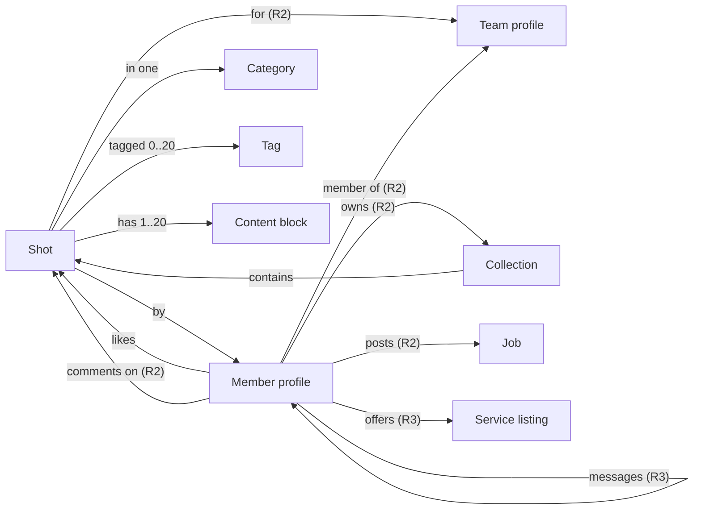
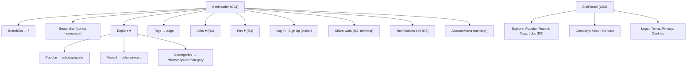
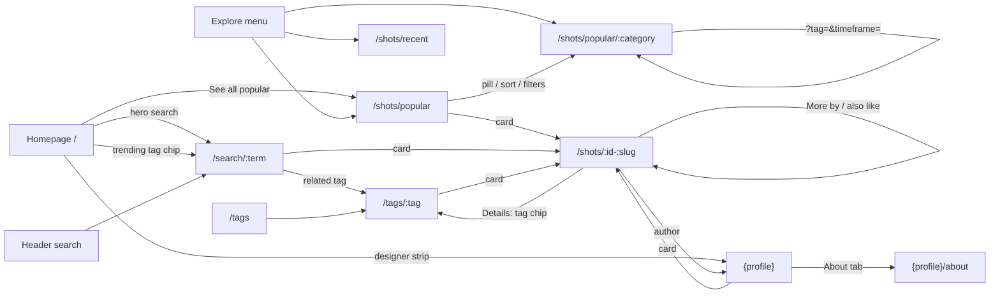

# Information Architecture (P06-01)

| Field | Value |
|---|---|
| Task | P06-01 — Information architecture |
| Owner | Designer (UI/UX, information architecture) |
| Version | 1.0 — draft for review |
| Date | 2026-11-12 |
| Status | Awaiting Review (proposed) |
| Depends on | P01-02 [FEATURE_INVENTORY](../01-requirements/FEATURE_INVENTORY.md), P01-04 [USER_JOURNEYS](../01-requirements/USER_JOURNEYS.md), P05-01 [FRONTEND_DESIGN_CONSTITUTION](../05-design-system/FRONTEND_DESIGN_CONSTITUTION.md) |
| Baseline | P01 requirements are **Awaiting Review**; this document uses them as the baseline and flags anything that depends on an open question (OQ-xx) or a pending decision (D-01, D-23, D-24) |
| Companion documents | [APPLICATION_SITEMAP](APPLICATION_SITEMAP.md) · [WIREFRAME_SPECIFICATION](WIREFRAME_SPECIFICATION.md) · [RESPONSIVE_DESIGN](RESPONSIVE_DESIGN.md) |
| Inputs | [REQUIREMENTS_SPECIFICATION](../01-requirements/REQUIREMENTS_SPECIFICATION.md) (FR-01…FR-94), [BUSINESS_RULES](../01-requirements/BUSINESS_RULES.md) (BR-14…BR-45, §13 reserved names), [USER_ROLES](../01-requirements/USER_ROLES.md), [OPEN_QUESTIONS](../01-requirements/OPEN_QUESTIONS.md), [DESIGN_SYSTEM](../05-design-system/DESIGN_SYSTEM.md) (component IDs C01…C51), [DECISION_LOG](../DECISION_LOG.md) (D-02 scope), [PROJECT_ASSESSMENT §8](../00-project-assessment/PROJECT_ASSESSMENT.md), reverse-engineering [01](../reverse-engineering/01-page-inventory.md), [02](../reverse-engineering/02-frontend-analysis.md), [03](../reverse-engineering/03-component-inventory.md), [04](../reverse-engineering/04-user-journeys.md) (structure and behaviour only) |

> **Originality rule (A-10, BR-88).** The reference product informed *structure and behaviour* only. No label, copy, name, artwork or visual treatment is taken from it. Where a requirement still carries a reference-product label, this document proposes a neutral replacement and lists it in [§9](#9-gaps-contradictions-and-proposals).

---

## 1. Scope and conventions

- **Releases** follow decision D-02: **R1** MVP, **R2** creators/social/free jobs, **R3** marketplace I and polish, **Later** not planned. A navigation entry exists only from the release that ships its feature (BR-45: no dead buttons).
- **Access levels:** **Public** (anyone, including visitors) · **Auth** (signed-in, onboarded member; visitors are redirected to `/login?returnTo=` per BR-17) · **Owner** (Auth and owns the resource; others get 404) · **Pending** (signed in, no username yet: only `/onboarding`, auth routes, legal pages and sign-out, BR-16) · **Staff** (moderator/admin proposal, OQ-04) · **System** (no page).
- **Profile path token `{profile}`.** The profile URL shape is open (**OQ-02**, needed by 2026-11-26). Everything in P06 is route-agnostic and uses `{profile}`:

| Option | `{profile}` resolves to | Example | Consequences |
|---|---|---|---|
| **A (default assumption in OQ-02)** | `/:username` | `/lena-ortiz`, `/lena-ortiz/about` | Matches the reference structure. Needs the reserved-word list ([BUSINESS_RULES §13](../01-requirements/BUSINESS_RULES.md)) and a test that ties it to the route tree. Static routes must win over the dynamic segment |
| **B (namespace)** | `/@:username` (or `/u/:username`) | `/@lena-ortiz`, `/@lena-ortiz/about` | No collision risk; the reserved list shrinks to impersonation words. Note for P02-03: in the App Router a folder name starting with `@` is a parallel-route slot, so `/@name` would need a rewrite to an internal segment (architecture to confirm). `u` would need adding to the reserved list only if `/u/` is used for something else |

  Wireframes show the profile URL as `{profile}`; the onboarding preview line (C33) shows `{domain}{profile}` so the copy works under either option.
- **Component IDs** (Cxx) refer to [DESIGN_SYSTEM §1](../05-design-system/DESIGN_SYSTEM.md). **Screen IDs** (SCR-xx, OV-xx, SH-xx) are defined in [APPLICATION_SITEMAP](APPLICATION_SITEMAP.md).
- **Mermaid** labels that contain `/ : ? & + ( )` are quoted.

---

## 2. Content model

The content model lists the user-facing content types, what each shows, where it lives and how types link. Field names are descriptive; the schema is P03's job.

### 2.1 Content types

| Type | Rel. | Canonical page | Shown as | Key displayed attributes | Notes / rules |
|---|---|---|---|---|---|
| **Shot** (design post) | R1 | `/shots/:id-:slug` | ShotCard (C16) in every grid; ShotDetail page | Title, cover (4:3 in grids, own ratio on detail), author (+ team from R2), likes, views (abbreviated, BR-28), tags, category, posted date | Eligibility BR-37; canonical slug BR-42; "shot" is the generic term (BR-88) |
| **Content block** | R1 | Inside a shot | ContentBlock (C24) | Image (alt text, full-width flag) or text; video from R3 | Order fixed by author (R2 composer); R1 from seed |
| **Member profile** (person) | R1 | `{profile}` | ProfileHeader (C26), author rows in cards and shot header, avatar | Avatar, display name, `@username`, headline, location, member since, stats (R1: shots, likes received), Featured Studio badge (OQ-27) | Sign-in email never shown (BR-78); public contact email optional |
| **Team** (account type) | R1 (label) / R2 (membership) | `{profile}` | Same as profile with a "Team" label; "for {Team}" attribution from R2 | As member + Members tab (R2) | Teams have no credentials (BR-57) |
| **Category** | R1 | `/shots/popular/:category`, `/shots/recent/:category` | CategoryPills (C10), Explore menu | Name | Exactly 8 fixed slugs (BR-36) |
| **Tag** | R1 | `/tags/:tag` | TagChip (C15), tags index, related tags | Name, eligible-shot count | Exists only with ≥ 1 eligible shot (BR-41) |
| **Search term** | R1 | `/search/:term` | Search results heading | Normalised term, related tags | BR-38, BR-39 |
| **Like** | R1 | — (state) | LikeButton (C20) state + counts | Liked/not liked, count | No self-likes (BR-46) |
| **View** | R1 | — (count) | Count on card and Details modal | Count | Detail-page views only (BR-29) |
| **Legal / static page** | R1 | `/terms`, `/privacy`, `/cookies`, `/about`, `/contact` | Static text page | Title, last updated, body | Text supplied/approved by the user (OQ-03) |
| **Collection** | R2 | `{profile}/collections/:id-:slug` | Collection card (mosaic), collection detail | Name, description, shot count, curator, privacy | Private collections → 404 to others (BR-54) |
| **Comment** | R2 | Panel on the shot page | Comment list item | Author, body, time, "edited", likes, replies (1 level) | BR-48…BR-52 |
| **Follow** | R2 | `{profile}/followers`, `{profile}/following` | Follow button, follower lists | Counts, lists | No self-follow (BR-56) |
| **Job** | R2 | `/jobs/:id-:slug` | Job row, job detail | Title, company, location/remote, type, posted, apply destination | Expiry notice instead of removal (BR-73) |
| **Report** | R2 | `/admin/reports` (staff) | Report dialog, queue row | Target, reason, status | Proposal (OQ-04) |
| **Notification** | R3 | `/notifications` | Bell + list | Actor, action, subject, time, read state | BR-83 |
| **Conversation / message** | R3 | `/messages/:threadId` | Inbox row, thread | Participants, last message, unread | BR-82; polling (OQ-17) |
| **Service listing** | R3 | `/services/:id-:slug` | Service card/row, detail | Title, "from" price (USD), delivery days, seller | No checkout (BR-84) |
| **Block** | R3 | `/settings/blocked` | Profile menu action, settings list | Blocked member | BR-81 |

### 2.2 Relationships (what links to what)

### 2.3 Content hierarchy per page type

Priority 1 is what the page exists for; lower numbers come first in reading order and on small screens.

| Page type | Priority 1 | Priority 2 | Priority 3 | Priority 4 |
|---|---|---|---|---|
| Homepage | Hero message + search (FR-21) | Trending tags row | Popular feed | Top designers strip |
| Feed (explore) | Shot grid | Sort + category pills | Filters (tag, timeframe) | Load more / end of list |
| Shot detail | Media (first content block, LCP) | Title + author + Like | Share / Details actions | More by author, You might also like |
| Profile Work | Identity (avatar, name, headline) | Shot grid | Stats + tabs + sort | — |
| Profile About | Bio | Skills, links, contact email | Location, member since, languages | — |
| Search results | Term heading + results grid | Related tags | Description line | — |
| Tags index | Most-used tags | A–Z index | — | — |
| Tag page | Headline with count | Grid | — | — |
| Auth (sign in / up / code) | The single current step's field + primary action | Alternative method (Google) | Switch link, legal disclaimer | — |
| Onboarding | Username field + availability | Display name | Terms acknowledgement | Sign out |
| 404 / error | Message + recovery (search, home, retry) | — | — | — |
| Legal page | Title + body | Last updated | Contact route for deletion (BR-24, Privacy) | — |

---

## 3. Navigation model

### 3.1 Global navigation overview

### 3.2 Header per release and session (FR-01, BR-45)

Desktop nav shows from the `lg` breakpoint (1024 px) per [DESIGN_TOKENS §10](../05-design-system/DESIGN_TOKENS.md) and D-24(e); **FR-01 says ≥ 1280 px** — see gap G-01 in §9. Below the nav breakpoint everything moves into the drawer (§3.3).

| Slot (left → right) | R1 visitor | R1 member | R2 adds | R3 adds |
|---|---|---|---|---|
| BrandSlot (C04) | Wordmark "Trippple" → `/` (placeholder until D-01) | Same | — | — |
| SearchBar (C09) | "Search shots" — **hidden on the homepage** (hero search instead, FR-21, V-2) | Same | Type switch Shots / Designers + autocomplete (FR-35) | Services type (FR-35) |
| Explore ▾ (C05) | Popular · Recent · divider · 8 categories · "All tags" | Same | — | — |
| Tags (link) | `/tags` | Same | — | — |
| Jobs ▾ | — | — | Browse jobs · Post a job (free) | — |
| Hire ▾ | — | — | — | Find designers (`/hire`) · Browse services (`/services`) · Post a job |
| Primary action | "Sign up" (primary button) | — | "Share work" (primary, → `/uploads/new`) | — |
| Secondary action | "Log in" (secondary) | — | — | — |
| Notifications | — | — | — | Bell with unread count (FR-51) |
| AccountMenu (C07) | — | Avatar → menu (§3.4) | Menu entries added | Menu entries added |

Signed-out header on auth pages and onboarding: **no SiteHeader** (C03 is "all except auth"); the AuthLayout shows only the BrandSlot.

### 3.3 Mobile drawer (C06, below the nav breakpoint)

Header (mobile): burger IconButton (left) · BrandSlot · search IconButton (opens drawer focused on search, except on the homepage where the hero search is on the page) · "Log in" (visitor) or avatar (member).

| Drawer section (order) | R1 | R2 | R3 |
|---|---|---|---|
| Close button + BrandSlot | ✔ | ✔ | ✔ |
| Search field (full width) | Shots | + type switch | + Services |
| **Explore** (accordion, open by default) | Popular · Recent · 8 categories | — | — |
| Tags (row link) | ✔ | ✔ | ✔ |
| **Jobs** (accordion) | — | Browse jobs · Post a job | — |
| **Hire** (accordion) | — | — | Find designers · Browse services · Post a job |
| Account block (visitor) | "Sign up" (primary, full width) + "Log in" (secondary) | Same | Same |
| Account block (member) | Avatar + name + `@username` · View profile · Sign out | + Share work · Liked shots · Settings | + Notifications · Messages |
| Footer links (compact) | Terms · Privacy · Cookies · About · Contact | + Jobs | + Cookie settings |

The drawer closes on route change, Escape and the close button, and returns focus to the burger (COMPONENT_GUIDELINES §1.4).

### 3.4 Avatar (account) menu per release (FR-01, FR-14)

| Order | R1 | R2 (adds) | R3 (adds) | Destination |
|---|---|---|---|---|
| Identity header (not focusable) | Display name + `@username` | — | — | — |
| 1 | **View profile** | — | — | `{profile}` |
| 2 | — | **Share work** (upload) | — | `/uploads/new` |
| 3 | — | **Liked shots** | — | `{profile}/likes` |
| 4 | — | — | **Notifications** (with count) | `/notifications` |
| 5 | — | — | **Messages** (with unread count) | `/messages` |
| 6 | — | **Settings** | — | `/settings/profile` |
| 7 (staff only) | — | **Report queue** (moderators/admins only; see G-08) | — | `/admin/reports` |
| Divider + last | **Sign out** | — | — | POST action, then `/` |

R1 has exactly two entries (View profile, Sign out) per FR-01 and verification V-7. Account deletion in R1 is on request through the Privacy page contact route (BR-24), so there is no "Delete account" entry until R2 Settings.

### 3.5 Footer (C08, FR-02)

Three columns plus a copyright line "© {year} {product name}" (product name pending D-01; placeholder "Trippple").

| Column | R1 | R2 adds | R3 adds |
|---|---|---|---|
| Explore | Popular · Recent · Tags | Jobs | Find designers · Services |
| Company | About · Contact | — | — |
| Legal | Terms · Privacy · Cookies | — | Cookie settings (opens consent dialog, FR-86) |

Footer is present on every standard page, reachable by keyboard below infinite lists (the "Load more" button stops auto-loading from trapping it, NFR-27), and absent on `/login`, `/signup` and `/onboarding`.

### 3.6 Local navigation

| Page | Local navigation | Pattern |
|---|---|---|
| Feeds | SortDropdown (Popular / Recent) · CategoryPills ("All" + 8) · Filters toggle | Links that change the URL (D-24(g): pills are links with `aria-current`, not ARIA tabs) |
| Profile | ProfileTabs: R1 Work · About; R2 + Collections, Liked shots (owner), Members (teams); R3 + Services | Links with `aria-current` |
| Shot detail | Action rail: Share · Details (R2 + Comments); R2 adds Previous / Next (FR-44) | Buttons opening dialogs |
| Settings (R2) | Side list (≥ md) / select list (< md): Profile · Account · Sessions · Teams · Jobs (R3 + Blocked users) | Links |
| Tags index | A–Z jump links | In-page anchors |

---

## 4. Labelling and terminology

### 4.1 Principles

1. **Neutral and original.** Plain descriptive words; no reference-product brand terms or distinctive phrases (BR-88). Renamed concepts: Featured Studio, Challenges, collections.
2. **One term per concept** across navigation, headings, buttons, toasts and page titles.
3. **Sentence case** everywhere ("Share work", not "Share Work").
4. **Verbs on buttons, nouns in navigation.**
5. **Counts** abbreviated per BR-28 with the full number available to assistive technology.

### 4.2 Glossary (UI labels)

| Concept | UI label | Avoid | Source / note |
|---|---|---|---|
| A design post | **shot** (plural "shots") | post, design, upload | BR-88 (generic term) |
| Popularity sort | **Popular** | — | FR-22 |
| Recency sort | **Recent** | "New & noteworthy" (reference wording, used in FR-01/FR-22/C05/C11 — see G-04) | Matches the route `/shots/recent` |
| All-categories pill | **All** | "Discover" (BR-89 forbids a Discover tab; C10/V-8 still list it — G-05) | — |
| Timeframe options | **Trending now** · **Past 7 days** · **Past 30 days** · **Past 12 months** · **All time** | "This past week…" (reference wording in FR-25) | Values `now/week/month/year/ever` (BR-34); labels state the exact windows of BR-34 — G-06 |
| Category menu | **Explore** | — | Generic word |
| Tag index | **Tags** / **All tags** | — | — |
| Tag page headline | "**{n} shots tagged {tag}**" | reference headline phrasing | FR-34 |
| Search results heading | "**Results for {term}**" + one-line description "Shots about {term} from the community" | — | FR-31 |
| Related tags row | **Related tags** | "Related" alone | FR-32 |
| Homepage tag row | **Trending tags** | "Popular:" | FR-21 |
| Designer strip | **Most appreciated designers** | — | FR-21 (10 designers with most likes received) |
| Like action | **Like** / **Liked** | Appreciate, heart | FR-45 |
| Share action | **Share** | — | FR-39 |
| Details action | **Details** (dialog title "Shot details") | — | FR-40 |
| Sign up / sign in | **Sign up** · **Log in** (buttons); page headings "Create your account" / "Welcome back" | "Sign in" mixed with "Log in" | One verb pair across header, gate and pages |
| Email code | **6-digit code**; buttons **Continue with email**, **Send a new code**, **Use a different email** | "OTP", "magic link" | FR-10…FR-12 |
| Google | **Continue with Google** | — | FR-13 |
| Username step | **Choose your username** | — | FR-17 |
| Profile tabs | **Work** · **About** (R2 **Collections**, **Liked shots**, **Members**; R3 **Services**) | "Shots" tab | FR-54 |
| Team label | **Team** badge | — | FR-54 |
| Featured badge | **Featured Studio** | reference badge name | BR-88, OQ-27 |
| Collections (R2) | **collection**, **Save** / **Saved** | bucket | BR-88 |
| Upload (R2) | **Share work** (nav), page heading "New shot" | — | FR-63 |
| Jobs menu (R2) | **Jobs**: Browse jobs · Post a job | "Get hired" | Neutral replacement for the reference's two-sided menu |
| Hiring menu (R3) | **Hire**: Find designers · Browse services · Post a job | "Hire talent" | — |
| Messaging (R3) | **Message** / "Get in touch" kept only as FR-53's working name; UI button **Message** | — | G-07 |
| End of list | "**You've reached the end**" | — | FR-23 |
| Empty search | "**No shots match '{term}'**" + "Try one of these tags" | reference empty copy | FR-32 |
| 404 | "**We can't find that page**" + search + "Go home" | reference 404 copy | FR-05 |
| Server error | "**Something went wrong**" + "Try again" + request ID | — | FR-05 |

### 4.3 Page title pattern (FR-87)

`{Page-specific title} · {Product}` (product = "Trippple" until D-01). Examples: "Popular branding shots · Trippple", "{Shot title} by {Display name} · Trippple", "{Display name} (@{username}) · Trippple", "Results for dashboard · Trippple", "Shots tagged dashboard · Trippple". `noindex` on auth pages, onboarding, zero-result searches and error pages (FR-87, FR-05).

---

## 5. Search and browse paths

### 5.1 Entry points per user goal

| Goal | Primary path | Alternative paths | Journey |
|---|---|---|---|
| Browse what's popular | Homepage feed → "See all popular" → `/shots/popular` | Explore ▾ › Popular; footer › Popular | UJ-01 |
| Browse newest | Explore ▾ › Recent → `/shots/recent` | Sort dropdown on any feed; footer › Recent | UJ-01 |
| Browse a category | Explore ▾ › {category} | Category pill on any feed | UJ-01 |
| Narrow by tag / time | Feed › Filters › Tag, Timeframe | Tag chip in Details dialog → `/tags/:tag`; related tags | UJ-01 |
| Find by keyword | Header search (or homepage hero search) → `/search/:term` | Trending tags row on home (each chip links to `/search/:term`, FR-21) | UJ-02 |
| Browse topics | Header › Tags → `/tags` → `/tags/:tag` | Footer › Tags; Details dialog tag chips; related tags on search | UJ-02 |
| Recover from no results | Empty state → popular tag suggestions | Clear filters; header search | UJ-02 |
| Discover a designer | Shot card / shot header author link → `{profile}` | Homepage designer strip; "More by" → View profile | UJ-03 |
| Learn about a designer | Profile › About tab | — | UJ-03 |
| Find related work | Shot detail › More by / You might also like | Tag chips | UJ-01 |
| Like / share / inspect | Card hover/focus bar or shot detail | Mobile: below-card Like; rail row under media | UJ-04 |
| Sign up / log in | Header buttons; gated action (Like) → auth gate | Direct `/login`, `/signup`; drawer | UJ-05 |
| Find designers by name (R2) | Header search type "Designers" | Autocomplete suggestion | E2E-85 |
| Find a job (R2) | Jobs ▾ › Browse jobs | Footer › Jobs | UJ-10 |
| Hire a designer (R3) | Hire ▾ › Find designers | Profile › Message | R3 outline |

### 5.2 Search behaviour (IA level)

- The SearchBar submits to `/search/{normalised term}` (BR-38). For a no-JavaScript fallback the form posts `GET /search?q=…`, which the server redirects (308) to the canonical path — **proposal** (C09 guidelines use `action="/search"` with `name="q"`, while FR-31 uses a path parameter; see G-09).
- R1 searches shots only (V-6). R2 adds the Designers type; designer results need a route the requirements do not name — this document proposes `/search/:term?type=designers` (G-10).
- Empty submit does not navigate (BR-38). `/search` with no term renders the search page in its "no term" state (popular tags + focused search field, `noindex`) — proposal.

### 5.3 Browse path diagram (R1)

---

## 6. URL scheme

### 6.1 Rules

1. **Lower case, hyphenated slugs, no trailing slash** (trailing slash → 308 to the bare path).
2. **The URL is the state** for feeds and filters (FR-22, FR-25): the path holds sort and category; the query holds `tag`, `timeframe` (and `color` in R3). Unknown or empty parameters are dropped from the canonical URL (BR-34).
3. **Canonical entity URLs** include `{id}-{slug}` for shots, collections, jobs and services; a missing or outdated slug redirects with 308 (BR-42).
4. **`returnTo`** is a same-origin relative path only (BR-14); auth routes are never valid targets.
5. **No separate URL for the code-entry step.** `/login` and `/signup` keep the email step and code step on one URL, so the email address never appears in a URL, history or logs (privacy, BR-79). Reloading during the code step returns to the email step with the email pre-filled from session storage (proposal).
6. **Top-level segments are reserved** (Option A only): every static first segment below is in [BUSINESS_RULES §13](../01-requirements/BUSINESS_RULES.md); see [APPLICATION_SITEMAP §5](APPLICATION_SITEMAP.md) for the cross-check.

### 6.2 URL scheme table

**Access:** Public · Auth · Owner · Pending · Staff · System (see §1). **Idx** = indexable (FR-87).

| # | URL pattern | Page / purpose | Rel. | Access | Params | Idx | FR |
|---|---|---|---|---|---|---|---|
| 1 | `/` | Homepage | R1 | Public | — | ✔ | FR-21 |
| 2 | `/shots/popular` | Popular feed | R1 | Public | `tag`, `timeframe` (R3 `color`) | ✔ | FR-22, FR-25 |
| 3 | `/shots/popular/:category` | Popular feed in a category | R1 | Public | as #2 | ✔ | FR-22 |
| 4 | `/shots/recent` | Recent feed | R1 | Public | `tag` (timeframe ignored, BR-34) | ✔ | FR-22 |
| 5 | `/shots/recent/:category` | Recent feed in a category | R1 | Public | as #4 | ✔ | FR-22 |
| 6 | `/shots/:id-:slug` | Shot detail | R1 | Public (hidden shots: Staff) | — | ✔ | FR-37 |
| 7 | `/search/:term` | Search results / empty state | R1 | Public | R2 `type=designers` (proposal) | ✔ (✖ zero results) | FR-31, FR-32 |
| 8 | `/tags` | Tags index | R1 | Public | — | ✔ | FR-33 |
| 9 | `/tags/:tag` | Tag page | R1 | Public | — | ✔ | FR-34 |
| 10 | `{profile}` | Profile — Work tab | R1 | Public | `sort=popular` (default recent) | ✔ | FR-54 |
| 11 | `{profile}/about` | Profile — About tab | R1 | Public | — | ✔ | FR-55 |
| 12 | `/login` | Log in (email → code; Google) | R1 | Public (signed-in → redirect) | `returnTo`, `intent`, `target` | ✖ | FR-10…FR-13, FR-16, FR-20 |
| 13 | `/signup` | Sign up (same flow, sign-up copy) | R1 | Public (signed-in → redirect) | as #12 | ✖ | FR-10…FR-13 |
| 14 | `/onboarding` | Choose username + display name | R1 | Pending (visitor → login; member → `returnTo` or `/`) | `returnTo` | ✖ | FR-17 |
| 15 | `/terms` | Terms | R1 | Public | — | ✔ | FR-04 |
| 16 | `/privacy` | Privacy (incl. deletion request route) | R1 | Public | — | ✔ | FR-04 |
| 17 | `/cookies` | Cookie policy | R1 | Public | — | ✔ | FR-04 |
| 18 | `/about` | About the product | R1 | Public | — | ✔ | FR-04 |
| 19 | `/contact` | Contact | R1 | Public | — | ✔ | FR-04 |
| 20 | *(any unmatched)* | 404 page | R1 (R3 mosaic) | Public | — | ✖ | FR-05, FR-08 |
| 21 | *(server error)* | Error page (500) | R1 | Public | — | ✖ | FR-05 |
| 22 | `/api/health` | Health check | R1 | System | — | ✖ | FR-07 |
| 23 | `/api/auth/*` | Auth endpoints incl. Google callback | R1 | System | — | ✖ | FR-10…FR-14 |
| 24 | `/robots.txt` | Robots | R1 | System | — | — | FR-87 |
| 25 | `/uploads/new` | New shot (composer) | R2 | Auth | — | ✖ | FR-61…FR-64 |
| 26 | `/shots/:id/edit` | Edit shot | R2 | Owner | — | ✖ | FR-63 |
| 27 | `{profile}/collections` | Profile — Collections tab | R2 | Public | — | ✔ | FR-56 |
| 28 | `{profile}/collections/:id-:slug` | Collection detail | R2 | Public (private: Owner) | — | ✔ | FR-56 |
| 29 | `{profile}/likes` | Liked shots | R2 | Owner (visitor → login; others 404) | — | ✖ | FR-57 |
| 30 | `{profile}/members` | Team members | R2 | Public (teams only; others 404) | — | ✔ | FR-58 |
| 31 | `{profile}/followers` | Followers list | R2 | Public | — | ✖ | FR-48 |
| 32 | `{profile}/following` | Following list | R2 | Public | — | ✖ | FR-48 |
| 33 | `/settings` | → 308 `/settings/profile` | R2 | Auth | — | ✖ | FR-19 |
| 34 | `/settings/profile` | Profile edit | R2 | Auth | — | ✖ | FR-59 |
| 35 | `/settings/account` | Username, email, delete account | R2 | Auth | — | ✖ | FR-19 |
| 36 | `/settings/sessions` | Active sessions | R2 | Auth | — | ✖ | FR-19 |
| 37 | `/settings/teams` | My teams + invitations | R2 | Auth | — | ✖ | FR-19, FR-58 |
| 38 | `/settings/teams/:team` | Team administration | R2 | Auth (team owner/admin) | — | ✖ | FR-58 |
| 39 | `/teams/new` | Create a team | R2 | Auth | — | ✖ | FR-58 |
| 40 | `/settings/jobs` | My jobs | R2 | Auth | — | ✖ | FR-70 |
| 41 | `/jobs` | Job board | R2 | Public | `q`, `specialty`, `location`, `remote`, `type` | ✔ | FR-67 |
| 42 | `/jobs/:id-:slug` | Job detail | R2 | Public | — | ✔ (✖ expired) | FR-68 |
| 43 | `/jobs/new` | Post a free job (3 steps) | R2 | Public form; submit gated (`post-job`) | `step` | ✖ | FR-69 |
| 44 | `/jobs/:id/edit` | Edit own job | R2 | Owner | — | ✖ | FR-70 |
| 45 | `/admin/reports` | Report queue | R2 | Staff | `status` | ✖ | FR-90 |
| 46 | `/notifications` | Notifications | R3 | Auth | — | ✖ | FR-51 |
| 47 | `/messages` | Inbox | R3 | Auth | — | ✖ | FR-53 |
| 48 | `/messages/:threadId` | Conversation | R3 | Auth (participant; others 404) | — | ✖ | FR-53 |
| 49 | `/hire` | Designer directory | R3 | Public | `category`, `location`, `available`, `teams` | ✔ | FR-73 |
| 50 | `/services` | Services listing | R3 | Public | `category`, `tag`, `price`, `delivery` | ✔ | FR-75 |
| 51 | `/services/:id-:slug` | Service detail | R3 | Public | — | ✔ | FR-75 |
| 52 | `/services/new` | New service listing | R3 | Auth | — | ✖ | FR-75 |
| 53 | `/services/:id/edit` | Edit service listing | R3 | Owner | — | ✖ | FR-75 |
| 54 | `{profile}/services` | Profile — Services tab | R3 | Public (hidden when none) | — | ✔ | FR-60 |
| 55 | `/settings/blocked` | Blocked members | R3 | Auth | — | ✖ | FR-52 |
| 56 | `/sitemap.xml`, `/sitemaps/*.xml` | Sitemap index and files | R3 | System | — | — | FR-88 |

Later routes (not planned) are listed in [APPLICATION_SITEMAP §4](APPLICATION_SITEMAP.md) and are only reserved, never built.

### 6.3 Redirects and canonicalisation

| From | To | Status | Rule |
|---|---|---|---|
| `/shots/:id` or `/shots/:id-old-slug` | `/shots/:id-:slug` | 308 | BR-42 |
| `/search/<non-normalised term>` (case, spaces, > 100 chars) | `/search/<normalised>` | 308 | BR-38 |
| `/search?q=term` | `/search/term` | 308 | Proposal (G-09) |
| `/shots` | `/shots/popular` | 308 | Proposal |
| `{profile}` with upper-case letters | lower-case form | 308 | FR-54 |
| `/shots/recent?timeframe=…` | same path without `timeframe` | canonical link only (no redirect) | BR-34 |
| Any path with a trailing slash | path without it | 308 | §6.1 rule 1 |
| Protected page as visitor | `/login?returnTo=<path>` | 303/307 | BR-17 |
| Any page (except allowed) as pending member | `/onboarding?returnTo=<path>` | 303/307 | BR-16 |
| `/login`, `/signup` while signed in | safe `returnTo` or `/` | 303 | Proposal |
| `/onboarding` while onboarded | safe `returnTo` or `/` | 303 | Proposal |
| `/settings` | `/settings/profile` | 308 | R2 |
| Option B only: `/:username` | `/@:username` | none (404) unless the user asks for redirects | OQ-02 |
| Invalid `returnTo` | `/` | — | BR-14 |

404 cases are listed in [APPLICATION_SITEMAP §6](APPLICATION_SITEMAP.md).

---

## 7. Cross-links

| From page | Links to | Mechanism |
|---|---|---|
| Every standard page | Home, feeds, tags, search, auth, legal | Header, drawer, footer |
| Homepage | Search results, tag searches, popular feed, shot detail, profiles | Hero search, trending tags, feed cards, designer strip, "See all popular" |
| Feed | Shot detail, profile, other feeds | Card image, card author, sort/pills/filters |
| Shot detail | Profile, tag pages, other shots, sign-in | Author row, Details dialog chips, related sections, auth gate |
| Profile Work | Shot detail, About tab | Cards, tabs |
| Profile About | External links (new tab, `nofollow noopener noreferrer`), email copy | TextLink (C50), copy action |
| Search results | Shot detail, tag pages, home | Cards, related tags, empty-state tag suggestions |
| Tags index / tag page | Tag pages, shot detail | Chips, cards |
| Sign-in / sign-up | Each other, Terms, Privacy, `returnTo` destination | Switch link, disclaimer links, redirect |
| Onboarding | Terms, Privacy, sign-out, `returnTo` | Acknowledgement text, "Not you? Sign out" |
| 404 / error | Search, home, retry | Search box, "Go home", "Try again" |
| R2 shot detail | Comments, collections picker, prev/next shots, team profile | Rail, Save, nav buttons, "for {Team}" |
| R2 job detail | Job board, external apply destination | "All jobs", Apply (new tab) |
| R3 profile / shot / service | Message composer, services tab | Message button, tabs |

---

## 8. Journey completion via the documented navigation (acceptance check)

Acceptance criterion P06-01: *every R1 journey can be completed via the documented navigation.*

| Journey | Steps through the IA | Navigation elements used | Result |
|---|---|---|---|
| UJ-01 Discover a design | Home → Explore ▾ › Popular → "Branding" pill → Filters (tag, timeframe) → card → shot → author | SH-01 header, SH-02 Explore menu, C10 pills, C12–C14 filters, C16 card, author link | ✔ Completable (desktop and drawer) |
| UJ-02 Search and browse tags | Header search → `/search/:term` → related tag → `/tags/:tag`; header › Tags → `/tags` → tag | C09, related tags C15, Tags nav link, footer › Tags | ✔ |
| UJ-03 Discover a designer | Shot → author → Work (sort Popular) → About → copy email | Author link, C27 tabs, C11 sort, C28 copy action + C38 toast | ✔ |
| UJ-04 Interact with a design | Card or shot → Like (gate if visitor) → Share → Details → tag | C17/C20, C21 rail, OV-01, OV-02, OV-03 | ✔ |
| UJ-05 Authentication and onboarding | Header "Log in"/"Sign up" or gate → email → code → (new) onboarding → `returnTo`; avatar › Sign out; footer › Terms/Privacy | SH-01 auth buttons, OV-03, SCR-09, SCR-10, SH-04 Sign out, SH-05 legal links | ✔ |

All five R1 journeys complete at desktop (header) and mobile (drawer) widths. The usability walkthrough itself is P07-04 (T-20).

---

## 9. Gaps, contradictions and proposals

Found while building the IA. None is resolved here: each needs the lead (or the user) to decide and, where it touches a requirement or design-system document, to record a change there.

| ID | Type | Finding | Documents | Proposal in P06 |
|---|---|---|---|---|
| G-01 | Contradiction | Desktop nav breakpoint: FR-01 says ≥ 1280 px (burger below); DESIGN_TOKENS `--breakpoint-lg` and D-24(e) say desktop nav from 1024 px | FR-01 vs DESIGN_TOKENS §10, D-24 (pending) | P06 uses **1024 px** (D-24 proposal); FR-01 to be aligned when D-24 is approved. **Resolved:** D-24(e) approved 1024 px; FR-01 updated (Revision 1) |
| G-02 | Contradiction | Gallery columns at 1280 px: NFR-28 says 3 columns (1024–1439); tokens/D-24 give 4 columns at 1280. NFR-28 also says up to 6 columns ≥ 1920; tokens give 5 from ≈ 1600 within a 1680 px container | NFR-28 vs DESIGN_TOKENS §10, D-24 | P06 uses the token arithmetic (1/2/3/4) — see [RESPONSIVE_DESIGN §3](RESPONSIVE_DESIGN.md). **Resolved:** D-24(e) approved the token arithmetic; NFR-28 updated |
| G-03 | Gap | OQ-02 (profile URL) open; Option B (`/@name`) has an App Router folder-naming implication | OQ-02, P02-03 | Route-agnostic `{profile}` token; both options shown |
| G-04 | Reference wording | "New & noteworthy" (FR-01, FR-22, C05, C11) is the reference product's distinctive label | FR-01, FR-22, DESIGN_SYSTEM C05/C11 | Use **Recent**. **Resolved:** "Recent" approved (D-25, A-15); FR-22 updated |
| G-05 | Contradiction | "Discover" pill (C10, V-8) vs BR-89 "There is no Discover tab" | DESIGN_SYSTEM C10, §10.1 V-8 vs BR-89 | Use **All** |
| G-06 | Reference wording | Timeframe labels in FR-25 mirror the reference ("This past week…"); C14 uses "Past week…" | FR-25, C14 | **Trending now · Past 7 days · Past 30 days · Past 12 months · All time** (states BR-34 windows exactly) |
| G-07 | Naming | "Get in touch" (FR-53) is the reference button label | FR-53, BR-15 intent `message-user` | UI label **Message**; keep FR name until renamed |
| G-08 | Gap | Staff entry to `/admin/reports` (FR-90) has no navigation location | FR-01, FR-90 | Role-conditional avatar-menu item "Report queue" (R2) |
| G-09 | Contradiction | SearchBar guideline posts `?q=` to `/search`; FR-31/BR-38 use `/search/:term` | COMPONENT_GUIDELINES §2.1 vs FR-31 | `/search?q=` → 308 to `/search/:term` |
| G-10 | Gap | FR-35 (R2) designer search has no results route; `/designers` is reserved for R3 | FR-35, BR §13 | `/search/:term?type=designers` |
| G-11 | Gap | Signed-in visits to `/login`, `/signup`, `/onboarding` (when onboarded) are unspecified | FR-10, FR-17 | Redirect to safe `returnTo` or `/` |
| G-12 | Gap | Pending members on `/onboarding` have no visible way to sign out (no header) | FR-17, BR-16 | "Not you? Sign out" link on the onboarding page |
| G-13 | Gap | R2 Settings sub-routes, team creation and team-admin routes are not named in FR-19/FR-58 | FR-19, FR-58 | Routes #33–#40 in §6.2; `teams` and `settings` already reserved |
| G-14 | Gap | Footer "Cookie settings" (FR-86 "footer link to change the choice") needs a label and location | FR-86 | Legal column, R3 |

---

## 10. Self-check

| Check | Result |
|---|---|
| Content model covers every R1–R3 content type | Pass (§2.1, 19 types) |
| Header, drawer, footer, avatar menu defined per release R1/R2/R3 (FR-01, FR-02, BR-45) | Pass (§3.2–§3.5) |
| Labels neutral; reference wording replaced or flagged | Pass (§4.2; G-04…G-07) |
| URL scheme with release and access for every route | Pass (§6.2, 56 rows; Later in the sitemap) |
| Every R1 journey completable via the documented navigation | Pass (§8, 5/5) |
| OQ-02 handled route-agnostically, both options shown | Pass (§1) |
| Relative links resolve | Pass (scripted check, see [APPLICATION_SITEMAP §8](APPLICATION_SITEMAP.md)) |
