# Master Project Workflow

**Project:** independent functional clone of a design-community portfolio and hiring marketplace. It has original branding (name pending decision D-01) and uses the reverse-engineering study in [reverse-engineering/](reverse-engineering/00-executive-summary.md) as its functional reference.
**Document owner:** Technical Project Manager + QA Lead · **Last updated:** 2026-11-13
**Companion documents:** [TASK_TRACKER.md](TASK_TRACKER.md) (flat task list, same IDs and statuses), [BLOCKERS_AND_RISKS.md](BLOCKERS_AND_RISKS.md), [TESTING_PROGRESS.md](TESTING_PROGRESS.md), [DECISION_LOG.md](DECISION_LOG.md) and [CHANGELOG.md](CHANGELOG.md) (owned by the lead), [00-project-assessment/TECHNOLOGY_EVALUATION.md](00-project-assessment/TECHNOLOGY_EVALUATION.md).

> **Current state:** the reverse-engineering study is complete (P00-01 Completed). **G1 was approved on 2026-11-12** and P00 is Completed. P01 (requirements), P05 (design constitution) and the local-capable spikes (SPIKE-01..03) are In Progress. Every task from P01 onward is **Not Started**. No application code, scaffold or package installation exists or is permitted yet.

---

## 1. Purpose and operating rules

This document is the central roadmap. It defines every phase, task, dependency, deliverable, acceptance criterion, test and approval gate from planning to production. [TASK_TRACKER.md](TASK_TRACKER.md) mirrors it as a flat table. When the two disagree, this document is corrected first and the tracker is regenerated from it in the same change.

### 1.1 Continuous-execution rules (authoritative, from the project brief §21)

1. Always consult the master workflow before beginning new work.
2. Check task dependencies.
3. Never duplicate completed work unnecessarily.
4. Update task statuses accurately.
5. Record technical decisions.
6. Maintain the approved technology stack.
7. Keep API and database documentation synchronized.
8. Keep the design system consistent.
9. Test every important implementation.
10. Document failures and corrections.
11. Identify blockers immediately.
12. Never fabricate test results.
13. Do not silently change approved requirements.
14. Avoid unnecessary dependencies.
15. Prioritize maintainability, security and reliability.
16. Preserve existing functionality during modifications.
17. Maintain project continuity between working sessions.

If an implementation fails, investigate the root cause, fix it and retest. If requirements are unclear, document the ambiguity and ask for clarification.

### 1.1a Project-specific working rules (supplement to §1.1)

1. **Work phase by phase.** A phase starts only when its entry criteria are met and its preceding gate is approved. The two exceptions are listed in rule 14 (spikes) and §5 (parallel streams).
2. **Gates are approved only by the user.** Agents prepare the evidence and never self-approve a gate.
3. **Keep going within approved scope.** After finishing a task, start the next unblocked task in the same phase without waiting to be prompted. Stop only at a gate, a blocker, or a decision that needs the user.
4. **Use only the six statuses:** Not Started, In Progress, Blocked, Awaiting Review, Approved, Completed. Update the status the moment it changes.
5. **Update this workflow and the tracker in the same change**, so IDs, statuses and estimates always match.
6. **Use no technology that has not been approved.** Pending technologies (auth library, search approach, jobs, email, image processing, R2 SDK, rate limiting, host, monitoring) are used only after their DECISION_LOG entry is approved.
7. **Never assume an answer to an open decision.** Record it as a blocker that references its decision ID (D-xx), then continue with other unblocked work.
8. **Every decision is recorded in DECISION_LOG.md (by the lead),** and every delivered change is recorded in CHANGELOG.md.
9. **Every phase has testing or validation.** The mandatory testing model ([§8](#8-testing-workflow), [TESTING_PROGRESS.md](TESTING_PROGRESS.md)) applies to documentation phases too, as reviews.
10. **Never claim a test passed without executing it** and storing the evidence (report, log or screenshot path). Planned tests remain "Test planned".
11. **Gate evidence must be concrete:** file paths, test reports and screenshots, never just the statement "done".
12. **Record blockers immediately** in [BLOCKERS_AND_RISKS.md](BLOCKERS_AND_RISKS.md) with an unblocking action and an owner.
13. **No reference-product assets.** No Dribbble name, logo, illustrations, copy, screenshots, fonts or user content may ship. Seed content must be licence-free or generated.
14. **Write no application code before G5.** Throwaway spike code (`spikes/`) is allowed after G1 and prototype HTML/CSS (`prototypes/`) after G3. Both live outside `src/` and never ship.
15. **Security and privacy by default:** commit no secrets, put no personal data in logs, and give every mutation an authorization rule and a rate-limit class.
16. **A module is done only when it passes its G6 gate** ([§9 Definition of Done](#9-definition-of-done)). Partially done modules do not count toward a release.
17. **Hold scope to the approved release.** Any request outside R1/R2/R3 (payments, Pro, marketplace orders) is logged as a change request and needs a decision before work starts.

> §1.1 is the user's wording and takes precedence. §1.1a adds project-specific operating detail and must not contradict §1.1.

### 1.2 Roles

| Role | Who | Responsibility |
|---|---|---|
| User (approver) | Project owner | Approves gates and decisions, creates external accounts (Turso, R2, Google OAuth, email, host) and enters credentials |
| Lead / Architect | Agent 1 | Technology evaluation, architecture, database and API specifications, DECISION_LOG, CHANGELOG |
| TPM / QA Lead | Agent 2 (author of this document) | Workflow, tracker, risks, test strategy, reviews, gate packages, test execution and reports |
| Designer | Agent role (either agent) | Design constitution, tokens, IA, wireframes, coded HTML/CSS prototypes |
| Developer | Agent role (either agent, with AI assistance) | Environment, backend and frontend implementation |

### 1.3 Conventions

- **Task IDs:** `Pxx-nn` (for example P01-03). Spikes are P02 tasks that carry their spike ID in the title (SPIKE-01..05).
- **Gates:** G1–G8. G4, G6, G7 and G8 run once per release or module, written as `G4-R2`, `G6-AUTH-R1`, `G7-R1`, `G8-R1`.
- **Releases:** R1 MVP, R2 creators and social, R3 marketplace I and polish, and Later (needs payment approval; not planned in detail). Release scope is pending **D-02**.
- **Estimates** are in developer-days (d) for one full-stack developer with AI assistance. They are effort, not calendar time.
- **Deliverable paths** are relative to the project root. Testing evidence lives under `docs/08-testing/`, including the P07 design-validation documents in `docs/08-testing/design/`, so that all test evidence is in one tree.

---

## 2. Phase overview

| Phase | Goal | Entry criteria | Exit criteria | Gate | Tasks | Est. effort |
|---|---|---|---|---|---|---|
| P00 Assessment & Planning | Understand the product and plan the project | Reverse-engineering study complete | Assessment, technology evaluation, workflow, risks, testing strategy and decision log in Awaiting Review; D-01, D-02, D-13 presented | **G1** Project Understanding | 7 | 9.5 d (4 d done) |
| P01 Requirements | Testable requirements for R1–R3 | G1 approved; D-02 decided | All 6 requirement documents written; traceability check has zero untraced R1 features | (checkpoint P01-07 → G2) | 7 | 7 d |
| P02 Architecture | Validated architecture | P01-07 done (spikes may start right after G1) | 7 architecture documents written; SPIKE-01..05 concluded; review with no high findings | (checkpoint P02-13 → G2) | 13 | 15.5 d |
| P03 Database | SQLite/Turso schema specification | P02-13 done | Design, ERD, schema, migration plan and test plan written; review complete | (checkpoint P03-06 → G2) | 6 | 6.5 d |
| P04 API | API contract | P02-04, P03-03 done | Conventions, inventory, full R1 spec and testing plan written | **G2** Technical Specification | 5 | 6 d |
| P05 Design Constitution | Accessible visual foundation | G1 approved; D-01 decided (D-05 and D-06 decided during the phase) | 6 design-system documents written; token contrast validation shows zero failures | **G3** Design Foundation | 7 | 8 d |
| P06 UI/UX Design & Prototyping | Approved screen designs as coded prototypes | G3 approved (IA and wireframes may start after P01-04) | R1 prototypes complete with screenshots at 6 widths; design review has no open critical findings | (→ G4) | 10 | 19.5 d |
| P07 Design Testing & Validation | Validated, approved designs | P06-10 done | Design QA, responsive, accessibility and usability reports written; approval record signed | **G4** UI/UX Approval (G4-R1, then G4-R2, G4-R3) | 7 | 10.5 d |
| P08 Development Environment | Reproducible toolchain, CI and environments | G2 and G3 approved; D-13, D-09, D-10 decided; Turso account exists | Scaffold, structure, standards, env schema, DB tooling, test configs, CI and preview deploy working | **G5** Development Readiness | 10 | 10.5 d |
| P09 Backend Implementation | Server modules per release | G5 approved (R2 after G7-R1, R3 after G7-R2) | Each module's backend task complete with tests | **G6** per module (with P10) | 30 | 97 d |
| P10 Frontend Implementation | UI modules per release | G5 + G4 for the release; matching backend task done | Each module's UI complete, matches approved designs, E2E updated | **G6** per module | 27 | 92.5 d |
| P11 System Integration & QA | Release-level quality | All G6 gates of the release passed | System, E2E, regression, security and performance reports written; no open critical/high defects | **G7** System Quality (per release) | 10 | 26.5 d |
| P12 Deployment & Production Readiness | Safe production release | G7 for the release approved | Deployment plan, production configuration, checklist, backup drill and release report done; smoke tests pass | **G8** Production Approval (per release) | 9 | 12 d |
| **Total** | | | | | **148** | **321 d** (317 d remaining; +4 moderation tasks per A-14) |

**Effort to the first production release (R1):** about **168 d**. This is P00–P08 without the R2/R3 design work (83 d), plus R1 implementation (63 d), R1 QA (14.5 d) and the R1 release (8 d). With two agents working the parallel streams in [§5](#5-parallel-work-matrix), the expected calendar time is **28–34 weeks** to R1 production. R2 adds about 64.5 d of implementation plus 8 d of QA and release. R3 adds about 53 d plus 8 d.

---

## 3. Approval gates

All gates are approved by the **user**. The TPM / QA Lead prepares the evidence package. Gate statuses use the task status vocabulary.

| Gate | Closes | Criteria | Evidence required | Approver | Status |
|---|---|---|---|---|---|
| **G1** Project Understanding | P00 | The product is understood. Stack confirmed. Plan, risks and testing strategy accepted. MVP scope (D-02), branding (D-01) and repository (D-13) decided or scheduled. Spike execution authorised | Reverse-engineering docs 00–10, TECHNOLOGY_EVALUATION.md, this workflow, TASK_TRACKER.md, BLOCKERS_AND_RISKS.md, TESTING_PROGRESS.md, DECISION_LOG.md; T-01 and T-02 results | User | **Approved 2026-11-12** |
| **G2** Technical Specification | P01–P04 | Requirements are traceable. Architecture is validated by spikes. Schema and API are specified for R1 in full and for R2/R3 at signature level. D-03, D-04, D-07, D-11, D-12 decided | All P01–P04 deliverables; review notes from P01-07, P02-13, P03-06; spike ADRs; T-03, T-04, T-05..T-09, T-10, T-13 results | User | Not Started |
| **G3** Design Foundation | P05 | Constitution, tokens, colour, typography and component guidelines approved. All text and control colour pairs meet WCAG 2.2 AA. D-05 and D-06 decided | P05 deliverables; T-15 contrast report; T-16 review | User | **Approved 2026-11-13** (A-15); revision **G3-R2** (identity v2, A-16) awaiting review |
| **G4** UI/UX Approval (G4-R1, G4-R2, G4-R3) | P06–P07 (per release) | Every screen of the release is prototyped, validated at 6 widths, accessible and usable, and signed off screen by screen | Prototype screenshots (1440/1280/1024/768/390/360); DESIGN_QA_CHECKLIST, RESPONSIVE_VALIDATION_REPORT, ACCESSIBILITY_REVIEW, USABILITY_REVIEW, DESIGN_APPROVAL_RECORD | User | Not Started |
| **G5** Development Readiness | P08 | Toolchain, CI, environments, DB tooling and test configuration work. Preview deploy is healthy. G2 and G3 approved | P08 deliverables; green CI run link; preview health check; T-21 result | User | Not Started |
| **G6** Module Implementation (per module and release, see [§6](#6-module-map-p09p10)) | P09 + P10 task pair | Module meets the Definition of Done ([§9](#9-definition-of-done)) | Test run output (unit, integration, contract, component, E2E), coverage, axe report, screenshots at 6 widths vs approved designs, updated docs | User | Not Started |
| **G7** System Quality (G7-R1, G7-R2, G7-R3) | P11 (per release) | All release suites pass. Zero open critical/high defects. Performance and accessibility targets met | SYSTEM_TEST_REPORT, END_TO_END_TEST_REPORT, REGRESSION_TEST_REPORT, SECURITY_TEST_REPORT, PERFORMANCE_TEST_REPORT, DEFECT_REGISTER | User | Not Started |
| **G8** Production Approval (G8-R1, G8-R2, G8-R3) | P12 (per release) | Production configured, backup restore drill done, monitoring alerting, smoke tests pass, release report accepted | DEPLOYMENT_PLAN, PRODUCTION_CONFIGURATION, PRODUCTION_CHECKLIST, BACKUP_AND_RECOVERY_PLAN, RELEASE_REPORT; T-31 and T-32 results | User | Not Started |

---

## 4. Critical path

The critical path to R1 production runs through the technical-specification stream. The design stream (P05 → P07) runs alongside it and must finish (G4-R1) before P10-03 starts. If design slips, it becomes critical at P10-03.

```mermaid
flowchart LR
  G1["G1 Project Understanding (P00-07)"] --> REQ["P01 Requirements (P01-01 to P01-07)"]
  G1 --> SPK["Spikes SPIKE-01 to 04 (P02-07 to P02-10)"]
  REQ --> ARCH["P02 Architecture docs (P02-01 to P02-06)"]
  SPK --> ADR["P02-12 ADRs + P02-13 review"]
  ARCH --> ADR
  ADR --> DB["P03 Database (P03-01 to P03-06)"]
  DB --> API["P04 API (P04-01 to P04-04)"]
  API --> G2["G2 Technical Specification (P04-05)"]
  G1 --> DS["P05 Design Constitution"]
  DS --> G3["G3 Design Foundation (P05-07)"]
  G3 --> PROTO["P06 R1 prototypes (P06-04, P06-05)"]
  PROTO --> VAL["P07 Design validation (P07-01 to P07-05)"]
  VAL --> G4["G4-R1 UI/UX Approval (P07-06)"]
  G2 --> ENV["P08 Dev environment (P08-01 to P08-09)"]
  G3 --> ENV
  ENV --> G5["G5 Development Readiness (P08-10)"]
  G5 --> CORE["P09-01 Server foundation + P09-02 seed"]
  CORE --> BER1["R1 backend: profiles, shots, feed, search, auth, likes, views"]
  G5 --> UIF["P10-01 tokens + P10-02 primitives"]
  UIF --> SHELL["P10-03 App shell"]
  G4 --> SHELL
  BER1 --> FER1["R1 frontend: feed, shot detail, profile, search, auth, likes, homepage"]
  SHELL --> FER1
  FER1 --> G6["G6 R1 module gates"]
  G6 --> QA["P11 R1 QA (P11-01 to P11-07)"]
  QA --> G7["G7-R1 System Quality (P11-08)"]
  G7 --> REL["P12 R1 production (P12-05, P12-06)"]
  REL --> G8["G8-R1 Production Approval (P12-07)"]
```

**Critical path (one line):** P00-07 (G1) → P01-01 → P01-07 → P02-01 → SPIKE-01..04 (P02-07..P02-10) → P02-12 → P02-13 → P03-03 → P04-02 → P04-03 → P04-05 (G2) → P08-01 → P08-02 → P08-05 → P08-06 → P08-09 → P08-10 (G5) → P09-01 → P09-04 → P09-05 → P09-06 → P10-05 → P10-06 → P10-10 / P10-11 → P11-01 + P11-02 → P11-06 → P11-08 (G7-R1) → P12-05 → P12-06 → P12-07 (G8-R1).

---

## 5. Parallel-work matrix

Two agents work in parallel streams. A cell holds the tasks one stream can run in a given window. Constraints are listed per window.

| Window | Stream A: Lead / Architect → backend | Stream B: TPM/QA + Designer → frontend | QA activity (TPM) | Constraint |
|---|---|---|---|---|
| W0: now → G1 | P00-02, P00-06 | P00-03, P00-04, P00-05 | T-02 consistency check | Nothing past P00 starts before G1 |
| W1: after G1 | SPIKE-01..03 (P02-07..P02-09); SPIKE-04/05 when D-10/D-09 are decided | P01-01..P01-06; then P05-01, P05-02 (D-01 needed) | T-03 requirements review, T-05..T-07 spike validation | Spikes need D-13 (git) and run in `spikes/` |
| W2 | P02-01..P02-06 → P02-12, P02-13 | P05-03..P05-06, P06-01..P06-03 | T-04, T-15, T-16 | P05-04 needs D-05 and P05-03 needs D-06 |
| W3 | P03-01..P03-06, P04-01..P04-04 → G2 | P05-07 (G3) → P06-04, P06-05, P06-08, P06-09 | T-10, T-13; T-18 harness | P06-04 needs G3 |
| W4 | P08-01..P08-09 → G5 | P06-10 → P07-01..P07-06 (G4-R1) | T-17..T-21 | P08 needs G2 + G3 |
| W5: R1 build | P09-01..P09-09 | P10-01..P10-11; P06-06 (R2 designs) in idle slots | T-22..T-27 per module, G6 gates | P10-03+ needs G4-R1; each P10 task needs its backend task |
| W6: R1 QA/release | Defect fixes (P11-06), P12-01..P12-04 | P11-01..P11-05, P11-07; P06-07, P07-07 (R2/R3 designs) | Full suites, G7-R1 | Release work and R2 design overlap |
| W7: R2 | P09-10..P09-19 | P10-12..P10-19 | Per-module G6, then P11-09, P12-08 | R2 starts after G7-R1; FE needs G4-R2 |
| W8: R3 | P09-20..P09-28 | P10-20..P10-25 | Per-module G6, then P11-10, P12-09 | R3 starts after G7-R2; FE needs G4-R3 |

> **2026-11-13 (A-22):** backend and frontend now run as separate sessions. The R2 backend (P09-10…P09-19, P09-30) is implemented and tested ahead of the R2 UI; the integration contract is `docs/04-api/API_SPECIFICATION.md` v2.0. Gate reviews (G6-*-R2) continue on the built result.

**Pairs that can run in parallel within a phase** are named in each task's "Parallelizable" field in [§10](#10-task-breakdown-by-phase).

---

## 6. Module map (P09/P10)

Every module is delivered as a backend task (P09) and a frontend task (P10). The **G6 gate** for a module is evaluated when both tasks are Completed and the Definition of Done is met. Shared foundations close **G6-FOUNDATION**.

| Module | R1 (MVP) | R2 | R3 | G6 gates |
|---|---|---|---|---|
| Foundation (core server, seed, tokens, primitives, shell) | P09-01, P09-02, P10-01, P10-02, P10-03 | — | — | G6-FOUNDATION |
| Auth | P09-03 + P10-04 | — | — | G6-AUTH-R1 |
| Users / profiles | P09-04 + P10-07 | P09-12 + P10-13 (onboarding, edit, settings) | — | G6-PROFILES-R1, G6-PROFILES-R2 |
| Shots / content | P09-05 + P10-06 | P09-11 + P10-12 (composer) | — | G6-SHOTS-R1, G6-SHOTS-R2 |
| Media / uploads | (seed media read via shots) | P09-10 + P10-12 | P09-23 + P10-23 (video teasers) | G6-MEDIA-R2, G6-MEDIA-R3 |
| Discovery / feed (incl. homepage) | P09-06 + P10-05, P10-11 | P09-17 + P10-18 (popularity ranking) | — | G6-FEED-R1, G6-FEED-R2 |
| Search / tags | P09-07 + P10-08 | P09-18 + P10-18 (header search types) | P09-24 + P10-23 (colour search) | G6-SEARCH-R1, -R2, -R3 |
| Likes | P09-08 + P10-09 | (Liked Shots tab in P10-14) | — | G6-LIKES-R1 |
| Views | P09-09 + P10-10 | — | — | G6-VIEWS-R1 |
| Collections | — | P09-13 + P10-14 | — | G6-COLLECTIONS-R2 |
| Follows (incl. block) | — | P09-14 + P10-15 | P09-21 + P10-21 (block) | G6-FOLLOWS-R2, G6-FOLLOWS-R3 |
| Comments | — | P09-15 + P10-16 | — | G6-COMMENTS-R2 |
| Teams | — | P09-16 + P10-17 | — | G6-TEAMS-R2 |
| Jobs | — | P09-19 + P10-19 | — | G6-JOBS-R2 |
| Notifications | — | — | P09-20 + P10-20 | G6-NOTIFICATIONS-R3 |
| Messaging | — | — | P09-22 + P10-22 | G6-MESSAGING-R3 |
| Hire / services | — | — | P09-25, P09-26 + P10-24 | G6-HIRE-R3 |
| Platform (SEO, sitemaps, analytics, cookie consent, 404) | — | — | P09-27, P09-28 + P10-25 | G6-PLATFORM-R3 |
| Moderation (A-14) | P09-29 + P10-26 | P09-30 + P10-27 | — | G6-MODERATION-R1, G6-MODERATION-R2 |

**Effort by release (P09 + P10):** R1 66 d · R2 70.5 d · R3 53 d (moderation added 2026-11-12, A-14). The **Later** scope (Stripe, Pro tiers, paid jobs, service orders, reviews, project briefs, proposals, ads/boosts, playoffs, rebounds, blog/CMS) is **not** broken into tasks. It needs payment approval and a new planning pass.

---

## 7. Design workflow

Figma is **not authorised** in this environment. High-fidelity designs are therefore built as **coded static HTML/CSS prototypes**. If the user connects and authorises Figma later, Figma can replace steps 4–5 without changing the gates.

1. **Constitution (P05-01).** Fix the 40% Neumorphism / 30% Glassmorphism / 30% Minimalism mix as concrete usage rules:
   - Neumorphism is used for controls and small widgets on the neutral `#E9EDF3` surface (never cards, per the constitution; T16-34), and each control also gets a ≥3:1 boundary or outline, because soft shadows alone fail WCAG 1.4.11.
   - Glassmorphism is used for overlays, the header and modals, never behind body text without a solid fallback.
   - Minimalism governs layout, content density and imagery.
2. **Colour and type (P05-02, P05-03).** Build a contrast matrix for the lavender `#9273C7`, pink `#EA78A5` and neutral palette. The known failures must be resolved through D-05 before tokens are frozen: text2 `#647184` 4.22:1, white on lavender 3.82:1, white on pink 2.72:1, muted 2.39:1. The font (Inter vs Geist) is decided by D-06.
3. **Tokens and components (P05-04 → P05-06), then G3.** Tokens are the only source of colour, shadow, blur, radius and spacing values, for prototypes and later for the app.
4. **IA, sitemap and wireframes (P06-01 → P06-03).** These may start once P01-04 and P05-01 exist.
5. **Prototypes (P06-04 → P06-07).** `prototypes/` is a static HTML/CSS workspace that imports the token CSS. It sits outside `src/` and never ships. R1 screens come first. R2/R3 screens follow while R1 is being built.
6. **Screenshots.** A Playwright script captures every prototype page at **1440 / 1280 / 1024 / 768 / 390 / 360** px into `docs/08-testing/design/screenshots/<release>/<screen>/<width>.png`.
7. **Validation (P07).** Run the design QA checklist, responsive validation, accessibility (axe + keyboard + neumorphic boundary check) and usability walkthrough. Fix findings in P07-05 and re-run.
8. **Approval (P07-06 / P07-07).** The user signs off screen by screen in `DESIGN_APPROVAL_RECORD.md`. Approved screenshots become the visual-regression reference for P10 and P11.
9. **Change control.** After G4, a design change needs an entry in DESIGN_REVIEW.md and re-approval of the affected screens.

---

## 8. Testing workflow

The **mandatory testing model** applies to every phase. Suite IDs (T-xx) and statuses are tracked in [TESTING_PROGRESS.md](TESTING_PROGRESS.md).

| Phase | Mandatory validation | Suites |
|---|---|---|
| P00 | Planning-document consistency review | T-01 (executed), T-02 |
| P01 | Requirements review and traceability | T-03 |
| P02 | Architecture review; spike validation | T-04, T-05..T-09 |
| P03 | Schema review; schema and integrity test design; migration test design | T-10, T-11, T-12 |
| P04 | API specification review; contract test design | T-13, T-14 |
| P05 | Visual consistency; token contrast validation | T-15, T-16 |
| P06 | Visual consistency; usability review input | T-16, T-20 |
| P07 | Design QA; viewport validation (6 widths); prototype accessibility; usability review | T-17, T-18, T-19, T-20 |
| P08 | Toolchain smoke (lint, typecheck, sample tests, build, preview deploy) | T-21 |
| P09 | Unit; integration (services + repositories on libSQL); schema and integrity; API contract | T-22, T-23, T-11, T-12, T-14 |
| P10 | Component/interaction; E2E per journey; visual regression; accessibility | T-24, T-25, T-26, T-27 |
| P11 | System, E2E, regression, security, performance, accessibility | T-22..T-30 |
| P12 | Production smoke; backup restore drill | T-31, T-32 |

**Execution rules**

- **Pyramid.** Unit tests (Vitest) cover pure domain logic: scoring, abbreviation, slugs, colour distance, OTP/throttle rules and permission helpers. Integration tests run services and repositories against a fresh local libSQL file per test worker, with migrations applied and the FK pragma on. API contract tests invoke Route Handlers and Server Actions directly. Component tests use React Testing Library. E2E tests use Playwright projects at the 6 widths, with journeys run fully at 1440 and 390.
- **CI** runs lint, typecheck, unit, integration, contract, component, build and E2E smoke on every PR. The full E2E suite and visual regression run nightly and before every G7.
- **Evidence.** Every executed run stores its report path. A suite changes from "Test planned" to "Test passed" or "Test failed" only with that evidence.
- **Defects** go into `docs/08-testing/DEFECT_REGISTER.md` with severity S1–S4. S1/S2 block the module's G6 and the release's G7.
- **Flakiness.** A test that fails intermittently is quarantined with a defect ID within one day. A quarantined test does not count as passing for gate evidence.
- **No real third-party side effects in tests.** Email goes to a test adapter, OAuth uses a mocked provider in E2E, and R2 uses a dedicated test bucket or a stub.

---

## 9. Definition of Done

**Task (any phase)**

- All deliverables exist at the stated paths and use relative links.
- Every acceptance criterion is met and evidenced.
- The listed tests or validations are executed (or, for documentation tasks, the review is recorded), and TESTING_PROGRESS.md is updated.
- The status is updated in both this workflow and TASK_TRACKER.md. A CHANGELOG entry is requested from the lead.
- New risks and blockers are recorded. No unapproved technology was introduced.

**Module (G6)**

- Backend and frontend tasks for the module are Completed.
- Every endpoint and Server Action has Zod validation, an authorization rule, a rate-limit class and contract tests covering happy, 400, 401/403, 404 and 409/429 where applicable.
- Unit + integration coverage is ≥ 80% for the module's services and repositories. Integrity tests exist for every new constraint.
- The UI implements loading (skeleton), empty, error and success states. It matches the approved screenshots at 1440/1280/1024/768/390/360 within the visual-diff threshold.
- Zero serious or critical axe violations. Full keyboard operability. Visible focus. Reduced motion is respected.
- E2E journeys touching the module pass 3 consecutive runs.
- Migrations apply cleanly on a fresh DB and on a copy of the previous release's DB.
- No open S1/S2 defects. Docs are updated (API spec, schema, CHANGELOG). The user approves the G6 evidence.

---

## 10. Task breakdown by phase

Each task lists subtasks, dependencies (task IDs, spikes, decisions), deliverables, measurable acceptance criteria, tests, estimate, parallelism and status. Decision IDs refer to [DECISION_LOG.md](DECISION_LOG.md).

**Spike policy.** SPIKE-01..05 are P02 tasks (P02-07..P02-11) because their results decide architecture choices that must be settled before G2. They need code, so they:

- run only after **G1** and **D-13** (repository), with the user's authorisation recorded at G1;
- live in a top-level `spikes/` folder **outside `src/`**, excluded from the app build, lint and test configuration;
- install only the packages the spike evaluates;
- produce an ADR in `docs/02-architecture/ARCHITECTURE_DECISIONS.md`;
- are deleted or archived at G5 (P08-10).

No spike code is promoted into `src/`. Patterns are re-implemented in P08/P09 under the approved standards.

### P00 Assessment & Planning

Gate **G1**. Deliverables in `docs/` and `docs/00-project-assessment/`. P00-01 is done, P00-02..P00-06 are in progress, and P00-07 assembles the G1 package. **7 tasks · 9.5 d.**

#### P00-01 — Reverse-engineering study of the reference product

- **Subtasks:** Crawl public pages (anonymous, robots-respecting); Document pages, components, journeys, APIs, proposed DB; Feature breakdown, roadmap, unknowns.
- **Depends on:** —
- **Deliverables:** `docs/reverse-engineering/00–10 + screenshots/`
- **Acceptance criteria:** 11 documents (00–10) exist; 52 route patterns documented with HTTP status; All Mermaid diagrams parse (10/10).
- **Tests / validation:** Documentation review; T-01 Mermaid parse (executed: 10/10 parsed)
- **Estimate:** 4 d · **Parallelizable:** N · **Owner:** Lead / Architect · **Status:** Completed
- **Notes:** Done before this plan; doc 07 superseded by the confirmed stack

#### P00-02 — Project assessment and technology evaluation

- **Subtasks:** Evaluate pending technologies (auth library, search, jobs, email, image processing, R2 SDK, rate limiting, host, monitoring); Recommend options with trade-offs; Define spikes SPIKE-01..05.
- **Depends on:** P00-01
- **Deliverables:** `docs/00-project-assessment/TECHNOLOGY_EVALUATION.md`
- **Acceptance criteria:** Every pending technology has a recommendation and an alternative; Each recommendation maps to a decision ID in the DECISION_LOG; Each spike has a question and pass/fail criteria.
- **Tests / validation:** Documentation review (G1)
- **Estimate:** 2 d · **Parallelizable:** Y (with P00-03..P00-05) · **Owner:** Lead / Architect · **Status:** Completed
- **Notes:** Owned by the other agent

#### P00-03 — Master project workflow and task tracker

- **Subtasks:** Phase overview, task breakdown, gates; Critical path and parallel-work matrix; Flat tracker with the same IDs and statuses.
- **Depends on:** P00-01
- **Deliverables:** `docs/MASTER_PROJECT_WORKFLOW.md`, `docs/TASK_TRACKER.md`
- **Acceptance criteria:** Every task in the workflow appears in the tracker with an identical ID, status and estimate; Every task has dependencies, deliverables, acceptance criteria, tests and an estimate; Statuses use only the 6 allowed values.
- **Tests / validation:** T-02 planning-docs consistency check
- **Estimate:** 1.5 d · **Parallelizable:** Y (with P00-02) · **Owner:** TPM / QA Lead · **Status:** Completed

#### P00-04 — Blockers and risk register

- **Subtasks:** List current blockers with unblocking actions; Risk register with likelihood, impact, mitigation, owner.
- **Depends on:** P00-01, P00-02
- **Deliverables:** `docs/BLOCKERS_AND_RISKS.md`
- **Acceptance criteria:** Every pending decision D-01..D-13 appears as a blocker or as resolved; Every risk has an owner and a mitigation.
- **Tests / validation:** T-02 planning-docs consistency check
- **Estimate:** 0.5 d · **Parallelizable:** Y (with P00-03) · **Owner:** TPM / QA Lead · **Status:** Completed

#### P00-05 — Testing strategy and testing progress register

- **Subtasks:** Testing model per phase; Status legend; Register of planned suites T-xx.
- **Depends on:** P00-03
- **Deliverables:** `docs/TESTING_PROGRESS.md`
- **Acceptance criteria:** Every phase has at least one validation type; No suite is marked passed without execution evidence.
- **Tests / validation:** T-02 planning-docs consistency check
- **Estimate:** 0.5 d · **Parallelizable:** Y (with P00-04) · **Owner:** TPM / QA Lead · **Status:** Completed

#### P00-06 — Decision log and changelog

- **Subtasks:** Record confirmed decisions (stack); Record pending decisions D-01..D-13 with options.
- **Depends on:** P00-02
- **Deliverables:** `docs/DECISION_LOG.md`, `docs/CHANGELOG.md`
- **Acceptance criteria:** Each pending decision lists options, recommendation, impacted tasks.
- **Tests / validation:** Documentation review (G1)
- **Estimate:** 0.5 d · **Parallelizable:** Y (with P00-03) · **Owner:** Lead / Architect · **Status:** Completed
- **Notes:** Owned by the lead; referenced, not written, here

#### P00-07 — G1 Project Understanding: review package and approval

- **Subtasks:** Assemble the G1 evidence list; Present decisions needed now: D-01, D-02, D-13 (plus spike authorisation); Record the outcome and update statuses.
- **Depends on:** P00-02, P00-03, P00-04, P00-05, P00-06
- **Deliverables:** `Gate entry in this workflow; approval recorded in docs/DECISION_LOG.md`
- **Acceptance criteria:** User approval recorded with date; P00-02..P00-06 moved from Awaiting Review to Approved/Completed; D-02 (MVP scope) decided or explicitly deferred with an owner.
- **Tests / validation:** T-02 planning-docs consistency check; Requirements-readiness review
- **Estimate:** 0.5 d · **Parallelizable:** N · **Owner:** TPM / QA Lead · **Status:** Completed

### P01 Requirements

Feeds **G2** through checkpoint P01-07. Deliverables in `docs/01-requirements/`. Source material: reverse-engineering docs [04](reverse-engineering/04-user-journeys.md), [08](reverse-engineering/08-feature-breakdown.md), [10](reverse-engineering/10-unknowns-and-limitations.md). **7 tasks · 7 d.**

#### P01-01 — Requirements specification

- **Subtasks:** Functional requirements per module, tagged R1/R2/R3/Later; Non-functional requirements (performance, a11y WCAG 2.2 AA, security, SEO, privacy); Requirement IDs (FR-xx, NFR-xx) linked to feature IDs in doc 08.
- **Depends on:** P00-07, D-02
- **Deliverables:** `docs/01-requirements/REQUIREMENTS_SPECIFICATION.md`
- **Acceptance criteria:** Every R1 feature in doc 08 maps to ≥1 FR; Every NFR has a measurable threshold (e.g. LCP < 2.5 s, feed API p95 < 300 ms); No requirement references Dribbble branding or assets.
- **Tests / validation:** T-03 requirements review
- **Estimate:** 2 d · **Parallelizable:** Y (with P01-03, P01-05) · **Owner:** TPM / QA Lead · **Status:** Awaiting Review

#### P01-02 — Feature inventory with release mapping

- **Subtasks:** Import doc 08 features; Assign release (R1/R2/R3/Later) per D-02; Mark evidence level (observed/unverified) and clone-specific changes.
- **Depends on:** P00-07, D-02
- **Deliverables:** `docs/01-requirements/FEATURE_INVENTORY.md`
- **Acceptance criteria:** 100% of doc 08 features listed with a release; Later items (payments) clearly flagged as needing payment approval.
- **Tests / validation:** T-03 requirements review (traceability)
- **Estimate:** 1 d · **Parallelizable:** Y (with P01-01) · **Owner:** TPM / QA Lead · **Status:** Awaiting Review

#### P01-03 — User roles and permissions

- **Subtasks:** Roles: visitor, member, designer, team owner, team member, employer, admin; Permission matrix per action and resource; Ownership rules (own shot, own comment).
- **Depends on:** P00-07
- **Deliverables:** `docs/01-requirements/USER_ROLES.md`
- **Acceptance criteria:** Every gated action from doc 04 has an explicit role rule; Matrix covers R1–R3 actions.
- **Tests / validation:** T-03 requirements review
- **Estimate:** 0.5 d · **Parallelizable:** Y (with P01-01) · **Owner:** TPM / QA Lead · **Status:** Awaiting Review

#### P01-04 — User journeys with acceptance scenarios

- **Subtasks:** Rewrite journeys 1–4, 7, 8 for the clone; Given/When/Then scenarios including failure paths; Mark which journeys become E2E tests per release.
- **Depends on:** P01-01, P01-03
- **Deliverables:** `docs/01-requirements/USER_JOURNEYS.md`
- **Acceptance criteria:** Each R1 journey has ≥1 happy and ≥2 failure scenarios; Each scenario names the E2E test that will cover it.
- **Tests / validation:** T-03 requirements review
- **Estimate:** 1.5 d · **Parallelizable:** N · **Owner:** TPM / QA Lead · **Status:** Awaiting Review

#### P01-05 — Business rules

- **Subtasks:** Auth rules (OTP length/expiry/attempts, password policy if chosen, return_to allow-list); Username rules and reserved words; Counters, view de-duplication, popularity, comment depth, privacy, deletion.
- **Depends on:** P01-01, D-03
- **Deliverables:** `docs/01-requirements/BUSINESS_RULES.md`
- **Acceptance criteria:** Every rule has an ID (BR-xx) and a testable statement; Every UNVERIFIED behaviour from doc 10 is resolved as a rule or an open question.
- **Tests / validation:** T-03 requirements review
- **Estimate:** 1 d · **Parallelizable:** Y (with P01-04) · **Owner:** TPM / QA Lead · **Status:** Awaiting Review

#### P01-06 — Open questions register

- **Subtasks:** Collect gaps from doc 10 §2–4; Assign owner and needed-by task; Link to decision IDs where relevant.
- **Depends on:** P01-01
- **Deliverables:** `docs/01-requirements/OPEN_QUESTIONS.md`
- **Acceptance criteria:** Every question has an owner and a needed-by task ID.
- **Tests / validation:** T-03 requirements review
- **Estimate:** 0.5 d · **Parallelizable:** Y (with P01-05) · **Owner:** TPM / QA Lead · **Status:** Awaiting Review

#### P01-07 — Requirements review checkpoint

- **Subtasks:** Traceability check feature → FR → journey → planned test; Consistency check against D-02 scope; User walk-through.
- **Depends on:** P01-01, P01-02, P01-03, P01-04, P01-05, P01-06
- **Deliverables:** `Review notes appended to docs/01-requirements/REQUIREMENTS_SPECIFICATION.md`
- **Acceptance criteria:** Zero untraced R1 features; Open questions blocking R1 are ≤ 3 and each has a decision date.
- **Tests / validation:** T-03 requirements review
- **Estimate:** 0.5 d · **Parallelizable:** N · **Owner:** TPM / QA Lead · **Status:** Completed
- **Notes:** Review checkpoint; formal approval at G2

### P02 Architecture

Feeds **G2** through checkpoint P02-13. Deliverables in `docs/02-architecture/`. Contains the five technical spikes (see the spike policy above). **13 tasks · 15.5 d.**

#### P02-01 — System architecture

- **Subtasks:** Context and container views (Next.js app, Turso, R2, email, jobs); Module boundaries (src/modules) and runtime choices (Node vs Edge); Environments (local, preview, production).
- **Depends on:** P01-07
- **Deliverables:** `docs/02-architecture/SYSTEM_ARCHITECTURE.md`
- **Acceptance criteria:** Every module from the module list is placed in a container; Each external dependency names its pending decision ID.
- **Tests / validation:** T-04 architecture review
- **Estimate:** 1.5 d · **Parallelizable:** Y (with P02-03, spikes) · **Owner:** Lead / Architect · **Status:** Awaiting Review

#### P02-02 — Technology stack

- **Subtasks:** Confirmed stack with pinned major versions; Pending technologies with decision IDs; Excluded technologies and why.
- **Depends on:** P00-02, P01-07
- **Deliverables:** `docs/02-architecture/TECHNOLOGY_STACK.md`
- **Acceptance criteria:** No technology listed as confirmed without a DECISION_LOG entry.
- **Tests / validation:** T-04 architecture review
- **Estimate:** 0.5 d · **Parallelizable:** Y (with P02-01) · **Owner:** Lead / Architect · **Status:** Awaiting Review

#### P02-03 — Frontend architecture

- **Subtasks:** App Router route map and layouts; Server/Client Component boundaries; Server Actions vs Route Handlers; Caching/revalidation, infinite scroll, optimistic updates, image strategy.
- **Depends on:** P02-01
- **Deliverables:** `docs/02-architecture/FRONTEND_ARCHITECTURE.md`
- **Acceptance criteria:** Every R1 route has a rendering mode (static/dynamic/ISR) and a data source; Client components are listed with their reason.
- **Tests / validation:** T-04 architecture review
- **Estimate:** 1.5 d · **Parallelizable:** Y (with P02-04) · **Owner:** Lead / Architect · **Status:** Awaiting Review

#### P02-04 — Backend architecture

- **Subtasks:** Layering: route handler/server action → service → repository → Drizzle; Error model, validation (Zod), transactions; Background work approach (per D-11), logging.
- **Depends on:** P02-01, D-11
- **Deliverables:** `docs/02-architecture/BACKEND_ARCHITECTURE.md`
- **Acceptance criteria:** Layering rules are expressed as lintable import rules; Each module lists its services and repositories.
- **Tests / validation:** T-04 architecture review
- **Estimate:** 1.5 d · **Parallelizable:** Y (with P02-03) · **Owner:** Lead / Architect · **Status:** Awaiting Review

#### P02-05 — Security architecture

- **Subtasks:** AuthN/AuthZ model, sessions, CSRF posture for Server Actions; Rate limiting (D-12), upload validation, secrets, CSP and headers; Threat model (STRIDE) and OWASP ASVS L1 mapping.
- **Depends on:** P02-01, D-03, D-12
- **Deliverables:** `docs/02-architecture/SECURITY_ARCHITECTURE.md`
- **Acceptance criteria:** Every R1 mutation has an authorization rule and a rate-limit class; Threat model covers auth, uploads, Server Actions, IDOR.
- **Tests / validation:** T-04 architecture review; T-28 security test design input
- **Estimate:** 1.5 d · **Parallelizable:** Y (with P02-06) · **Owner:** Lead / Architect · **Status:** Awaiting Review

#### P02-06 — Data flow diagrams

- **Subtasks:** Flows: feed read, shot detail, auth OTP/Google, like, view batching, upload (R2), search indexing.
- **Depends on:** P02-03, P02-04
- **Deliverables:** `docs/02-architecture/DATA_FLOW_DIAGRAM.md`
- **Acceptance criteria:** Each flow is a Mermaid diagram that parses; Each flow marks trust boundaries.
- **Tests / validation:** T-04 architecture review; Mermaid parse check
- **Estimate:** 1 d · **Parallelizable:** Y (with P02-05) · **Owner:** Lead / Architect · **Status:** Awaiting Review

#### P02-07 — SPIKE-01 Turso full-text search (FTS5 vs Tantivy `USING fts`)

- **Subtasks:** Create FTS5 virtual table + triggers on a local libSQL file and on a Turso dev DB; Try Turso `USING fts` index on the same 10k seeded shots; Measure query latency, ranking, prefix search, Drizzle migration handling (raw SQL).
- **Depends on:** P00-07, D-13
- **Deliverables:** `spikes/spike-01-fts/ (throwaway)`, `Findings in docs/02-architecture/ARCHITECTURE_DECISIONS.md`
- **Acceptance criteria:** Both options tested or one ruled out with evidence; p95 search latency on 10k rows recorded; Recommendation for D-07 written.
- **Tests / validation:** T-05 spike validation
- **Estimate:** 1.5 d · **Parallelizable:** Y (with P01, other spikes) · **Owner:** Lead / Architect · **Status:** Blocked
- **Notes:** Throwaway code; feeds D-07

#### P02-08 — SPIKE-02 Turso transactions and per-connection `PRAGMA foreign_keys=ON` with Drizzle

- **Subtasks:** Test interactive transactions vs batch over HTTP and embedded/local; Verify FK enforcement after reconnect and in transactions; Test counter update + join-row insert atomicity.
- **Depends on:** P00-07, D-13
- **Deliverables:** `spikes/spike-02-tx-fk/ (throwaway)`, `Findings in docs/02-architecture/ARCHITECTURE_DECISIONS.md`
- **Acceptance criteria:** FK violation is rejected in every connection mode used by the app; A rolled-back transaction leaves no partial rows; Connection helper pattern documented.
- **Tests / validation:** T-06 spike validation
- **Estimate:** 1 d · **Parallelizable:** Y (with P02-07) · **Owner:** Lead / Architect · **Status:** Blocked
- **Notes:** Feeds P09-01 and P03

#### P02-09 — SPIKE-03 Better Auth on Drizzle/libSQL

- **Subtasks:** Email OTP and/or password + Google OAuth with the Drizzle adapter on libSQL; Generated schema review (tables, indexes); Session cookie, sign-out, session lookup in Server Components.
- **Depends on:** P00-07, D-13, D-04
- **Deliverables:** `spikes/spike-03-auth/ (throwaway)`, `Findings in docs/02-architecture/ARCHITECTURE_DECISIONS.md`
- **Acceptance criteria:** Sign-up, sign-in, sign-out work end to end locally; Generated auth tables migrate with Drizzle Kit; Recommendation for D-04 written.
- **Tests / validation:** T-07 spike validation
- **Estimate:** 1.5 d · **Parallelizable:** Y (with P02-07) · **Owner:** Lead / Architect · **Status:** Blocked
- **Notes:** D-04 is evaluated by this spike (shortlist: Better Auth)

#### P02-10 — SPIKE-04 R2 presigned upload + sharp derivatives (Node runtime)

- **Subtasks:** Presigned PUT from browser to R2, CORS config; sharp: 4:3 crops, WebP, 3 widths, dominant colour + palette from a 20 MB image; Measure time and memory; check host function limits.
- **Depends on:** P00-07, D-13, D-10
- **Deliverables:** `spikes/spike-04-media/ (throwaway)`, `Findings in docs/02-architecture/ARCHITECTURE_DECISIONS.md`
- **Acceptance criteria:** Upload succeeds with a size/MIME-restricted presigned URL; Derivatives for a 20 MB image within host limits (time, memory) or a fallback is named; Recommendation for image processing and R2 SDK written.
- **Tests / validation:** T-08 spike validation
- **Estimate:** 1.5 d · **Parallelizable:** Y (with P02-08) · **Owner:** Lead / Architect · **Status:** Blocked
- **Notes:** Blocked until D-10 (R2 account)

#### P02-11 — SPIKE-05 Deployment target build

- **Subtasks:** Deploy a minimal Next.js App Router app with @libsql/client and sharp to the shortlisted host(s); Check Node runtime, bundle size, cold start, env/secrets handling.
- **Depends on:** P00-07, D-13, D-09
- **Deliverables:** `spikes/spike-05-deploy/ (throwaway)`, `Findings in docs/02-architecture/ARCHITECTURE_DECISIONS.md`
- **Acceptance criteria:** Build and deploy succeed on the chosen host; Cold start and a Turso round trip measured; Recommendation for D-09 written.
- **Tests / validation:** T-09 spike validation
- **Estimate:** 1 d · **Parallelizable:** Y (with P02-10) · **Owner:** Lead / Architect · **Status:** Blocked
- **Notes:** Needs a host account (D-09 shortlist)

#### P02-12 — Architecture decisions (ADRs)

- **Subtasks:** One ADR per significant choice (context, options, decision, consequences); Record spike results; Cross-reference DECISION_LOG IDs.
- **Depends on:** P02-01, P02-02, P02-03, P02-04, P02-05, P02-06, P02-07, P02-08, P02-09, P02-10, P02-11
- **Deliverables:** `docs/02-architecture/ARCHITECTURE_DECISIONS.md`
- **Acceptance criteria:** Every spike has an ADR with outcome; Every pending decision is either decided or carries a fallback.
- **Tests / validation:** T-04 architecture review
- **Estimate:** 1 d · **Parallelizable:** N · **Owner:** Lead / Architect · **Status:** Not Started

#### P02-13 — Architecture review checkpoint

- **Subtasks:** Check architecture against NFRs and security requirements; Check that every R1 FR has a component/flow.
- **Depends on:** P02-12
- **Deliverables:** `Review notes in docs/02-architecture/ARCHITECTURE_DECISIONS.md`
- **Acceptance criteria:** Zero unresolved high-severity review findings.
- **Tests / validation:** T-04 architecture review
- **Estimate:** 0.5 d · **Parallelizable:** N · **Owner:** TPM / QA Lead · **Status:** Not Started
- **Notes:** Review checkpoint; formal approval at G2

### P03 Database

Feeds **G2** through checkpoint P03-06. Deliverables in `docs/03-database/`. Adapts [reverse-engineering/06](reverse-engineering/06-database-design.md) from PostgreSQL to SQLite/Turso with Drizzle. **6 tasks · 6.5 d.**

#### P03-01 — Database design

- **Subtasks:** Adapt doc 06 to SQLite/Turso (types, IDs, timestamps, booleans); Counter caches, view aggregation, FTS strategy (per SPIKE-01); Soft delete and privacy rules.
- **Depends on:** P02-13, P01-05
- **Deliverables:** `docs/03-database/DATABASE_DESIGN.md`
- **Acceptance criteria:** Every entity needed for R1–R3 is listed with its release; Every business rule touching data maps to a constraint, trigger or service rule.
- **Tests / validation:** T-10 schema design review
- **Estimate:** 1.5 d · **Parallelizable:** Y (with P04-01) · **Owner:** Lead / Architect · **Status:** Not Started

#### P03-02 — Entity relationship diagram

- **Subtasks:** ERD for R1 and R2 entities, R3 summarised.
- **Depends on:** P03-01
- **Deliverables:** `docs/03-database/ERD.md`
- **Acceptance criteria:** All FKs from DATABASE_SCHEMA.md appear in the ERD; Diagram parses.
- **Tests / validation:** T-10 schema design review
- **Estimate:** 0.5 d · **Parallelizable:** Y (with P03-03) · **Owner:** Lead / Architect · **Status:** Not Started

#### P03-03 — Database schema specification

- **Subtasks:** Table-by-table columns, types, defaults, nullability; Indexes, unique constraints, FKs and ON DELETE behaviour; Auth tables as generated by the chosen auth library.
- **Depends on:** P03-01, P02-09
- **Deliverables:** `docs/03-database/DATABASE_SCHEMA.md`
- **Acceptance criteria:** Every table has a primary key and an explicit ON DELETE rule on each FK; Every R1 query in the API spec has a supporting index.
- **Tests / validation:** T-10 schema design review; T-11 integrity test design
- **Estimate:** 2 d · **Parallelizable:** N · **Owner:** Lead / Architect · **Status:** Not Started

#### P03-04 — Migration plan

- **Subtasks:** Drizzle Kit generate/migrate workflow per environment; SQLite ALTER TABLE limits and the table-rebuild pattern; Raw-SQL migrations (FTS, triggers); seed strategy; pre-migration backup.
- **Depends on:** P03-03
- **Deliverables:** `docs/03-database/MIGRATION_PLAN.md`
- **Acceptance criteria:** Each environment has a documented migrate and roll-forward procedure; A table-rebuild migration example is specified.
- **Tests / validation:** T-12 migration test design
- **Estimate:** 1 d · **Parallelizable:** Y (with P03-05) · **Owner:** Lead / Architect · **Status:** Awaiting Review

#### P03-05 — Database test plan

- **Subtasks:** Constraint tests (unique like/follow/save, self-follow, FK); Counter consistency tests, migration tests on a fresh DB; Test DB strategy (local libSQL file per worker).
- **Depends on:** P03-03
- **Deliverables:** `docs/03-database/DATABASE_TEST_PLAN.md`
- **Acceptance criteria:** Every unique/FK/check constraint has ≥1 negative test case; Test isolation strategy documented.
- **Tests / validation:** T-11, T-12 planned
- **Estimate:** 1 d · **Parallelizable:** Y (with P03-04) · **Owner:** TPM / QA Lead · **Status:** Not Started

#### P03-06 — Database review checkpoint

- **Subtasks:** Review normalisation, index coverage, Turso read-cost hot spots.
- **Depends on:** P03-02, P03-04, P03-05
- **Deliverables:** `Review notes in docs/03-database/DATABASE_DESIGN.md`
- **Acceptance criteria:** Zero unresolved high-severity findings.
- **Tests / validation:** T-10 schema design review
- **Estimate:** 0.5 d · **Parallelizable:** N · **Owner:** TPM / QA Lead · **Status:** Not Started
- **Notes:** Review checkpoint; formal approval at G2

### P04 API

Closes **G2**. Deliverables in `docs/04-api/`. Internal mutations use Server Actions. Route Handlers serve public/JSON APIs (feeds, views, search, sitemaps, auth callbacks). **5 tasks · 6 d.**

#### P04-01 — API response conventions

- **Subtasks:** Success envelope, error format (problem+json style), error codes; Cursor pagination, filtering, sorting; Idempotency for toggles, rate-limit headers, Server Action result shape.
- **Depends on:** P02-04
- **Deliverables:** `docs/04-api/API_RESPONSE_CONVENTIONS.md`
- **Acceptance criteria:** Every error class maps to an HTTP status and a code; Server Actions and Route Handlers share one error vocabulary.
- **Tests / validation:** T-13 API spec review
- **Estimate:** 1 d · **Parallelizable:** Y (with P03-01) · **Owner:** Lead / Architect · **Status:** Awaiting Review

#### P04-02 — API endpoint inventory

- **Subtasks:** List every Route Handler and Server Action per module and release; Mark auth requirement and rate-limit class.
- **Depends on:** P04-01, P03-03
- **Deliverables:** `docs/04-api/API_ENDPOINT_INVENTORY.md`
- **Acceptance criteria:** Every R1 FR with a data need maps to an endpoint or action; No endpoint without an auth rule.
- **Tests / validation:** T-13 API spec review
- **Estimate:** 1 d · **Parallelizable:** N · **Owner:** Lead / Architect · **Status:** Not Started

#### P04-03 — API specification

- **Subtasks:** Request/response schemas (Zod-style) for R1 in full, R2/R3 at signature level; Status codes and error cases per endpoint; Examples for each R1 endpoint.
- **Depends on:** P04-02
- **Deliverables:** `docs/04-api/API_SPECIFICATION.md`
- **Acceptance criteria:** 100% of R1 endpoints fully specified with examples; Each endpoint lists its authorization rule and error cases.
- **Tests / validation:** T-13 API spec review
- **Estimate:** 2.5 d · **Parallelizable:** N · **Owner:** Lead / Architect · **Status:** Not Started

#### P04-04 — API testing plan

- **Subtasks:** Contract tests per endpoint (happy, 400, 401/403, 404, 409, 429); Test data and fixtures, tooling (Vitest + route handler invocation).
- **Depends on:** P04-03
- **Deliverables:** `docs/04-api/API_TESTING_PLAN.md`
- **Acceptance criteria:** Every R1 endpoint has ≥5 planned test cases covering the error classes.
- **Tests / validation:** T-14 API contract tests planned
- **Estimate:** 1 d · **Parallelizable:** N · **Owner:** TPM / QA Lead · **Status:** Not Started

#### P04-05 — G2 Technical Specification: review package and approval

- **Subtasks:** Assemble P01–P04 evidence; Confirm D-03, D-04, D-07, D-11, D-12 decided; Record outcome.
- **Depends on:** P01-07, P02-13, P03-06, P04-04
- **Deliverables:** `Gate entry in this workflow; approval in docs/DECISION_LOG.md`
- **Acceptance criteria:** User approval recorded; All P01–P04 deliverables Approved.
- **Tests / validation:** T-03, T-04, T-10, T-13 results attached
- **Estimate:** 0.5 d · **Parallelizable:** N · **Owner:** TPM / QA Lead · **Status:** Not Started

### P05 Design Constitution

Closes **G3**. Deliverables in `docs/05-design-system/`. **7 tasks · 8 d.**

#### P05-01 — Frontend design constitution

- **Subtasks:** Principles for the 40% Neumorphism / 30% Glassmorphism / 30% Minimalism mix; Where each style may and may not be used (e.g. no glass behind body text); Non-negotiables: WCAG 2.2 AA, 3:1 control boundaries, reduced motion, original branding.
- **Depends on:** P00-07, D-01
- **Deliverables:** `docs/05-design-system/FRONTEND_DESIGN_CONSTITUTION.md`
- **Acceptance criteria:** Each style has allowed/forbidden usage rules with examples; Accessibility rules are testable (contrast, focus, motion).
- **Tests / validation:** T-16 visual consistency review
- **Estimate:** 1 d · **Parallelizable:** Y (with P01, P02) · **Owner:** Designer · **Status:** Awaiting Review (G3-R2)

#### P05-02 — Colour system and contrast refinement proposal

- **Subtasks:** Palette scales for lavender #9273C7, pink #EA78A5, neutral #E9EDF3; Contrast matrix for every text/background pair; Refinement proposal for failing pairs (text2 4.22:1, lavender white label 3.82:1, white-on-pink 2.72:1, muted 2.39:1).
- **Depends on:** P00-07
- **Deliverables:** `docs/05-design-system/COLOR_SYSTEM.md`
- **Acceptance criteria:** Every text pair used in components meets 4.5:1 (3:1 for large text) after refinement; Every control boundary meets 3:1 against adjacent colours; Proposal submitted for D-05.
- **Tests / validation:** T-15 token contrast validation
- **Estimate:** 1.5 d · **Parallelizable:** Y (with P05-01) · **Owner:** Designer · **Status:** Awaiting Review (G3-R2)

#### P05-03 — Typography system

- **Subtasks:** Type scale, weights, line heights, fluid sizes; Font loading strategy (next/font), fallbacks.
- **Depends on:** P00-07, D-06
- **Deliverables:** `docs/05-design-system/TYPOGRAPHY_SYSTEM.md`
- **Acceptance criteria:** Scale defined for 360–1440 px; Body text ≥ 16 px on mobile.
- **Tests / validation:** T-16 visual consistency review
- **Estimate:** 0.5 d · **Parallelizable:** Y (with P05-02) · **Owner:** Designer · **Status:** Awaiting Review (G3-R2)

#### P05-04 — Design tokens

- **Subtasks:** Colour, type, spacing, radius, neumorphic shadow pairs, glass blur/opacity, motion, z-index tokens; Mapping to CSS variables and Tailwind theme; Light theme only for R1 (dark mode deferred).
- **Depends on:** P05-02, P05-03, D-05
- **Deliverables:** `docs/05-design-system/DESIGN_TOKENS.md`
- **Acceptance criteria:** Every token has a name, value, usage note; No raw hex values needed by components outside tokens.
- **Tests / validation:** T-15 token contrast validation
- **Estimate:** 1 d · **Parallelizable:** N · **Owner:** Designer · **Status:** Awaiting Review (G3-R2)

#### P05-05 — Design system catalogue

- **Subtasks:** Component catalogue from doc 03 adapted (primitives, cards, grids, modals, nav); States: default, hover, focus, active, disabled, loading, error, empty.
- **Depends on:** P05-04, P01-04
- **Deliverables:** `docs/05-design-system/DESIGN_SYSTEM.md`
- **Acceptance criteria:** Every component in R1 screens is catalogued with all states; Each component names the tokens it uses.
- **Tests / validation:** T-16 visual consistency review
- **Estimate:** 1.5 d · **Parallelizable:** N · **Owner:** Designer · **Status:** Awaiting Review (G3-R2)

#### P05-06 — Component guidelines

- **Subtasks:** Anatomy, variants, sizing, do/don't; Keyboard and screen-reader behaviour per component.
- **Depends on:** P05-05
- **Deliverables:** `docs/05-design-system/COMPONENT_GUIDELINES.md`
- **Acceptance criteria:** Every interactive component has keyboard behaviour and ARIA pattern documented.
- **Tests / validation:** T-16 visual consistency review; T-19 a11y criteria input
- **Estimate:** 1.5 d · **Parallelizable:** N · **Owner:** Designer · **Status:** Awaiting Review (G3-R2)

#### P05-07 — G3 Design Foundation: validation and approval

- **Subtasks:** Run contrast computation over the token matrix; Visual consistency review; Record outcome; D-05 and D-06 decided.
- **Depends on:** P05-01, P05-02, P05-03, P05-04, P05-05, P05-06
- **Deliverables:** `Gate entry in this workflow; approval in docs/DECISION_LOG.md`
- **Acceptance criteria:** T-15 shows zero failing text/control pairs; User approval recorded.
- **Tests / validation:** T-15 token contrast validation; T-16 visual consistency review
- **Estimate:** 1 d · **Parallelizable:** N · **Owner:** TPM / QA Lead · **Status:** Awaiting Review (G3-R2)

### P06 UI/UX Design & Prototyping

Feeds **G4**. Deliverables in `docs/06-ui-ux/` and `prototypes/`. Screenshots go to `docs/08-testing/design/screenshots/`. **10 tasks · 19.5 d.**

#### P06-01 — Information architecture

- **Subtasks:** Navigation model (header, mega-menu, mobile drawer, footer); Content hierarchy per page type; Labels and terminology (original, no Dribbble wording).
- **Depends on:** P01-02, P01-04, P05-01
- **Deliverables:** `docs/06-ui-ux/INFORMATION_ARCHITECTURE.md`
- **Acceptance criteria:** Every R1 journey can be completed via the documented navigation.
- **Tests / validation:** T-20 usability review input
- **Estimate:** 1 d · **Parallelizable:** Y (with P02) · **Owner:** Designer · **Status:** Awaiting Review

#### P06-02 — Application sitemap

- **Subtasks:** Route list per release with access level; Reserved usernames list; Redirects and 404 behaviour.
- **Depends on:** P06-01
- **Deliverables:** `docs/06-ui-ux/APPLICATION_SITEMAP.md`
- **Acceptance criteria:** Every route in FEATURE_INVENTORY appears once with a release.
- **Tests / validation:** T-03 traceability
- **Estimate:** 0.5 d · **Parallelizable:** Y (with P06-09) · **Owner:** Designer · **Status:** Awaiting Review

#### P06-03 — Wireframe specification

- **Subtasks:** Low-fidelity layouts for all R1 screens and states; R2/R3 screens at block level; Annotated interactions.
- **Depends on:** P06-02
- **Deliverables:** `docs/06-ui-ux/WIREFRAME_SPECIFICATION.md`
- **Acceptance criteria:** Every R1 screen has a wireframe including empty, loading and error states.
- **Tests / validation:** T-20 usability review input
- **Estimate:** 2.5 d · **Parallelizable:** N · **Owner:** Designer · **Status:** Awaiting Review

#### P06-04 — Prototype workspace and screenshot harness

- **Subtasks:** Static HTML/CSS workspace consuming the token CSS; Playwright screenshot script for 1440/1280/1024/768/390/360; Index page linking all prototypes.
- **Depends on:** P05-07, D-13
- **Deliverables:** `prototypes/ (static HTML/CSS, outside src)`, `docs/08-testing/design/screenshots/`
- **Acceptance criteria:** One command produces screenshots for every prototype page at 6 widths.
- **Tests / validation:** T-18 viewport validation harness smoke
- **Estimate:** 1 d · **Parallelizable:** Y (with P06-03) · **Owner:** Designer · **Status:** Completed
- **Notes:** Figma only if the user authorises it; currently not authorised

#### P06-05 — High-fidelity prototypes: R1 screens

- **Subtasks:** Homepage, explore feed + filters, shot card states, shot detail + share/details modals; Profile work/about, search results + empty, tags index/page; Sign in/up, OTP entry, auth-gate modal, header/footer/mobile drawer.
- **Depends on:** P06-03, P06-04
- **Deliverables:** `prototypes/r1/`
- **Acceptance criteria:** Every R1 screen and state from the wireframes exists as a prototype page; Only design tokens are used (no ad-hoc colours).
- **Tests / validation:** T-16 visual consistency; T-18 viewport validation
- **Estimate:** 5 d · **Parallelizable:** N · **Owner:** Designer · **Status:** Not Started

#### P06-06 — High-fidelity prototypes: R2 screens

- **Subtasks:** Upload + composer, collections + picker, comments, follow lists; Onboarding, profile edit, settings, teams/members, jobs list/detail/post wizard.
- **Depends on:** P06-05
- **Deliverables:** `prototypes/r2/`
- **Acceptance criteria:** Every R2 screen in the wireframes exists as a prototype page.
- **Tests / validation:** T-16, T-18
- **Estimate:** 4 d · **Parallelizable:** Y (with P07-01..P07-04 for R1) · **Owner:** Designer · **Status:** Not Started
- **Notes:** Approved in the G4-R2 increment (P07-07)

#### P06-07 — High-fidelity prototypes: R3 screens

- **Subtasks:** Notifications, messaging, hire directory, services, colour search, 404, cookie consent.
- **Depends on:** P06-06
- **Deliverables:** `prototypes/r3/`
- **Acceptance criteria:** Every R3 screen in the wireframes exists as a prototype page.
- **Tests / validation:** T-16, T-18
- **Estimate:** 3 d · **Parallelizable:** Y (with P08/P09 R1 work) · **Owner:** Designer · **Status:** Not Started
- **Notes:** Approved in the G4-R3 increment (P07-07)

#### P06-08 — High-fidelity design inventory

- **Subtasks:** Table: screen, states, release, prototype path, screenshot paths, status.
- **Depends on:** P06-05
- **Deliverables:** `docs/06-ui-ux/HIGH_FIDELITY_DESIGN_INVENTORY.md`
- **Acceptance criteria:** Every prototype page is listed with screenshots at 6 widths.
- **Tests / validation:** T-17 design QA input
- **Estimate:** 0.5 d · **Parallelizable:** Y (with P06-09) · **Owner:** Designer · **Status:** Not Started
- **Notes:** Updated again after P06-06 and P06-07

#### P06-09 — Responsive design specification

- **Subtasks:** Breakpoints, grid columns per width, nav collapse rules; Touch targets ≥ 44 px, image srcset rules.
- **Depends on:** P06-03
- **Deliverables:** `docs/06-ui-ux/RESPONSIVE_DESIGN.md`
- **Acceptance criteria:** Behaviour is defined for each of 1440/1280/1024/768/390/360.
- **Tests / validation:** T-18 viewport validation criteria
- **Estimate:** 1 d · **Parallelizable:** Y (with P06-05) · **Owner:** Designer · **Status:** Awaiting Review

#### P06-10 — Design review

- **Subtasks:** Self-review against constitution and component guidelines; List of findings with severity and fix.
- **Depends on:** P06-05, P06-08, P06-09
- **Deliverables:** `docs/06-ui-ux/DESIGN_REVIEW.md`
- **Acceptance criteria:** Every finding has a severity and an owner; Zero open critical findings before P07.
- **Tests / validation:** T-16 visual consistency review
- **Estimate:** 1 d · **Parallelizable:** N · **Owner:** Designer · **Status:** Not Started

### P07 Design Testing & Validation

Closes **G4** (G4-R1 in P07-06, G4-R2 and G4-R3 in P07-07). Deliverables in `docs/08-testing/design/`. **7 tasks · 10.5 d.**

#### P07-01 — Design QA checklist execution

- **Subtasks:** Checklist: tokens, spacing, states, copy, iconography, branding (no Dribbble assets); Run per R1 screen.
- **Depends on:** P06-10
- **Deliverables:** `docs/08-testing/design/DESIGN_QA_CHECKLIST.md`
- **Acceptance criteria:** Every R1 screen checked; failures logged with screen and item.
- **Tests / validation:** T-17 design QA
- **Estimate:** 1 d · **Parallelizable:** Y (with P07-02, P07-03) · **Owner:** TPM / QA Lead · **Status:** Not Started

#### P07-02 — Responsive validation

- **Subtasks:** Capture screenshots at 1440/1280/1024/768/390/360; Check overflow, wrapping, tap targets, grid columns.
- **Depends on:** P06-10
- **Deliverables:** `docs/08-testing/design/RESPONSIVE_VALIDATION_REPORT.md`
- **Acceptance criteria:** No horizontal scroll at any width; Grid columns match RESPONSIVE_DESIGN.md at every width.
- **Tests / validation:** T-18 viewport validation
- **Estimate:** 1.5 d · **Parallelizable:** Y (with P07-01) · **Owner:** TPM / QA Lead · **Status:** Not Started

#### P07-03 — Accessibility review of prototypes

- **Subtasks:** axe scan of every prototype page; Keyboard walk-through, focus visibility, reduced motion; Neumorphic control boundary check (3:1), glass text legibility over imagery.
- **Depends on:** P06-10
- **Deliverables:** `docs/08-testing/design/ACCESSIBILITY_REVIEW.md`
- **Acceptance criteria:** Zero serious/critical axe violations; Every interactive control has a visible focus indicator and ≥3:1 boundary.
- **Tests / validation:** T-19 prototype accessibility
- **Estimate:** 1.5 d · **Parallelizable:** Y (with P07-02) · **Owner:** TPM / QA Lead · **Status:** Not Started

#### P07-04 — Usability review

- **Subtasks:** Heuristic evaluation (Nielsen 10); Task walkthrough of R1 journeys with the user.
- **Depends on:** P06-10
- **Deliverables:** `docs/08-testing/design/USABILITY_REVIEW.md`
- **Acceptance criteria:** Each R1 journey completed in the walkthrough; All severity-3+ issues have a fix task.
- **Tests / validation:** T-20 usability review
- **Estimate:** 1 d · **Parallelizable:** Y (with P07-03) · **Owner:** TPM / QA Lead · **Status:** Not Started

#### P07-05 — Design fix iteration

- **Subtasks:** Fix logged findings; Re-run screenshots and axe.
- **Depends on:** P07-01, P07-02, P07-03, P07-04
- **Deliverables:** `Updated prototypes/r1/`, `Updated docs/06-ui-ux/DESIGN_REVIEW.md`
- **Acceptance criteria:** All critical/serious findings closed and re-verified.
- **Tests / validation:** T-17, T-18, T-19 re-run
- **Estimate:** 2 d · **Parallelizable:** N · **Owner:** Designer · **Status:** Not Started

#### P07-06 — G4 UI/UX Approval: design approval record (R1)

- **Subtasks:** Compile evidence (screenshots, reports); User sign-off per screen.
- **Depends on:** P07-05
- **Deliverables:** `docs/08-testing/design/DESIGN_APPROVAL_RECORD.md`
- **Acceptance criteria:** User approval recorded per R1 screen; Approved screenshots stored as visual baselines.
- **Tests / validation:** T-17, T-18, T-19, T-20 results attached
- **Estimate:** 0.5 d · **Parallelizable:** N · **Owner:** TPM / QA Lead · **Status:** Not Started

#### P07-07 — Design validation increments for R2 and R3 (G4-R2, G4-R3)

- **Subtasks:** Repeat P07-01..P07-05 for R2 screens, then for R3 screens; Record G4-R2 and G4-R3 approvals.
- **Depends on:** P06-06, P06-07, P07-06
- **Deliverables:** `docs/08-testing/design/DESIGN_APPROVAL_RECORD.md (R2, R3 sections)`
- **Acceptance criteria:** G4-R2 approved before any R2 frontend task starts; G4-R3 before any R3 frontend task.
- **Tests / validation:** T-17, T-18, T-19, T-20
- **Estimate:** 3 d · **Parallelizable:** Y (with P09 R1/R2 work) · **Owner:** TPM / QA Lead · **Status:** Not Started

### P08 Development Environment

Closes **G5**. Deliverables in `docs/07-development/` plus the application scaffold. This is the first phase where application code is allowed. **10 tasks · 10.5 d.**

#### P08-01 — Repository configuration

- **Subtasks:** Remote hosting per D-13, main branch protection; Commit convention, PR template, CODEOWNERS.
- **Depends on:** P04-05, D-13
- **Deliverables:** `Git remote, branch protection, .gitignore, PR template`
- **Acceptance criteria:** Pushing to main without PR is rejected; Secrets files are ignored.
- **Tests / validation:** T-21 toolchain smoke
- **Estimate:** 0.5 d · **Parallelizable:** N · **Owner:** Developer · **Status:** Not Started
- **Notes:** git init itself happens when D-13 is approved (needed by spikes)

#### P08-02 — Development setup and application scaffold

- **Subtasks:** Next.js App Router, TypeScript strict, Tailwind, ESLint, Prettier; Node version pin, package manager, scripts; Windows + Linux setup notes.
- **Depends on:** P08-01
- **Deliverables:** `docs/07-development/DEVELOPMENT_SETUP.md`, `Next.js app scaffold`
- **Acceptance criteria:** Fresh clone → dev server running in ≤ 15 min following the doc; `typecheck` and `lint` pass on the scaffold.
- **Tests / validation:** T-21 toolchain smoke
- **Estimate:** 1.5 d · **Parallelizable:** N · **Owner:** Developer · **Status:** Not Started

#### P08-03 — Project structure

- **Subtasks:** Folder layout and module template; Import boundary lint rules (modules may not import each other's internals).
- **Depends on:** P08-02
- **Deliverables:** `docs/07-development/PROJECT_STRUCTURE.md`, `src/app, src/modules, src/server skeleton`
- **Acceptance criteria:** A boundary violation fails lint.
- **Tests / validation:** T-21 toolchain smoke
- **Estimate:** 0.5 d · **Parallelizable:** Y (with P08-07) · **Owner:** Developer · **Status:** Not Started

#### P08-04 — Coding standards

- **Subtasks:** Naming, error handling, Server Action rules, logging; Testing conventions, commit/PR rules.
- **Depends on:** P08-03
- **Deliverables:** `docs/07-development/CODING_STANDARDS.md`
- **Acceptance criteria:** Every rule that can be automated has a lint/format rule.
- **Tests / validation:** Documentation review
- **Estimate:** 0.5 d · **Parallelizable:** Y (with P08-05) · **Owner:** Developer · **Status:** Not Started

#### P08-05 — Environment configuration

- **Subtasks:** Env schema validated at boot (Zod); Turso DBs: local file, dev, preview, prod; R2 buckets, email, OAuth credentials per environment.
- **Depends on:** P08-02, D-10
- **Deliverables:** `docs/07-development/ENVIRONMENT_CONFIGURATION.md`, `.env.example`, `Typed env schema`
- **Acceptance criteria:** App refuses to boot with a missing/invalid variable and names it; No secret values committed.
- **Tests / validation:** T-21 toolchain smoke
- **Estimate:** 1 d · **Parallelizable:** Y (with P08-04) · **Owner:** Developer · **Status:** Not Started
- **Notes:** Needs Turso and R2 accounts

#### P08-06 — Database tooling (Drizzle, migrations, seed framework)

- **Subtasks:** Drizzle client with FK pragma helper (per SPIKE-02); Drizzle Kit migrate on local and dev DB; Seed framework with licence-free placeholder media.
- **Depends on:** P08-05, P03-04
- **Deliverables:** `drizzle config, src/server/db`, `Seed script framework`
- **Acceptance criteria:** `db:migrate` then `db:seed` succeed on an empty DB; FK enforcement verified by a test.
- **Tests / validation:** T-11 first integrity test; T-12 migration test
- **Estimate:** 2 d · **Parallelizable:** N · **Owner:** Developer · **Status:** Not Started

#### P08-07 — Testing configuration

- **Subtasks:** Vitest (unit + integration projects), RTL + jsdom; Playwright projects at 1440/1280/1024/768/390/360 + axe; Coverage thresholds.
- **Depends on:** P08-02
- **Deliverables:** `docs/07-development/TESTING_CONFIGURATION.md`, `Vitest, RTL, Playwright configs`
- **Acceptance criteria:** One sample test of each kind passes locally and in CI.
- **Tests / validation:** T-21 toolchain smoke
- **Estimate:** 1.5 d · **Parallelizable:** Y (with P08-03) · **Owner:** Developer · **Status:** Not Started

#### P08-08 — CI pipeline

- **Subtasks:** Lint, typecheck, unit, integration, build, E2E smoke on PR; Dependency audit.
- **Depends on:** P08-07, P08-04
- **Deliverables:** `.github/workflows (or host equivalent per D-13)`
- **Acceptance criteria:** Pipeline runs on every PR and blocks merge on failure; Full run ≤ 15 min.
- **Tests / validation:** T-21 toolchain smoke
- **Estimate:** 1.5 d · **Parallelizable:** N · **Owner:** Developer · **Status:** Not Started

#### P08-09 — Walking skeleton deployed to preview

- **Subtasks:** Deploy to the D-09 host; Health route checks Turso connectivity.
- **Depends on:** P08-06, P08-08, D-09
- **Deliverables:** `Preview deployment with /api/health`
- **Acceptance criteria:** Preview URL returns 200 with DB status OK.
- **Tests / validation:** T-31 smoke (preview)
- **Estimate:** 1 d · **Parallelizable:** N · **Owner:** Developer · **Status:** Not Started

#### P08-10 — G5 Development Readiness: review and approval

- **Subtasks:** Verify toolchain, CI, environments, G2 and G3 approved; Archive or delete spikes/.
- **Depends on:** P08-01, P08-02, P08-03, P08-04, P08-05, P08-06, P08-07, P08-08, P08-09, P05-07
- **Deliverables:** `Gate entry in this workflow; approval in docs/DECISION_LOG.md`
- **Acceptance criteria:** User approval recorded; CI green on main.
- **Tests / validation:** T-21 toolchain smoke
- **Estimate:** 0.5 d · **Parallelizable:** N · **Owner:** TPM / QA Lead · **Status:** Not Started

### P09 Backend Implementation

Each task ends in a contribution to a **G6** module gate (see [§6](#6-module-map-p09p10)). R1 tasks start after G5. R2 tasks start after G7-R1 (P11-08). R3 tasks start after G7-R2 (P11-09). Code lives in `src/modules/<module>/` (actions, route handlers, services) and `src/server/` (db, repositories, core). **30 tasks · 97 d.**

#### P09-01 — [R1] Server foundation (db client, transactions, errors, validation, logging, rate-limit adapter, authz helpers)

- **Subtasks:** DB client with per-connection FK pragma and transaction helper; Result/error model mapped to API conventions; Zod validation, request context, logger, rate-limit adapter (D-12), authz policy helpers.
- **Depends on:** P08-10, P02-08, D-12
- **Deliverables:** `src/modules/_core/ (server)`, `tests`
- **Acceptance criteria:** ≥ 90% line coverage on src/server/core; An FK violation and a rollback are covered by integration tests; Contributes to G6-FOUNDATION.
- **Tests / validation:** T-22 unit; T-23 integration; T-14 API contract; T-11 integrity (where data changes)
- **Estimate:** 3 d · **Parallelizable:** N · **Owner:** Developer · **Status:** Not Started

#### P09-02 — [R1] Seed data generator

- **Subtasks:** ~40 users incl. 5 teams, ~600 shots, tags, 8 categories, likes, views; Licence-free generated placeholder images (no Dribbble assets).
- **Depends on:** P09-01, P03-03
- **Deliverables:** `src/modules/_seed/ (server)`, `tests`
- **Acceptance criteria:** Seed is deterministic (fixed random seed) and runs in < 2 min; Zero rows violate constraints; Contributes to G6-FOUNDATION.
- **Tests / validation:** T-22 unit; T-23 integration; T-14 API contract; T-11 integrity (where data changes)
- **Estimate:** 2.5 d · **Parallelizable:** Y (with P10-01) · **Owner:** Developer · **Status:** Not Started

#### P09-03 — [R1] Auth module: sign-up/sign-in (methods per D-03), Google OAuth, sessions, guards

- **Subtasks:** Configure auth library on Drizzle/libSQL; Email OTP and/or password per D-03, Google OAuth, sign-out; Session helpers for RSC/actions, route guards, return_to allow-list, throttling, email adapter.
- **Depends on:** P09-01, P02-09, D-03, D-04, D-08, D-12
- **Deliverables:** `src/modules/auth/ (server)`, `tests`
- **Acceptance criteria:** OTP/password brute force is throttled per BUSINESS_RULES; Open redirect via return_to is impossible (test); All auth endpoints covered by contract tests; Contributes to G6-AUTH-R1.
- **Tests / validation:** T-22 unit; T-23 integration; T-14 API contract; T-11 integrity (where data changes)
- **Estimate:** 5 d · **Parallelizable:** N · **Owner:** Developer · **Status:** Not Started

#### P09-04 — [R1] Users/profiles read model

- **Subtasks:** Profile by username, reserved usernames; About data, counts; Profile shots query (recent/popular).
- **Depends on:** P09-01, P09-02
- **Deliverables:** `src/modules/users/ (server)`, `tests`
- **Acceptance criteria:** Unknown username → 404; reserved word cannot be registered; Contributes to G6-PROFILES-R1.
- **Tests / validation:** T-22 unit; T-23 integration; T-14 API contract; T-11 integrity (where data changes)
- **Estimate:** 2 d · **Parallelizable:** Y (with P09-03) · **Owner:** Developer · **Status:** Not Started

#### P09-05 — [R1] Shots/content read model

- **Subtasks:** Shot detail with ordered content blocks and media read model; Palette read, details stats; More by author, You might also like (tags/category).
- **Depends on:** P09-04
- **Deliverables:** `src/modules/shots/ (server)`, `tests`
- **Acceptance criteria:** Shot detail served from ≤ 3 queries; Drafts and deleted shots are never returned publicly; Contributes to G6-SHOTS-R1.
- **Tests / validation:** T-22 unit; T-23 integration; T-14 API contract; T-11 integrity (where data changes)
- **Estimate:** 4 d · **Parallelizable:** N · **Owner:** Developer · **Status:** Not Started

#### P09-06 — [R1] Discovery/feed queries

- **Subtasks:** Popular/recent/category feeds with cursor pagination; Filters: tag, timeframe (interim score: likes + views in window); Homepage queries.
- **Depends on:** P09-05
- **Deliverables:** `src/modules/discovery/ (server)`, `tests`
- **Acceptance criteria:** Cursor pagination returns no duplicates/skips across 10 pages (test); Feed p95 < 300 ms on seed data; Contributes to G6-FEED-R1.
- **Tests / validation:** T-22 unit; T-23 integration; T-14 API contract; T-11 integrity (where data changes)
- **Estimate:** 3 d · **Parallelizable:** N · **Owner:** Developer · **Status:** Not Started

#### P09-07 — [R1] Search and tags

- **Subtasks:** Search index per SPIKE-01/D-07 with sync on write; Search service interface, related terms; Tags index and tag page data.
- **Depends on:** P09-05, P02-07, D-07
- **Deliverables:** `src/modules/search/ (server)`, `tests`
- **Acceptance criteria:** Index stays consistent after insert/update/delete (test); Empty result path returns 200 with empty list; Contributes to G6-SEARCH-R1.
- **Tests / validation:** T-22 unit; T-23 integration; T-14 API contract; T-11 integrity (where data changes)
- **Estimate:** 4 d · **Parallelizable:** Y (with P09-06) · **Owner:** Developer · **Status:** Not Started

#### P09-08 — [R1] Likes

- **Subtasks:** Idempotent like/unlike Server Action; Counter update in the same transaction; Liked-state lookup for viewers.
- **Depends on:** P09-03, P09-05
- **Deliverables:** `src/modules/likes/ (server)`, `tests`
- **Acceptance criteria:** Double like does not double count (test); Unauthenticated call → 401; Contributes to G6-LIKES-R1.
- **Tests / validation:** T-22 unit; T-23 integration; T-14 API contract; T-11 integrity (where data changes)
- **Estimate:** 1.5 d · **Parallelizable:** Y (with P09-07) · **Owner:** Developer · **Status:** Not Started

#### P09-09 — [R1] View logging and counts

- **Subtasks:** Batched view endpoint, dedupe per visitor/day; Aggregation to counters (per D-11).
- **Depends on:** P09-05, D-11
- **Deliverables:** `src/modules/views/ (server)`, `tests`
- **Acceptance criteria:** Repeated views by the same visitor in a day count once (test); Endpoint is rate-limited; Contributes to G6-VIEWS-R1.
- **Tests / validation:** T-22 unit; T-23 integration; T-14 API contract; T-11 integrity (where data changes)
- **Estimate:** 2 d · **Parallelizable:** Y (with P09-08) · **Owner:** Developer · **Status:** Not Started

#### P09-10 — [R2] Media/uploads: presigned R2, validation, sharp derivatives, palette

- **Subtasks:** Presigned upload with size/MIME limits; Derivatives (4:3, WebP, srcset widths), dominant colour, 7-colour palette; Processing status, retries, orphan cleanup.
- **Depends on:** P11-08, P02-10, D-10, D-11
- **Deliverables:** `src/modules/media/ (server)`, `tests`
- **Acceptance criteria:** Malformed/oversized/wrong-MIME uploads rejected (tests); 20 MB image processed within the host limit measured in SPIKE-04; Contributes to G6-MEDIA-R2.
- **Tests / validation:** T-22 unit; T-23 integration; T-14 API contract; T-11 integrity (where data changes)
- **Estimate:** 6 d · **Parallelizable:** N · **Owner:** Developer · **Status:** Awaiting Review (backend done 2026-11-13; see BACKEND_PROGRESS_REPORT)

#### P09-11 — [R2] Shot composer: create/edit/delete/draft/publish

- **Subtasks:** Ordered content blocks (image/video/text), tags, category; Draft/publish, edit, delete with media cleanup; Search index sync.
- **Depends on:** P09-10
- **Deliverables:** `src/modules/shots/ (server)`, `tests`
- **Acceptance criteria:** Only the owner can edit/delete (test); Block reordering is persisted atomically; Contributes to G6-SHOTS-R2.
- **Tests / validation:** T-22 unit; T-23 integration; T-14 API contract; T-11 integrity (where data changes)
- **Estimate:** 5 d · **Parallelizable:** N · **Owner:** Developer · **Status:** Awaiting Review (backend done 2026-11-13; see BACKEND_PROGRESS_REPORT)

#### P09-12 — [R2] Users/profiles: onboarding, profile edit, settings, account deletion

- **Subtasks:** Onboarding (username, name, avatar, intent); Profile edit, availability, links; Email change, account deletion with data rules.
- **Depends on:** P11-08, P09-10
- **Deliverables:** `src/modules/users/ (server)`, `tests`
- **Acceptance criteria:** Deletion removes or anonymises per BUSINESS_RULES (test); Contributes to G6-PROFILES-R2.
- **Tests / validation:** T-22 unit; T-23 integration; T-14 API contract; T-11 integrity (where data changes)
- **Estimate:** 3 d · **Parallelizable:** Y (with P09-11) · **Owner:** Developer · **Status:** Awaiting Review (backend done 2026-11-13; see BACKEND_PROGRESS_REPORT)

#### P09-13 — [R2] Collections

- **Subtasks:** Create/rename/delete, privacy; Save/unsave shot, counts; Liked-shots listing for owner.
- **Depends on:** P11-08
- **Deliverables:** `src/modules/collections/ (server)`, `tests`
- **Acceptance criteria:** Private collections invisible to others (test); Duplicate save rejected; Contributes to G6-COLLECTIONS-R2.
- **Tests / validation:** T-22 unit; T-23 integration; T-14 API contract; T-11 integrity (where data changes)
- **Estimate:** 3 d · **Parallelizable:** Y (with P09-14) · **Owner:** Developer · **Status:** Awaiting Review (backend done 2026-11-13; see BACKEND_PROGRESS_REPORT)

#### P09-14 — [R2] Follows

- **Subtasks:** Follow/unfollow, counts; Followers/following lists.
- **Depends on:** P11-08
- **Deliverables:** `src/modules/follows/ (server)`, `tests`
- **Acceptance criteria:** Self-follow rejected; double follow idempotent (tests); Contributes to G6-FOLLOWS-R2.
- **Tests / validation:** T-22 unit; T-23 integration; T-14 API contract; T-11 integrity (where data changes)
- **Estimate:** 2 d · **Parallelizable:** Y (with P09-13) · **Owner:** Developer · **Status:** Awaiting Review (backend done 2026-11-13; see BACKEND_PROGRESS_REPORT)

#### P09-15 — [R2] Comments

- **Subtasks:** List, create, one-level replies, delete; Disable per shot, comment likes, rate limiting.
- **Depends on:** P11-08
- **Deliverables:** `src/modules/comments/ (server)`, `tests`
- **Acceptance criteria:** Reply to a reply rejected; comments on disabled shot rejected (tests); Contributes to G6-COMMENTS-R2.
- **Tests / validation:** T-22 unit; T-23 integration; T-14 API contract; T-11 integrity (where data changes)
- **Estimate:** 3.5 d · **Parallelizable:** Y (with P09-16) · **Owner:** Developer · **Status:** Awaiting Review (backend done 2026-11-13; see BACKEND_PROGRESS_REPORT)

#### P09-16 — [R2] Teams and members

- **Subtasks:** Team accounts, membership, roles; 'for Team' attribution on shots.
- **Depends on:** P09-12
- **Deliverables:** `src/modules/teams/ (server)`, `tests`
- **Acceptance criteria:** Only team owners manage members (test); Contributes to G6-TEAMS-R2.
- **Tests / validation:** T-22 unit; T-23 integration; T-14 API contract; T-11 integrity (where data changes)
- **Estimate:** 3 d · **Parallelizable:** Y (with P09-15) · **Owner:** Developer · **Status:** Awaiting Review (backend done 2026-11-13; see BACKEND_PROGRESS_REPORT)

#### P09-17 — [R2] Discovery: popularity ranking job

- **Subtasks:** Time-decayed score from likes/saves/views; Scheduled recomputation per D-11, timeframe ranking.
- **Depends on:** P11-08, D-11
- **Deliverables:** `src/modules/discovery/ (server)`, `tests`
- **Acceptance criteria:** Score function unit-tested with fixed fixtures; Recompute of 10k shots within the job limit; Contributes to G6-FEED-R2.
- **Tests / validation:** T-22 unit; T-23 integration; T-14 API contract; T-11 integrity (where data changes)
- **Estimate:** 2.5 d · **Parallelizable:** Y · **Owner:** Developer · **Status:** Awaiting Review (backend done 2026-11-13; see BACKEND_PROGRESS_REPORT)

#### P09-18 — [R2] Search: header search types (shots/designers) and autocomplete

- **Subtasks:** Designer search; Autocomplete endpoint with rate limit.
- **Depends on:** P11-08, P09-07
- **Deliverables:** `src/modules/search/ (server)`, `tests`
- **Acceptance criteria:** Autocomplete p95 < 150 ms on seed data; Contributes to G6-SEARCH-R2.
- **Tests / validation:** T-22 unit; T-23 integration; T-14 API contract; T-11 integrity (where data changes)
- **Estimate:** 2 d · **Parallelizable:** Y · **Owner:** Developer · **Status:** Awaiting Review (backend done 2026-11-13; see BACKEND_PROGRESS_REPORT)

#### P09-19 — [R2] Jobs: list, filters, detail, free posting

- **Subtasks:** Jobs, companies, specialties; Filters (specialty, location, remote, type), keyword; 4-step post (free), expiry, owner edit.
- **Depends on:** P11-08
- **Deliverables:** `src/modules/jobs/ (server)`, `tests`
- **Acceptance criteria:** Apply URL validated as https URL; Expired jobs hidden from listing (test); Contributes to G6-JOBS-R2.
- **Tests / validation:** T-22 unit; T-23 integration; T-14 API contract; T-11 integrity (where data changes)
- **Estimate:** 4 d · **Parallelizable:** Y · **Owner:** Developer · **Status:** Awaiting Review (backend done 2026-11-13; see BACKEND_PROGRESS_REPORT)

#### P09-20 — [R3] Notifications

- **Subtasks:** Events from likes/comments/follows/saves; Fan-out per D-11, read/unread, preferences.
- **Depends on:** P11-09, D-11
- **Deliverables:** `src/modules/notifications/ (server)`, `tests`
- **Acceptance criteria:** No notification to self; no duplicate per event (tests); Contributes to G6-NOTIFICATIONS-R3.
- **Tests / validation:** T-22 unit; T-23 integration; T-14 API contract; T-11 integrity (where data changes)
- **Estimate:** 4 d · **Parallelizable:** N · **Owner:** Developer · **Status:** Not Started

#### P09-21 — [R3] Block user

- **Subtasks:** Block/unblock; effects on follow, comments, messages.
- **Depends on:** P11-09
- **Deliverables:** `src/modules/follows/ (server)`, `tests`
- **Acceptance criteria:** Blocked user cannot follow, comment or message the blocker (tests); Contributes to G6-FOLLOWS-R3.
- **Tests / validation:** T-22 unit; T-23 integration; T-14 API contract; T-11 integrity (where data changes)
- **Estimate:** 1.5 d · **Parallelizable:** Y (with P09-20) · **Owner:** Developer · **Status:** Not Started

#### P09-22 — [R3] Messaging (Get in touch)

- **Subtasks:** Threads, messages, read state; Abuse controls: rate limit, block integration.
- **Depends on:** P11-09, P09-20
- **Deliverables:** `src/modules/messaging/ (server)`, `tests`
- **Acceptance criteria:** Only participants can read a thread (test); Contributes to G6-MESSAGING-R3.
- **Tests / validation:** T-22 unit; T-23 integration; T-14 API contract; T-11 integrity (where data changes)
- **Estimate:** 6 d · **Parallelizable:** N · **Owner:** Developer · **Status:** Not Started

#### P09-23 — [R3] Media: video/GIF teasers

- **Subtasks:** Poster still + small/large teasers via the approved video service; Status handling and fallbacks.
- **Depends on:** P11-09
- **Deliverables:** `src/modules/media/ (server)`, `tests`
- **Acceptance criteria:** Video over the limit rejected; poster always produced or fallback shown; Contributes to G6-MEDIA-R3.
- **Tests / validation:** T-22 unit; T-23 integration; T-14 API contract; T-11 integrity (where data changes)
- **Estimate:** 5 d · **Parallelizable:** Y · **Owner:** Developer · **Status:** Not Started
- **Notes:** Needs a video-processing decision (ID to be assigned by the lead)

#### P09-24 — [R3] Search: colour search (CIELAB)

- **Subtasks:** Store palette in Lab, nearest-colour query.
- **Depends on:** P11-09
- **Deliverables:** `src/modules/search/ (server)`, `tests`
- **Acceptance criteria:** Known fixtures return expected nearest shots (test); Contributes to G6-SEARCH-R3.
- **Tests / validation:** T-22 unit; T-23 integration; T-14 API contract; T-11 integrity (where data changes)
- **Estimate:** 2.5 d · **Parallelizable:** Y · **Owner:** Developer · **Status:** Not Started

#### P09-25 — [R3] Hire directory

- **Subtasks:** Designer directory with filters (categories, location, available, teams).
- **Depends on:** P11-09
- **Deliverables:** `src/modules/hire/ (server)`, `tests`
- **Acceptance criteria:** Filters combine with AND semantics (tests); Contributes to G6-HIRE-R3.
- **Tests / validation:** T-22 unit; T-23 integration; T-14 API contract; T-11 integrity (where data changes)
- **Estimate:** 3 d · **Parallelizable:** Y · **Owner:** Developer · **Status:** Not Started

#### P09-26 — [R3] Services listing (no ordering/payments)

- **Subtasks:** Service CRUD, listing with filters, detail.
- **Depends on:** P09-25
- **Deliverables:** `src/modules/hire/ (server)`, `tests`
- **Acceptance criteria:** No payment or order endpoints exist (scope check); Contributes to G6-HIRE-R3.
- **Tests / validation:** T-22 unit; T-23 integration; T-14 API contract; T-11 integrity (where data changes)
- **Estimate:** 5 d · **Parallelizable:** N · **Owner:** Developer · **Status:** Not Started

#### P09-27 — [R3] SEO data: sitemaps and structured data

- **Subtasks:** Sitemap route handlers (shots, tags, profiles, jobs); JSON-LD data builders.
- **Depends on:** P11-09
- **Deliverables:** `src/modules/seo/ (server)`, `tests`
- **Acceptance criteria:** Sitemaps validate against the sitemap schema; ≤ 50k URLs per file; Contributes to G6-PLATFORM-R3.
- **Tests / validation:** T-22 unit; T-23 integration; T-14 API contract; T-11 integrity (where data changes)
- **Estimate:** 2 d · **Parallelizable:** Y · **Owner:** Developer · **Status:** Not Started

#### P09-28 — [R3] Analytics events ingestion

- **Subtasks:** Event endpoint, consent-aware, batching.
- **Depends on:** P11-09
- **Deliverables:** `src/modules/analytics/ (server)`, `tests`
- **Acceptance criteria:** No events stored without consent (test); Contributes to G6-PLATFORM-R3.
- **Tests / validation:** T-22 unit; T-23 integration; T-14 API contract; T-11 integrity (where data changes)
- **Estimate:** 2 d · **Parallelizable:** Y · **Owner:** Developer · **Status:** Not Started

#### P09-29 — [R1] Moderation (minimal): admin-script suspend/hide with audit log

- **Subtasks:** `users.suspended_at`, `shots.hidden_at` + reason; operator CLI scripts (suspend/unsuspend user, hide/unhide shot); `moderation_actions` audit table (actor, target, action, reason, timestamp); hidden shots and suspended users excluded from feeds, search and profiles; owner still sees own hidden shot.
- **Depends on:** P09-04, P09-05
- **Deliverables:** `src/modules/moderation/ (server)`, `scripts/moderation/`, `tests`
- **Acceptance criteria:** Hidden shot returns 404 to others and appears in no feed or search (integration test); every action writes exactly one audit row; scripts refuse to run without an operator identity; BR-67–BR-69 satisfied. Contributes to G6-MODERATION-R1.
- **Tests / validation:** T-22 unit; T-23 integration; T-11 integrity (where data changes)
- **Estimate:** 2 d · **Parallelizable:** Y · **Owner:** Developer · **Status:** Not Started
- **Notes:** Approved via OQ-04 (A-14)

#### P09-30 — [R2] Moderation: content reports and review queue

- **Subtasks:** Report endpoint (shot, comment, user; reason enum; rate-limited); `reports` table; staff role check; queue query and resolve actions (dismiss / hide / suspend) reusing P09-29 services.
- **Depends on:** P09-29, P09-15, P11-08
- **Deliverables:** `src/modules/moderation/ (server)`, `tests`
- **Acceptance criteria:** One open report per reporter per target (unique); non-staff get 403 on queue actions; resolving writes an audit row. Contributes to G6-MODERATION-R2.
- **Tests / validation:** T-22 unit; T-23 integration; T-14 API contract; T-11 integrity (where data changes)
- **Estimate:** 3 d · **Parallelizable:** Y · **Owner:** Developer · **Status:** Awaiting Review (backend done 2026-11-13; see BACKEND_PROGRESS_REPORT)
- **Notes:** Approved via OQ-04 (A-14)

### P10 Frontend Implementation

Each module task closes its **G6** gate together with its backend task. P10-03 and every later task need the release's G4 approval. **27 tasks · 92.5 d.**

#### P10-01 — [R1] Design tokens in Tailwind theme and global styles

- **Subtasks:** Generate CSS variables from DESIGN_TOKENS.md; Tailwind theme mapping, base styles, font loading.
- **Depends on:** P08-10, P05-07
- **Deliverables:** `src/app/ routes + src/modules/*/ui`, `tests`
- **Acceptance criteria:** No hard-coded colour values in src (lint rule).
- **Tests / validation:** T-24 component; T-15 contrast re-check
- **Estimate:** 2 d · **Parallelizable:** Y (with P09-01) · **Owner:** Developer · **Status:** Not Started

#### P10-02 — [R1] Base primitives

- **Subtasks:** Button, IconButton, Avatar, Badge, Chip, Input, Dialog, Dropdown, Tooltip, Tabs, Toast, Skeleton; All states from DESIGN_SYSTEM.md.
- **Depends on:** P10-01
- **Deliverables:** `src/app/ routes + src/modules/*/ui`, `tests`
- **Acceptance criteria:** Each primitive has RTL tests for states and keyboard behaviour; Zero axe violations in a primitives test page.
- **Tests / validation:** T-24 component/interaction; T-25 E2E (journey); T-26 visual regression; T-27 accessibility
- **Estimate:** 5 d · **Parallelizable:** Y (with P09-02..P09-04) · **Owner:** Developer · **Status:** Not Started

#### P10-03 — [R1] App shell: header, mobile drawer, menus, footer, layouts

- **Subtasks:** SiteHeader desktop + mobile drawer, menus, footer; Layouts: App, Auth, Minimal.
- **Depends on:** P10-02, P07-06
- **Deliverables:** `src/app/ routes + src/modules/*/ui`, `tests`
- **Acceptance criteria:** Shell matches approved screenshots at 6 widths; Menus fully keyboard operable; Closes G6-FOUNDATION (with its backend task).
- **Tests / validation:** T-24 component/interaction; T-25 E2E (journey); T-26 visual regression; T-27 accessibility
- **Estimate:** 3 d · **Parallelizable:** N · **Owner:** Developer · **Status:** Not Started

#### P10-04 — [R1] Auth UI: sign in/up, OTP entry, Google button, auth-gate modal

- **Subtasks:** Sign-in/up pages, OTP/password screens per D-03; Auth-gate modal with intent + returnTo; Error and throttling messages.
- **Depends on:** P10-03, P09-03
- **Deliverables:** `src/app/ routes + src/modules/*/ui`, `tests`
- **Acceptance criteria:** Journey 4 E2E passes at 1440 and 390; Gated action → modal → sign-in → returns to the same shot; Closes G6-AUTH-R1 (with its backend task).
- **Tests / validation:** T-24 component/interaction; T-25 E2E (journey); T-26 visual regression; T-27 accessibility
- **Estimate:** 4 d · **Parallelizable:** N · **Owner:** Developer · **Status:** Not Started

#### P10-05 — [R1] Discovery/feed UI: ShotGrid, ShotCard, infinite scroll, filter bar

- **Subtasks:** ShotCard states (hover overlay, badges, abbreviated counts); ShotGrid responsive columns, infinite scroll with end state; Category pills, sort, filters panel (tag, timeframe).
- **Depends on:** P10-03, P09-06
- **Deliverables:** `src/app/ routes + src/modules/*/ui`, `tests`
- **Acceptance criteria:** Infinite scroll loads 5 pages without duplicates (E2E); CLS < 0.1 on the feed; Closes G6-FEED-R1 (with its backend task).
- **Tests / validation:** T-24 component/interaction; T-25 E2E (journey); T-26 visual regression; T-27 accessibility
- **Estimate:** 6 d · **Parallelizable:** N · **Owner:** Developer · **Status:** Not Started

#### P10-06 — [R1] Shot detail UI: content blocks, action rail, share/details modals, related

- **Subtasks:** Content blocks renderer, author card, palette; Share modal (copy link), Details modal; More by / You might also like, mobile layout.
- **Depends on:** P10-05, P09-05
- **Deliverables:** `src/app/ routes + src/modules/*/ui`, `tests`
- **Acceptance criteria:** Journey 1 E2E passes; Modals trap focus and close on Escape; Closes G6-SHOTS-R1 (with its backend task).
- **Tests / validation:** T-24 component/interaction; T-25 E2E (journey); T-26 visual regression; T-27 accessibility
- **Estimate:** 5 d · **Parallelizable:** N · **Owner:** Developer · **Status:** Not Started

#### P10-07 — [R1] Profile UI: header, Work tab, About tab

- **Subtasks:** Profile header and counts; Work tab with recent/popular sort; About tab.
- **Depends on:** P10-05, P09-04
- **Deliverables:** `src/app/ routes + src/modules/*/ui`, `tests`
- **Acceptance criteria:** Profile pages match approved screenshots at 6 widths; Closes G6-PROFILES-R1 (with its backend task).
- **Tests / validation:** T-24 component/interaction; T-25 E2E (journey); T-26 visual regression; T-27 accessibility
- **Estimate:** 3 d · **Parallelizable:** Y (with P10-06) · **Owner:** Developer · **Status:** Not Started

#### P10-08 — [R1] Search and tags UI

- **Subtasks:** Search page with related terms and empty state; Tags index and tag page.
- **Depends on:** P10-05, P09-07
- **Deliverables:** `src/app/ routes + src/modules/*/ui`, `tests`
- **Acceptance criteria:** Search E2E: query → results → shot; Empty state shown for no results; Closes G6-SEARCH-R1 (with its backend task).
- **Tests / validation:** T-24 component/interaction; T-25 E2E (journey); T-26 visual regression; T-27 accessibility
- **Estimate:** 3 d · **Parallelizable:** Y (with P10-07) · **Owner:** Developer · **Status:** Not Started

#### P10-09 — [R1] Likes UI (optimistic, gated)

- **Subtasks:** Optimistic toggle with rollback on error; Gate for anonymous users.
- **Depends on:** P10-04, P10-05, P09-08
- **Deliverables:** `src/app/ routes + src/modules/*/ui`, `tests`
- **Acceptance criteria:** Like state survives reload; failure rolls back (tests); Closes G6-LIKES-R1 (with its backend task).
- **Tests / validation:** T-24 component/interaction; T-25 E2E (journey); T-26 visual regression; T-27 accessibility
- **Estimate:** 1.5 d · **Parallelizable:** N · **Owner:** Developer · **Status:** Not Started

#### P10-10 — [R1] View tracking client (batched)

- **Subtasks:** Batch visible shot IDs, send via beacon.
- **Depends on:** P10-06, P09-09
- **Deliverables:** `src/app/ routes + src/modules/*/ui`, `tests`
- **Acceptance criteria:** ≤ 1 request per 10 s per page during scroll (test); Closes G6-VIEWS-R1 (with its backend task).
- **Tests / validation:** T-24 component/interaction; T-25 E2E (journey); T-26 visual regression; T-27 accessibility
- **Estimate:** 1 d · **Parallelizable:** Y (with P10-09) · **Owner:** Developer · **Status:** Not Started

#### P10-11 — [R1] Homepage

- **Subtasks:** Hero, search block, popular tag chips, feed, designer strip.
- **Depends on:** P10-05, P10-08
- **Deliverables:** `src/app/ routes + src/modules/*/ui`, `tests`
- **Acceptance criteria:** LCP < 2.5 s on preview (Lighthouse mobile); Matches approved screenshots at 6 widths; Closes G6-FEED-R1 (with its backend task).
- **Tests / validation:** T-24 component/interaction; T-25 E2E (journey); T-26 visual regression; T-27 accessibility
- **Estimate:** 2.5 d · **Parallelizable:** N · **Owner:** Developer · **Status:** Not Started

#### P10-12 — [R2] Upload and shot composer UI

- **Subtasks:** Uploader with progress and errors; Composer: blocks, reorder, tags, category, draft/publish; Edit/delete flows, palette display.
- **Depends on:** P09-10, P09-11, P07-07
- **Deliverables:** `src/app/ routes + src/modules/*/ui`, `tests`
- **Acceptance criteria:** Upload → publish → visible in feed (E2E); Composer fully keyboard operable; Closes G6-MEDIA-R2, G6-SHOTS-R2 (with its backend task).
- **Tests / validation:** T-24 component/interaction; T-25 E2E (journey); T-26 visual regression; T-27 accessibility
- **Estimate:** 7 d · **Parallelizable:** N · **Owner:** Developer · **Status:** Not Started

#### P10-13 — [R2] Onboarding, profile edit, settings UI

- **Subtasks:** Onboarding steps, profile edit, settings, delete account.
- **Depends on:** P09-12, P07-07
- **Deliverables:** `src/app/ routes + src/modules/*/ui`, `tests`
- **Acceptance criteria:** Onboarding E2E from first sign-in; Closes G6-PROFILES-R2 (with its backend task).
- **Tests / validation:** T-24 component/interaction; T-25 E2E (journey); T-26 visual regression; T-27 accessibility
- **Estimate:** 4 d · **Parallelizable:** Y (with P10-12) · **Owner:** Developer · **Status:** Not Started

#### P10-14 — [R2] Collections UI and Liked Shots tab

- **Subtasks:** Save picker popover, create collection; Collections tab and detail; Liked Shots tab (owner only).
- **Depends on:** P09-13, P07-07
- **Deliverables:** `src/app/ routes + src/modules/*/ui`, `tests`
- **Acceptance criteria:** Save → appears in collection (E2E); Closes G6-COLLECTIONS-R2 (with its backend task).
- **Tests / validation:** T-24 component/interaction; T-25 E2E (journey); T-26 visual regression; T-27 accessibility
- **Estimate:** 4 d · **Parallelizable:** Y (with P10-15) · **Owner:** Developer · **Status:** Not Started

#### P10-15 — [R2] Follows UI

- **Subtasks:** Follow button states, followers/following lists.
- **Depends on:** P09-14, P07-07
- **Deliverables:** `src/app/ routes + src/modules/*/ui`, `tests`
- **Acceptance criteria:** Journey 2 E2E passes; Closes G6-FOLLOWS-R2 (with its backend task).
- **Tests / validation:** T-24 component/interaction; T-25 E2E (journey); T-26 visual regression; T-27 accessibility
- **Estimate:** 2 d · **Parallelizable:** Y (with P10-14) · **Owner:** Developer · **Status:** Not Started

#### P10-16 — [R2] Comments UI

- **Subtasks:** Comment panel, composer, replies, delete, disabled state.
- **Depends on:** P09-15, P07-07
- **Deliverables:** `src/app/ routes + src/modules/*/ui`, `tests`
- **Acceptance criteria:** Comment E2E (create, reply, delete); Closes G6-COMMENTS-R2 (with its backend task).
- **Tests / validation:** T-24 component/interaction; T-25 E2E (journey); T-26 visual regression; T-27 accessibility
- **Estimate:** 3 d · **Parallelizable:** Y · **Owner:** Developer · **Status:** Not Started

#### P10-17 — [R2] Teams UI

- **Subtasks:** Members tab, team badge, attribution, member management.
- **Depends on:** P09-16, P10-13
- **Deliverables:** `src/app/ routes + src/modules/*/ui`, `tests`
- **Acceptance criteria:** Team owner can add/remove members (E2E); Closes G6-TEAMS-R2 (with its backend task).
- **Tests / validation:** T-24 component/interaction; T-25 E2E (journey); T-26 visual regression; T-27 accessibility
- **Estimate:** 2.5 d · **Parallelizable:** Y · **Owner:** Developer · **Status:** Not Started

#### P10-18 — [R2] Ranking timeframe UI, header search types + autocomplete, prev/next

- **Subtasks:** Timeframe filter wired to ranking; Header search type switch and autocomplete; Prev/next shot navigation.
- **Depends on:** P09-17, P09-18, P07-07
- **Deliverables:** `src/app/ routes + src/modules/*/ui`, `tests`
- **Acceptance criteria:** Autocomplete keyboard operable (combobox pattern); Closes G6-FEED-R2, G6-SEARCH-R2 (with its backend task).
- **Tests / validation:** T-24 component/interaction; T-25 E2E (journey); T-26 visual regression; T-27 accessibility
- **Estimate:** 3 d · **Parallelizable:** Y · **Owner:** Developer · **Status:** Not Started

#### P10-19 — [R2] Jobs UI: board, filters, detail, post wizard

- **Subtasks:** Job list + sidebar filters, detail with share; 4-step post wizard (free), validation.
- **Depends on:** P09-19, P07-07
- **Deliverables:** `src/app/ routes + src/modules/*/ui`, `tests`
- **Acceptance criteria:** Journeys 7 and 8 (free) E2E pass; Closes G6-JOBS-R2 (with its backend task).
- **Tests / validation:** T-24 component/interaction; T-25 E2E (journey); T-26 visual regression; T-27 accessibility
- **Estimate:** 5 d · **Parallelizable:** Y · **Owner:** Developer · **Status:** Not Started

#### P10-20 — [R3] Notifications UI

- **Subtasks:** Bell, list, read state, preferences.
- **Depends on:** P09-20, P07-07
- **Deliverables:** `src/app/ routes + src/modules/*/ui`, `tests`
- **Acceptance criteria:** Notification appears after a like by another user (E2E); Closes G6-NOTIFICATIONS-R3 (with its backend task).
- **Tests / validation:** T-24 component/interaction; T-25 E2E (journey); T-26 visual regression; T-27 accessibility
- **Estimate:** 3 d · **Parallelizable:** N · **Owner:** Developer · **Status:** Not Started

#### P10-21 — [R3] Block UI

- **Subtasks:** Block/unblock from profile, blocked state.
- **Depends on:** P09-21
- **Deliverables:** `src/app/ routes + src/modules/*/ui`, `tests`
- **Acceptance criteria:** Blocked state rendered (test); Closes G6-FOLLOWS-R3 (with its backend task).
- **Tests / validation:** T-24 component/interaction; T-25 E2E (journey); T-26 visual regression; T-27 accessibility
- **Estimate:** 1 d · **Parallelizable:** Y · **Owner:** Developer · **Status:** Not Started

#### P10-22 — [R3] Messaging UI

- **Subtasks:** Get in touch composer, inbox, thread view.
- **Depends on:** P09-22, P07-07
- **Deliverables:** `src/app/ routes + src/modules/*/ui`, `tests`
- **Acceptance criteria:** Message round-trip between two users (E2E); Closes G6-MESSAGING-R3 (with its backend task).
- **Tests / validation:** T-24 component/interaction; T-25 E2E (journey); T-26 visual regression; T-27 accessibility
- **Estimate:** 5 d · **Parallelizable:** N · **Owner:** Developer · **Status:** Not Started

#### P10-23 — [R3] Video teasers and colour search UI

- **Subtasks:** Teaser on hover (respects reduced motion); Colour filter swatches + hex input.
- **Depends on:** P09-23, P09-24, P07-07
- **Deliverables:** `src/app/ routes + src/modules/*/ui`, `tests`
- **Acceptance criteria:** No autoplay when prefers-reduced-motion is set (test); Closes G6-MEDIA-R3, G6-SEARCH-R3 (with its backend task).
- **Tests / validation:** T-24 component/interaction; T-25 E2E (journey); T-26 visual regression; T-27 accessibility
- **Estimate:** 3 d · **Parallelizable:** Y · **Owner:** Developer · **Status:** Not Started

#### P10-24 — [R3] Hire directory and services UI

- **Subtasks:** Directory with filters, designer cards; Services listing, filters, detail, profile Services tab.
- **Depends on:** P09-25, P09-26, P07-07
- **Deliverables:** `src/app/ routes + src/modules/*/ui`, `tests`
- **Acceptance criteria:** Client finds a designer and opens Get in touch (E2E); Closes G6-HIRE-R3 (with its backend task).
- **Tests / validation:** T-24 component/interaction; T-25 E2E (journey); T-26 visual regression; T-27 accessibility
- **Estimate:** 6 d · **Parallelizable:** Y · **Owner:** Developer · **Status:** Not Started

#### P10-25 — [R3] SEO metadata/OG/JSON-LD, analytics client, cookie consent, custom 404

- **Subtasks:** generateMetadata, OG images, JSON-LD; Consent banner gating analytics; Custom 404 with search.
- **Depends on:** P09-27, P09-28, P07-07
- **Deliverables:** `src/app/ routes + src/modules/*/ui`, `tests`
- **Acceptance criteria:** Lighthouse SEO ≥ 95 on shot, search, tag pages; No analytics request before consent (E2E); Closes G6-PLATFORM-R3 (with its backend task).
- **Tests / validation:** T-24 component/interaction; T-25 E2E (journey); T-26 visual regression; T-27 accessibility
- **Estimate:** 4 d · **Parallelizable:** Y · **Owner:** Developer · **Status:** Not Started

#### P10-26 — [R1] Moderation visibility UI

- **Subtasks:** Owner/moderator info alert on a hidden shot (C39); suspended-account sign-in message; hidden content absent from all lists.
- **Depends on:** P09-29, P10-06
- **Deliverables:** `src/app/ routes + src/modules/*/ui`, `tests`
- **Acceptance criteria:** Alert visible only to the owner and staff; copy reviewed; Closes G6-MODERATION-R1 (with its backend task).
- **Tests / validation:** T-24 component/interaction; T-27 accessibility
- **Estimate:** 1 d · **Parallelizable:** Y · **Owner:** Developer · **Status:** Not Started
- **Notes:** Approved via OQ-04 (A-14)

#### P10-27 — [R2] Report button and staff review queue page

- **Subtasks:** Report action on shot, comment and profile (menu item + modal with reasons); staff-only avatar-menu entry; queue page with resolve actions.
- **Depends on:** P09-30, P07-07
- **Deliverables:** `src/app/ routes + src/modules/*/ui`, `tests`
- **Acceptance criteria:** Report flow keyboard-accessible; queue hidden from non-staff (E2E); Closes G6-MODERATION-R2 (with its backend task).
- **Tests / validation:** T-24 component/interaction; T-25 E2E; T-27 accessibility
- **Estimate:** 3 d · **Parallelizable:** Y · **Owner:** Developer · **Status:** Not Started
- **Notes:** Approved via OQ-04 (A-14)
### P11 System Integration & QA

Closes **G7** per release. Deliverables in `docs/08-testing/`. R1 is planned in detail (P11-01..P11-08). R2 and R3 repeat the cycle (P11-09, P11-10). **10 tasks · 26.5 d.**

#### P11-01 — System test execution (R1)

- **Subtasks:** Run full unit/integration/component suites on the release candidate; Requirement-based system tests per FR.
- **Depends on:** All G6-*-R1 gates passed
- **Deliverables:** `docs/08-testing/SYSTEM_TEST_REPORT.md`
- **Acceptance criteria:** 100% of R1 FRs have a passing test or an accepted defect; Coverage thresholds met.
- **Tests / validation:** T-22, T-23, T-24, T-14
- **Estimate:** 2 d · **Parallelizable:** Y (with P11-02) · **Owner:** TPM / QA Lead · **Status:** Not Started

#### P11-02 — End-to-end journey tests (R1)

- **Subtasks:** Run R1 journeys at 1440 and 390 (+ smoke at other widths); Record flakiness (3 consecutive runs).
- **Depends on:** All G6-*-R1 gates passed
- **Deliverables:** `docs/08-testing/END_TO_END_TEST_REPORT.md`
- **Acceptance criteria:** All R1 journey tests pass 3 runs in a row.
- **Tests / validation:** T-25 E2E
- **Estimate:** 2 d · **Parallelizable:** Y (with P11-01) · **Owner:** TPM / QA Lead · **Status:** Not Started

#### P11-03 — Regression and visual regression baseline (R1)

- **Subtasks:** Freeze regression suite; Visual baselines from approved designs at 6 widths.
- **Depends on:** P11-01, P11-02
- **Deliverables:** `docs/08-testing/REGRESSION_TEST_REPORT.md`
- **Acceptance criteria:** Visual diff threshold defined and all pages within it.
- **Tests / validation:** T-26 visual regression; T-30 regression
- **Estimate:** 1.5 d · **Parallelizable:** N · **Owner:** TPM / QA Lead · **Status:** Not Started

#### P11-04 — Security testing (R1)

- **Subtasks:** Dependency audit, ZAP baseline scan on preview; Authz matrix tests (IDOR), CSRF/Server Action origin checks, rate-limit tests; Headers/CSP check.
- **Depends on:** All G6-*-R1 gates passed
- **Deliverables:** `docs/08-testing/SECURITY_TEST_REPORT.md`
- **Acceptance criteria:** Zero high/critical findings open; Every role rule in USER_ROLES has a test.
- **Tests / validation:** T-28 security
- **Estimate:** 2 d · **Parallelizable:** Y (with P11-05) · **Owner:** TPM / QA Lead · **Status:** Not Started

#### P11-05 — Performance testing (R1)

- **Subtasks:** Lighthouse CI on key pages (mobile + desktop); API load test on feed/search; Turso read-volume estimate per 1k visits.
- **Depends on:** All G6-*-R1 gates passed
- **Deliverables:** `docs/08-testing/PERFORMANCE_TEST_REPORT.md`
- **Acceptance criteria:** LCP < 2.5 s, CLS < 0.1, INP < 200 ms on key pages; Feed p95 < 300 ms at the agreed load.
- **Tests / validation:** T-29 performance
- **Estimate:** 2 d · **Parallelizable:** Y (with P11-04) · **Owner:** TPM / QA Lead · **Status:** Not Started

#### P11-06 — Defect triage and fix cycle (R1)

- **Subtasks:** Log, prioritise and fix defects; Re-test fixes.
- **Depends on:** P11-01, P11-02, P11-04, P11-05
- **Deliverables:** `docs/08-testing/DEFECT_REGISTER.md`
- **Acceptance criteria:** Zero open critical/high defects; mediums have an accepted plan.
- **Tests / validation:** T-30 regression re-run
- **Estimate:** 3 d · **Parallelizable:** N · **Owner:** Developer · **Status:** Not Started

#### P11-07 — Accessibility audit of the built app (R1)

- **Subtasks:** axe on every R1 route at 1440 and 390; Manual keyboard and screen-reader pass on journeys.
- **Depends on:** All G6-*-R1 gates passed
- **Deliverables:** `docs/08-testing/SYSTEM_TEST_REPORT.md (accessibility section)`
- **Acceptance criteria:** Zero serious/critical violations.
- **Tests / validation:** T-27 accessibility
- **Estimate:** 1.5 d · **Parallelizable:** Y (with P11-04) · **Owner:** TPM / QA Lead · **Status:** Not Started

#### P11-08 — G7 System Quality Approval (R1)

- **Subtasks:** Compile reports and defect status; User review.
- **Depends on:** P11-03, P11-06, P11-07
- **Deliverables:** `Gate entry; approval in docs/DECISION_LOG.md`
- **Acceptance criteria:** User approval recorded; All P11 R1 reports Approved.
- **Tests / validation:** T-22..T-30 results attached
- **Estimate:** 0.5 d · **Parallelizable:** N · **Owner:** TPM / QA Lead · **Status:** Not Started

#### P11-09 — QA cycle and G7 for R2

- **Subtasks:** Repeat P11-01..P11-07 for R2 scope, including upload fuzzing; G7-R2 approval.
- **Depends on:** All G6-*-R2 gates passed
- **Deliverables:** `docs/08-testing/* (R2 sections in each report)`
- **Acceptance criteria:** Same criteria as R1 for R2 scope; upload fuzz finds no unhandled error.
- **Tests / validation:** T-22..T-30
- **Estimate:** 6 d · **Parallelizable:** N · **Owner:** TPM / QA Lead · **Status:** Not Started

#### P11-10 — QA cycle and G7 for R3

- **Subtasks:** Repeat P11-01..P11-07 for R3 scope; G7-R3 approval.
- **Depends on:** All G6-*-R3 gates passed
- **Deliverables:** `docs/08-testing/* (R3 sections in each report)`
- **Acceptance criteria:** Same criteria as R1 for R3 scope.
- **Tests / validation:** T-22..T-30
- **Estimate:** 6 d · **Parallelizable:** N · **Owner:** TPM / QA Lead · **Status:** Not Started

### P12 Deployment & Production Readiness

Closes **G8** per release. Deliverables in `docs/09-deployment/`. **9 tasks · 12 d.**

#### P12-01 — Deployment plan

- **Subtasks:** Environments, promotion flow, migration step order, rollback.
- **Depends on:** P08-09, D-09
- **Deliverables:** `docs/09-deployment/DEPLOYMENT_PLAN.md`
- **Acceptance criteria:** Rollback procedure tested on preview.
- **Tests / validation:** T-31 smoke design
- **Estimate:** 1 d · **Parallelizable:** Y (with P11-01..P11-05) · **Owner:** Lead / Architect · **Status:** Not Started

#### P12-02 — Production configuration

- **Subtasks:** Domain/DNS, TLS, env and secrets, CSP; Turso prod DB, R2 bucket + CORS, email domain (SPF/DKIM/DMARC).
- **Depends on:** P12-01, D-01, D-08, D-10
- **Deliverables:** `docs/09-deployment/PRODUCTION_CONFIGURATION.md`
- **Acceptance criteria:** Every production variable is documented with its source (no values).
- **Tests / validation:** Documentation review
- **Estimate:** 1.5 d · **Parallelizable:** Y (with P12-03) · **Owner:** Lead / Architect · **Status:** Not Started

#### P12-03 — Backup and recovery plan

- **Subtasks:** Turso point-in-time restore, R2 versioning/lifecycle; RPO/RTO targets, restore drill.
- **Depends on:** P12-02
- **Deliverables:** `docs/09-deployment/BACKUP_AND_RECOVERY_PLAN.md`
- **Acceptance criteria:** Restore drill completed on a copy within the RTO.
- **Tests / validation:** T-32 restore drill
- **Estimate:** 1.5 d · **Parallelizable:** Y (with P12-04) · **Owner:** Lead / Architect · **Status:** Not Started

#### P12-04 — Monitoring and alerting

- **Subtasks:** Error tracking, uptime checks, logs, alert routing per the monitoring decision.
- **Depends on:** P12-02
- **Deliverables:** `docs/09-deployment/PRODUCTION_CONFIGURATION.md (monitoring section)`
- **Acceptance criteria:** A synthetic error raises an alert within 5 min.
- **Tests / validation:** T-31 smoke
- **Estimate:** 1.5 d · **Parallelizable:** Y (with P12-03) · **Owner:** Lead / Architect · **Status:** Not Started
- **Notes:** Monitoring tool decision has no ID yet

#### P12-05 — Production checklist execution

- **Subtasks:** Security headers, legal pages, robots, error pages, backups, alerts, secrets rotation.
- **Depends on:** P12-02, P12-03, P12-04, P11-08
- **Deliverables:** `docs/09-deployment/PRODUCTION_CHECKLIST.md`
- **Acceptance criteria:** Every checklist item ticked with evidence.
- **Tests / validation:** Checklist review
- **Estimate:** 1 d · **Parallelizable:** N · **Owner:** TPM / QA Lead · **Status:** Not Started

#### P12-06 — R1 production deployment and smoke tests

- **Subtasks:** Run migrations, deploy, smoke suite, monitor 24 h.
- **Depends on:** P12-05
- **Deliverables:** `Production deployment`
- **Acceptance criteria:** Smoke suite passes on production; no P1 alerts in 24 h.
- **Tests / validation:** T-31 production smoke
- **Estimate:** 1 d · **Parallelizable:** N · **Owner:** Developer · **Status:** Not Started

#### P12-07 — Release report and G8 Production Approval (R1)

- **Subtasks:** Summarise scope, test results, known issues; User approval.
- **Depends on:** P12-06
- **Deliverables:** `docs/09-deployment/RELEASE_REPORT.md`
- **Acceptance criteria:** User approval recorded.
- **Tests / validation:** T-31 results attached
- **Estimate:** 0.5 d · **Parallelizable:** N · **Owner:** TPM / QA Lead · **Status:** Not Started

#### P12-08 — R2 release (deploy, smoke, report, G8-R2)

- **Subtasks:** Migration rehearsal on a production copy; Deploy, smoke, report.
- **Depends on:** P11-09
- **Deliverables:** `docs/09-deployment/RELEASE_REPORT.md (R2 section)`
- **Acceptance criteria:** Migration rehearsal succeeds; smoke passes; user approval.
- **Tests / validation:** T-31; T-32
- **Estimate:** 2 d · **Parallelizable:** N · **Owner:** Developer · **Status:** Not Started

#### P12-09 — R3 release (deploy, smoke, report, G8-R3)

- **Subtasks:** Migration rehearsal, deploy, smoke, report.
- **Depends on:** P11-10
- **Deliverables:** `docs/09-deployment/RELEASE_REPORT.md (R3 section)`
- **Acceptance criteria:** Migration rehearsal succeeds; smoke passes; user approval.
- **Tests / validation:** T-31; T-32
- **Estimate:** 2 d · **Parallelizable:** N · **Owner:** Developer · **Status:** Not Started

---

## 11. Maintenance of this document

- Status changes are made here and in [TASK_TRACKER.md](TASK_TRACKER.md) in the same edit.
- New tasks take the next free ID in their phase. IDs are never reused or renumbered.
- Estimate changes above 25% for a task, or any change to a gate's criteria, need a DECISION_LOG entry.
