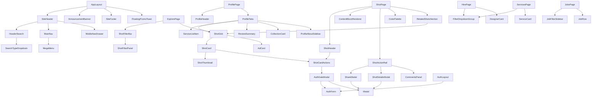

# 03 — Component Inventory

Components are named for the **clone** (React/TypeScript conventions). The "Original evidence" column cites the class names or custom elements observed on Dribbble, so implementers can check behaviour against the screenshots. All implementations must be written independently; no source code was copied.

**Total reusable components identified: 58** (layout 8, navigation and search 7, primitives 14, content cards 9, shot-detail 8, profile 5, forms/filters 5, feedback/overlay 2).

---

## 1. Layout shell

| # | Component | Responsibility | Original evidence | Used on |
|---|---|---|---|---|
| 1 | `AppLayout` | Header + optional banner + main + footer + floating promos | `#wrap`, `.site-nav`, `.site-footer` | All standard pages |
| 2 | `AuthLayout` | Split screen: form column + credited artwork panel; no nav/footer | `.auth-screen`, artwork credit `@glebich` | `/session/new`, `/signup`, `/password_resets/new` |
| 3 | `MinimalLayout` | Logo + single action (Cancel / Contact us) | 404, `/instantmatch` | 404, brief wizard |
| 4 | `WizardLayout` | Step counter ("1/4"), art panel, Back/Cancel/Continue | `/jobs/new`, `/instantmatch` | Job post, brief wizard |
| 5 | `SiteFooter` | Category marquee, link columns, socials, legal row | `[data-site-footer]`, `.site-footer-marquee` | All standard pages |
| 6 | `AnnouncementBanner` | Dismissible promo strip with CTA | `.announcements`, `announcements__close-btn` | All standard pages (logged out) |
| 7 | `FloatingPromoToast` | Bottom-centre "Start a Project Brief" card with ✕ | event `BriefFloatingPromoDisplayed` | Feed, search, hire pages |
| 8 | `Container` / `PageGutter` | Responsive side padding 20/32/72px | `.container-fluid`, `.shots-grid` padding | Everywhere |

## 2. Navigation and search

| # | Component | Responsibility | Original evidence |
|---|---|---|---|
| 9 | `SiteHeader` | Logo, search (except homepage), main nav, auth actions; logged-in variant UNVERIFIED | `.site-nav`, `[data-site-nav]` |
| 10 | `MainNav` + `MegaMenu` | 4 hover menus; each item = icon + title + description; secondary link column; "Learn more" footer link | `.site-nav-main`, `.site-nav-sub`, `.site-nav-sub--wide-format` |
| 11 | `MobileNavDrawer` | Burger toggle; accordion sections; dim page | `[data-site-nav-burger]`, `aria-label="Toggle mobile menu"` |
| 12 | `HeaderSearch` | Rounded input + search-type dropdown + pink submit; autocomplete panel | `.site-nav-search`, `aa-Form`, `drb-dropdown[data-site-nav-search-type]` |
| 13 | `SearchTypeDropdown` | Shots / Designers / Services; changes the submit target | `<drb-dropdown>` / `<drb-dropdown-option>` |
| 14 | `HeroSearch` | Homepage segmented tabs (Shots/Designers/Services) + big input | homepage hero search |
| 15 | `Breadcrumbs` | "Home / Designers and Developers" | `/hire` |

## 3. Primitives

| # | Component | Variants / notes | Original evidence |
|---|---|---|---|
| 16 | `Button` | `primary-dark` (#0D0C22 pill), `brand` (pink), `secondary-alt` (white), `tertiary` (outline #E7E7E9), `text`; sizes small(32)/medium(40)/large(48); `fullWidth` | `.btn2`, `.btn2--tertiary`, `.btn2--secondary-alt`, `.btn2--medium`, `.btn2--full-width` |
| 17 | `IconButton` (circle) | 40px circle, optional count indicator badge | `.btn2--circle`, `.with-indicator`, `.count-indicator` |
| 18 | `Avatar` | Sizes 24/48/60/80; optional online dot; team avatar stack | `<drb-avatar>` |
| 19 | `Badge` | `PRO`, `PRO+`, `SELECT`, `NEW`, `Promoted` | `aria-label="Pro user"` |
| 20 | `Chip` / `TagChip` | Outline pill links (popular searches, tags, skills) | Popular row, details-modal tags |
| 21 | `PillTabs` / `SegmentedControl` | Active = `#F8F7F4` bg, 600 weight | Category bar, profile tabs, jobs tabs, hero toggle |
| 22 | `Dropdown` / `Select` | Button + floating options; keyboard accessible | `<drb-dropdown>`, `.btn-dropdown-neue` |
| 23 | `Tooltip` | Hover tooltip | `<drb-tooltip>`, Tippy |
| 24 | `Modal` | Centred white card, ✕, scrim, focus trap | Sign-up, Share, Details modals |
| 25 | `Toast` | Short confirmation ("Email copied!") | Profile email copy |
| 26 | `Input` / `TextField` | Large rounded input, error message slot, `aria-invalid` | `.input2 .input2--large`, `.pristine-error` |
| 27 | `Checkbox` / `Radio` / `CheckboxGroup` | Filter lists | `.checkbox-radio-group` |
| 28 | `RichTextEditor` | Body/H1/H2, bold, italic, bullets, ordered lists | `/jobs/new` (icons bold, italic, bullet-list, ordered-list) |
| 29 | `Stat` | Icon + abbreviated number (`7.7k`) | `.shot-statistic` |

## 4. Content cards and grids

| # | Component | Responsibility | Original evidence |
|---|---|---|---|
| 30 | `ShotGrid` | Auto-fill grid, 36px gap, infinite-scroll sentinel, ad/boost slotting | `ol.shots-grid` |
| 31 | `ShotCard` | Thumbnail (4:3) + hover overlay + footer (author, badge, likes, views) | `li.shot-thumbnail`, `.shot2-item` |
| 32 | `ShotThumbnail` | Responsive image + dominant-colour placeholder + video teaser on hover + motion icon | `<drb-thumbnail>`, `hover-media-src`, `.is-motion` |
| 33 | `ShotCardActions` | Get in touch / Save / Like circles; auth-gate on click | `.shot-actions-container`, `<drb-shot-like>` |
| 34 | `AdCard` | Sponsored item with "Hide ads • Advertise" | `.carbon-item` |
| 35 | `DesignerCard` (hire) | Avatar, badges, rating, projects, price, location, response time, services, 4 thumbnails, skills, Save + Get in touch | `.resume-user-card` |
| 36 | `ServiceCard` | Cover, title, seller, price, delivery, Quick Hire | `article.service-result` |
| 37 | `JobRow` | Logo, company, title, location, remote, View/Apply, posted-ago | `/jobs` list |
| 38 | `CollectionCard` | Mosaic thumbnail, title, "N Shots • M Designers" | `.shots-group-item` |

## 5. Shot detail

| # | Component | Responsibility | Original evidence |
|---|---|---|---|
| 39 | `ShotHeader` (sticky) | Title, author line ("X for Team"), availability, Follow, Like, Save, Get in touch | `.user-sticky-header` |
| 40 | `ContentBlockRenderer` | Renders ordered blocks: image, video (autoplay/loop), text, full-width flag | `contentBlocks.results[]`, `contentBlocksApp` Vue app |
| 41 | `ShotActionRail` | Floating right rail: Comments (count), Share, Details; mobile → inline row | `.shot-actions-toolbar`, `.shot-actions-mobile` |
| 42 | `ShareModal` | Preview, Pinterest, X, copy link | share-action |
| 43 | `ShotDetailsModal` | Posted date, Views/Saves/Likes/Comments, Tags | "Detail actions" |
| 44 | `CommentsPanel` | Side panel list + composer (UNVERIFIED, robots-disallowed) | `.comments-action` |
| 45 | `ColorPalette` | Hex swatches + "Download color palette" | palette list on the shot page |
| 46 | `RelatedShotsSection` | "More by X" (4) and "You might also like" (12) | `/shots/:id/more_by`, `/shots/:id/similar` |

## 6. Profile

| # | Component | Responsibility | Original evidence |
|---|---|---|---|
| 47 | `ProfileHeader` | Avatar, name, Select badge, headline, stats, actions, promo panel | `/halolab` header |
| 48 | `ProfileTabs` | Work/Services/Reviews/Collections/Liked/Members/About + sort dropdown | profile tab bar |
| 49 | `ProfileAboutSidebar` | Location, Pro, member since, contact, social | About tab |
| 50 | `ReviewSummary` + `ReviewItem` | Aggregate rating + review list | `/reviews` |
| 51 | `ServiceListItem` | Profile service row | `/services` tab |

## 7. Forms and filters

| # | Component | Responsibility | Original evidence |
|---|---|---|---|
| 52 | `ShotFilterBar` | Sort dropdown + category pills (scrollable) + Filters toggle | `.filter-subnav` |
| 53 | `ShotFilterPanel` | Tags / Color (hex + swatch picker) / Timeframe | `.shot-filters-form` |
| 54 | `FilterDropdownGroup` | Dropdown pills each with Apply; Clear Filters (hire, services, briefs) | `/hire` filters |
| 55 | `JobFilterSidebar` | Specialties, location, remote, type | `.job-filters` |
| 56 | `AuthForm` | Google button, divider, single field, submit, disclaimer, switch link, invisible CAPTCHA | `[data-auth-form]`, `<drb-recaptcha-v2>` |

## 8. Feedback and overlays

| # | Component | Responsibility | Original evidence |
|---|---|---|---|
| 57 | `AuthGateModal` | Sign-up modal, parameterised by intent and return URL | `/signups/new?intent=…&return_to=…` |
| 58 | `EmptyState` | Illustration + title + body | Search no-results |

---

## 9. Shared-usage matrix

| Component | Home | Explore | Search | Shot | Profile | Hire | Services | Jobs | Auth |
|---|---|---|---|---|---|---|---|---|---|
| SiteHeader | ✔ (no search) | ✔ | ✔ | ✔ | ✔ | ✔ | ✔ | ✔ | — |
| AnnouncementBanner | ✔ | ✔ | ✔ | ✔ | ✔ | ✔ | ✔ | ✔ | — |
| SiteFooter | ✔ | ✔ | ✔ | ✔ | ✔ | ✔ | ✔ | ✔ | — |
| ShotGrid / ShotCard | ✔ | ✔ | ✔ | ✔ (related) | ✔ | — | — | — | — |
| ShotFilterBar | ✔ (sort only) | ✔ | ✔ | — | — | — | — | — | — |
| PillTabs | ✔ | ✔ | ✔ | — | ✔ | — | — | ✔ | — |
| FilterDropdownGroup | — | — | — | — | — | ✔ | ✔ | — | — |
| AuthGateModal | ✔ | ✔ | ✔ | ✔ | ✔ | ✔ | ✔ | — | — |
| Modal | ✔ | ✔ | ✔ | ✔ | ✔ | ✔ | ✔ | — | — |
| Avatar / Badge | ✔ | ✔ | ✔ | ✔ | ✔ | ✔ | ✔ | ✔ | — |
| AuthForm | — | — | — | — | — | — | — | — | ✔ (+ modal) |

## 10. Component relationships

