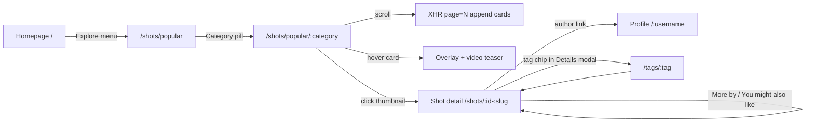
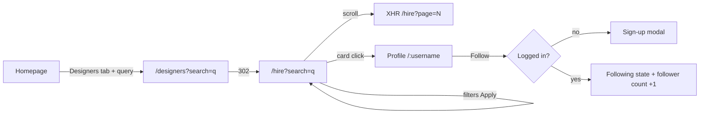
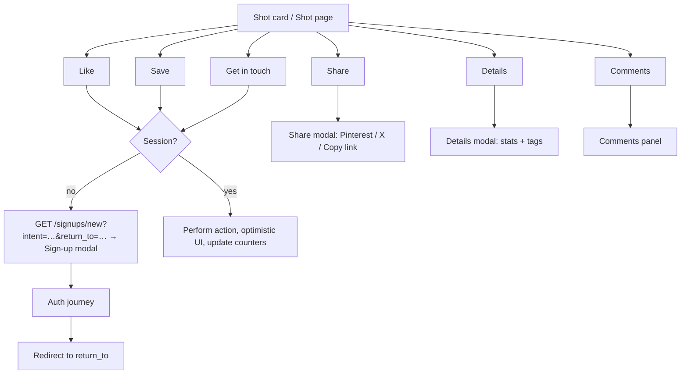
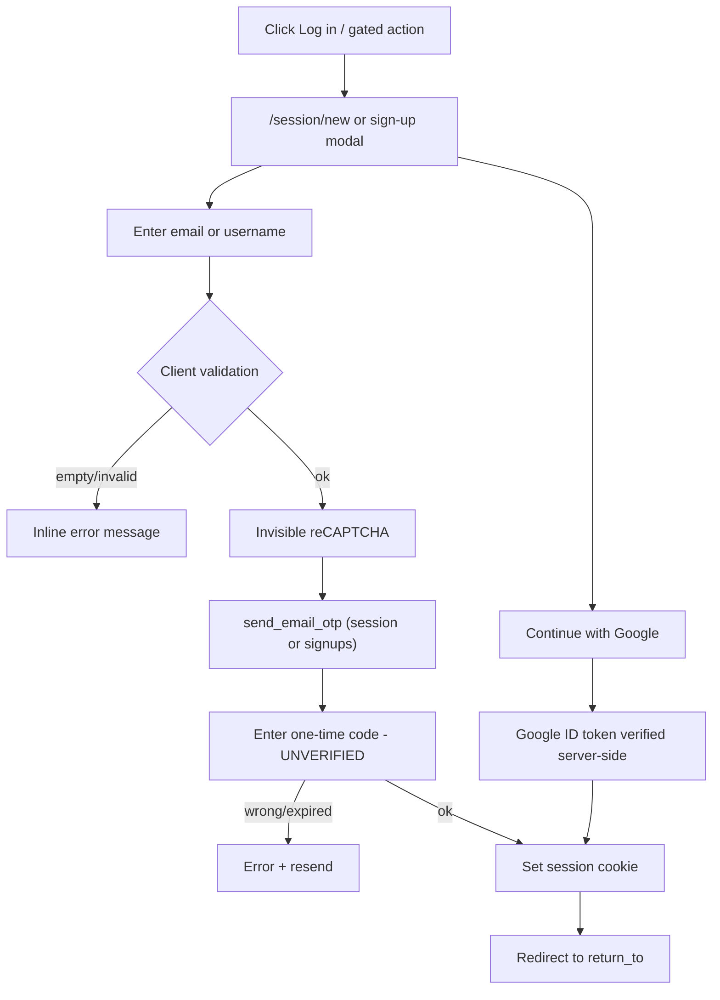
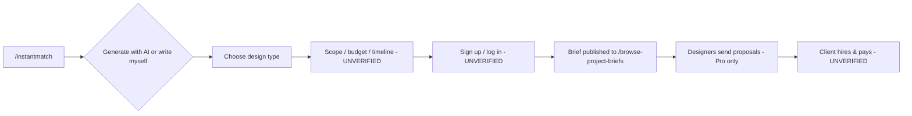
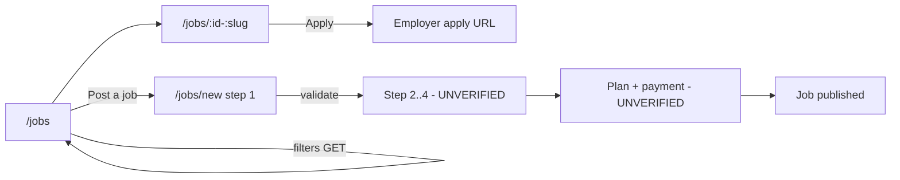

# 04 — User Journeys

Each journey was walked as an **anonymous visitor**. Steps after authentication are marked **[UNVERIFIED]** and describe expected behaviour for the clone, inferred from UI affordances and the `shotData` flags (`isLiked`, `isSaved`, `canCurrentUserComment`, …).

---

## Journey 1 — Discover a design

**Path:** Homepage → Explore → Category → Shot detail → Designer profile

| Step | User action | UI response [OBSERVED] | Navigation | Data required | Auth |
|---|---|---|---|---|---|
| 1 | Lands on `/` | WAF challenge (202) then the page; hero, search block, popular feed | — | Popular shots page 1, promo config | No |
| 2 | Hovers "Explore" → clicks "Popular" (or a category) | Mega-menu opens on hover | `/shots/popular[/:category]` | Shot list (24) + boosts | No |
| 3 | Clicks a category pill, e.g. "Branding" | Full page navigation; pill becomes active | `/shots/popular/branding` | Category-filtered list | No |
| 4 | Scrolls | Infinite scroll appends 24 cards; views logged in batches | XHR `GET ?page=N` | Next page fragment | No |
| 5 | Hovers a card | Overlay with title + 3 actions; video teaser if animated | — | Teaser URLs (in card markup) | No |
| 6 | Clicks the thumbnail | Shot detail page | `/shots/:id-:slug` | shotData, content blocks, palette, related | No |
| 7 | Clicks the author name or avatar | Profile Work tab | `/:username` | Profile header, shots | No |

**Failure scenarios:** unknown category slug (UNVERIFIED, probably 404). Deleted shot → 404 page. Infinite-scroll page beyond range → empty fragment (the reviews list returned 404 with empty `results`). WAF challenge failure → the page never loads.

---

## Journey 2 — Discover a designer

**Path:** Homepage → Search (Designers) → Results → Profile → Follow

| Step | User action | UI response | Navigation | Data | Auth |
|---|---|---|---|---|---|
| 1 | On the homepage selects the "Designers" tab, or the header search type "Designers" | Placeholder updates; Algolia-style autocomplete panel (not exercised) | — | — | No |
| 2 | Submits "logo" | Redirect | `/designers?search=logo` → **`/hire?search=logo`** [OBSERVED] | Designer search results | No |
| 3 | Applies filters (Categories, Budget, Location, Rating, More) | Each dropdown has Apply; results reload | `/hire?...` (exact param names for budget UNVERIFIED; checkbox names `categories`, `minimum_rating`, `available_for_work`, `pro_only`, `responds_quickly`, `agencies_only` observed) | Filtered designers | No |
| 4 | Scrolls | Infinite scroll `/hire?page=2&perPage=10&additional_count=4` | XHR | Designer cards | No |
| 5 | Clicks a designer card | Profile | `/:username` | Profile | No |
| 6 | Clicks **Follow** | Logged out: sign-up modal [INFERRED from `data-signup-trigger` pattern]. Logged in: button toggles to "Following" (both labels exist in the DOM: "Follow Following Blocked") [OBSERVED markup, behaviour UNVERIFIED] | — | follow relation | **Yes** |

**Failure scenarios:** no matching designers → empty state (UNVERIFIED for `/hire`). The user blocked the viewer → "Blocked" state (markup present). Following yourself → hidden button [INFERRED].

---

## Journey 3 — Interact with a design

**Path:** Shot card / Shot page → Like → Save → Comment → Share

| Step | Action | Logged-out response [OBSERVED] | Logged-in expected [UNVERIFIED] | Data | Auth |
|---|---|---|---|---|---|
| 1 | Like (♡) on card or shot header | `GET /signups/new?intent=like-shot&return_to=<current url>` → **sign-up modal**: "To like this shot, please sign in or create an account." | Optimistic toggle; likes count ±1 | like(user, shot) | Yes |
| 2 | Save (🔖) | Sign-up modal (`data-context="bucket-shot"`) | Collection picker popover: choose or create a collection ("bucket") | collection_items | Yes |
| 3 | Comments (💬, badge = count) | Opens the comments panel; content not inspected (robots disallows `/shots/*/comments`) | List + composer; `canCurrentUserComment` flag | comments | Read: UNVERIFIED; write: yes |
| 4 | Share | **Share modal**: Pinterest, X, copy link (`?utm_source=Shot&utm_campaign=<username>&utm_content=<title>` built from `shareUtms`) | Same | shot URL, image | No |
| 5 | Details (ⓘ) | **Details modal**: posted date, Views, Saves, Likes, Comments, Tags | Same | counters, tags | No |
| 6 | Get in touch | Sign-up modal (`data-context="message-user"`) | Message composer to the designer | messages | Yes |

**Failure scenarios:** rate-limit on likes (UNVERIFIED). Comments disabled (`commentsDisabled=true` → hide composer). Shot owned by the current user (`isOwnedByCurrentUser` → show edit actions instead).

---

## Journey 4 — Authentication (passwordless email OTP + Google)

| Step | Action | UI response | Data | Notes |
|---|---|---|---|---|
| 1 | Click "Log in" | `/session/new` split-screen page | — | [OBSERVED] |
| 2 | Submit empty | Client validation: "Please enter an email address or username"; pink outline; **no network request** | — | [OBSERVED] |
| 3 | Enter email or username → Continue | Invisible reCAPTCHA v2 executes; the form posts to `/session/send_email_otp` (the form declares `method=get`, but JS intercepts it; the actual verb is UNVERIFIED) | `login` | Not submitted (would send a real email) |
| 4 | Enter OTP code | Code entry screen (screen transitions via `data-screen-transition`) [INFERRED] | code | UNVERIFIED |
| 5 | Success | Session cookie `_dribbble_session` set; redirect to `return_to` or feed | — | [INFERRED] |
| Alt | "Continue with Google" | Google Identity Services popup / One Tap | Google ID token | Client ID visible in the GIS request; not executed |
| Alt | Sign up | `/signup` → email → `/signups/send_email_otp` → OTP → onboarding (UNVERIFIED) | `email` | |
| Alt | Forgot password | `/password_resets/new` email form (legacy password accounts) | `email` | Not submitted |

**Failure scenarios:** invalid email format ("Please enter a valid email address"), unknown account (server message, UNVERIFIED), CAPTCHA failure, OTP expired or wrong (UNVERIFIED), rate limiting (UNVERIFIED).

---

## Journey 5 — Client hires via project brief

| Step | Action | Response | Auth |
|---|---|---|---|
| 1 | Nav "Hire Talent → Start Project Brief" or the homepage CTA | `/instantmatch` landing (Generate Brief / I'll write it myself) [OBSERVED] | No |
| 2 | Either option | Step "What kind of design work do you need?" with 12 types + "Need something else?" [OBSERVED] | No |
| 3+ | Further steps (scope, budget, timeline, description), AI generation, account creation, publish | UNVERIFIED | Likely yes |
| N | Receive proposals, compare, hire, pay | UNVERIFIED (Stripe present) | Yes |

---

## Journey 6 — Designer finds work

| Step | Action | Response | Auth |
|---|---|---|---|
| 1 | Nav "Get Hired → Browse Project Briefs" | `/browse-project-briefs`: stats + filters + "Unlock Project Briefs with Pro" overlay [OBSERVED] | View: public teaser; details: **Pro** |
| 2 | Filters: Category, Project scope (All/Design only/Dev required), Budget, Timeline, Client type | Filtered list (behind the Pro gate) | Pro |
| 3 | Upgrade | `/pro` plans: Lite $4 · Standard $8 · Plus $99 per month billed yearly (monthly toggle available) [OBSERVED] | Yes + payment |
| 4 | Send proposal | UNVERIFIED | Pro |

## Journey 7 — Job seeker applies to a full-time job

| Step | Action | Response | Auth |
|---|---|---|---|
| 1 | `/jobs` | List + sidebar filters [OBSERVED] | No |
| 2 | Tick specialties, location, remote, type | GET form `/jobs?specialty_ids[]=…&location=…&anywhere=true&fulltime=…&freelance_or_contract=…` [OBSERVED form] | No |
| 3 | View job | `/jobs/:id-:slug` (link carries `?source=index`) [OBSERVED] | No |
| 4 | "Apply for this position" | Goes to the employer's apply URL (the job-post form asks "Where can people apply?", a URL) [INFERRED]; `/jobs/*/apply_now` is robots-disallowed | No |

## Journey 8 — Employer posts a job

| Step | Action | Response | Auth |
|---|---|---|---|
| 1 | "Post a job" | `/jobs/new` step 1/4 form [OBSERVED] | Form is public |
| 2 | Continue with empty fields | Required fields flagged (Job title, Description, Workplace type, Designer type, Employment type, Apply URL, Company website) [OBSERVED labels with *] | — |
| 3–4 | Steps 2–4 (likely plan selection + checkout) | UNVERIFIED; `/hiring` shows Free / $150 / $300 per month tiers | Likely yes + Stripe |

---

## Journey 9 — Buy a service (client)

| Step | Action | Response [OBSERVED] | Auth |
|---|---|---|---|
| 1 | `/services` → filter → card | Service detail | No |
| 2 | "Hire Now" or "Request Service" | Logged out: `GET /signups/new?intent=request-service&return_to=…` (sign-up modal) | **Yes** |
| 3 | Checkout / requirements / delivery | UNVERIFIED | Yes |
