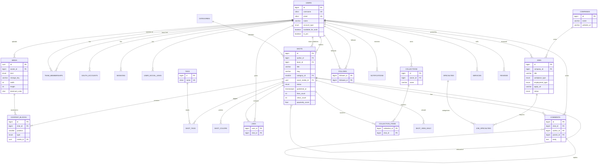

# 06 — Proposed Database Design

> **Superseded in part (2026-11-12, decision [A-09](../DECISION_LOG.md)).** The confirmed database is **Turso (libSQL/SQLite) with Drizzle ORM**, not PostgreSQL/Prisma. The **entities, relationships and constraints** below remain the functional reference. PostgreSQL-specific features (`citext`, `tsvector`, native enums, GIN/trigram indexes, `inet`) will be re-expressed for SQLite in phase P03 (`docs/03-database/`).

> **⚠ This is a PROPOSED, independent schema for the clone.** It is **not** Dribbble's actual database, which was not accessed. Entities and fields are derived from observable UI, URL patterns and the embedded `shotData` JSON (see [05-api-inventory.md §7](05-api-inventory.md)). Each entity lists its evidence source.

Target: **PostgreSQL 16 + Prisma ORM**. IDs are `BIGINT` identity (Dribbble's public URLs use numeric IDs plus a slug, e.g. `/shots/27883591-Brandform-Website-Design`). Media IDs are UUIDs.

---

## 1. Entity inventory

| Entity | Evidence | MVP? |
|---|---|---|
| **User** (individual or team account) | `shotUser {id, username, name, isTeam, forHire, avatarUrl}`; root-level `/:username` | ✔ |
| **Profile** details | About tab: bio, location, member since, expertise, languages, skills, website, email, socials | ✔ |
| **TeamMembership** | `/:username/members`, "Lalit **for** theosm™", "See all 4 members" | ✔ |
| **Shot** | `shotData` | ✔ |
| **ContentBlock** | `contentBlocks.results[] {contentType, position, content{alt, isFullWidth, shouldVideoLoop/Autoplay}}` | ✔ |
| **Media** (upload) | `media[] {id uuid, type, width, height, fileExtension}`, CDN `userupload/:id/file/...` | ✔ |
| **ShotColor** (palette) | 7 hex swatches per shot; colour search `?color=hex` | ✔ |
| **Category** | 8 fixed categories in the URL `/shots/popular/:category` | ✔ |
| **Tag** / **ShotTag** | `tags[]`, `/tags/:tag` | ✔ |
| **Like** | `likesCount`, `isLiked` | ✔ |
| **Comment** | `commentsCount`, `canCurrentUserComment`, `commentsDisabled` | ✔ |
| **Collection** ("bucket") / **CollectionItem** | `/:username/collections/:id-:slug`, `savesCount`, `isSaved` | ✔ |
| **Follow** | followers/following counts, Follow button | ✔ |
| **Block** | "Blocked" state in the follow button markup | Phase 2 |
| **ShotView** (aggregate) | `/shots/log_views`, `viewsCount` | ✔ (aggregated) |
| **Rebound** | `reboundPath`, `shotHasRebounds` (shot responding to a shot) | Phase 2 |
| **Playoff** | `/shots?list=playoffs`, `playoff_id` | Phase 3 |
| **Specialty** (job/designer) | 9 fixed `specialty_ids` | ✔ (jobs) |
| **Job** | `/jobs/:id-:slug`, job-post form fields | ✔ |
| **Company** | Job company card (name, logo, website) | ✔ |
| **Service** | `/services/:id-:slug`: price, duration, revisions, concepts, Quick Hire | Phase 3 |
| **Review** | Rating aggregate + review list | Phase 3 |
| **ProjectBrief** / **Proposal** | `/browse-project-briefs` filters (category, scope, budget, timeline, client type) | Phase 4 |
| **MessageThread** / **Message** | "Get in touch", robots `/messages` | Phase 3 |
| **Notification** | Not observed (auth-gated); standard for social actions | Phase 2 |
| **Subscription** (Pro) | `/pro` plans Lite / Standard / Plus | Phase 4 |
| **OtpCode**, **Session**, **OAuthAccount** | Email OTP + Google login | ✔ |
| **Story** (blog post) | `/stories/:y/:m/:d/:slug` | Optional (CMS) |

## 2. Proposed tables (fields and types)

Conventions: every table has `created_at timestamptz NOT NULL DEFAULT now()` and `updated_at timestamptz` (omitted below for brevity). `→` marks a foreign key.

### 2.1 Identity

**users**
| Column | Type | Constraints |
|---|---|---|
| id | bigint | PK, identity |
| username | citext | UNIQUE, NOT NULL, `^[A-Za-z0-9_-]{2,30}$`, not in the reserved-route list |
| email | citext | UNIQUE, NOT NULL |
| name | varchar(80) | NOT NULL |
| account_type | enum(`individual`,`team`) | NOT NULL default `individual` |
| avatar_media_id | uuid | → media.id, nullable |
| headline | varchar(160) | nullable (profile H2 / tagline) |
| bio | text | nullable |
| location | varchar(120) | nullable |
| website_url | varchar(255) | nullable |
| public_email | citext | nullable |
| available_for_work | boolean | default false |
| is_pro | boolean | default false (denormalised from subscriptions) |
| pro_tier | enum(`lite`,`standard`,`plus`) | nullable |
| is_select | boolean | default false ("Dribbble Select") |
| followers_count / following_count / likes_received_count / shots_count | integer | default 0 (counter caches) |
| email_verified_at | timestamptz | nullable |
| deleted_at | timestamptz | soft delete |

**user_social_links** — id PK · user_id → users · platform enum(`twitter`,`facebook`,`instagram`,`github`,`linkedin`,`website`,`other`) · url · UNIQUE(user_id, platform)

**user_skills** — user_id → users · skill varchar(60) · PK(user_id, skill)

**user_languages** — user_id → users · language varchar(40) · PK(user_id, language)

**team_memberships** — id PK · team_id → users (account_type=team) · member_id → users · role enum(`owner`,`admin`,`member`) · UNIQUE(team_id, member_id)

**oauth_accounts** — id PK · user_id → users · provider enum(`google`) · provider_account_id varchar · UNIQUE(provider, provider_account_id)

**otp_codes** — id PK · email citext · purpose enum(`signin`,`signup`) · code_hash varchar · expires_at timestamptz · attempts smallint default 0 · consumed_at timestamptz · INDEX(email, purpose, expires_at)

**sessions** — id uuid PK · user_id → users · token_hash UNIQUE · user_agent · ip inet · expires_at · revoked_at

### 2.2 Content

**media**
| Column | Type | Notes |
|---|---|---|
| id | uuid | PK |
| owner_id | bigint | → users |
| kind | enum(`image`,`video`,`gif`) | |
| storage_key | varchar(512) | object-storage key (original) |
| mime_type | varchar(80) | |
| width, height | integer | |
| bytes | bigint | |
| still_key | varchar(512) | poster frame for video/GIF |
| teaser_small_key, teaser_large_key | varchar(512) | hover teasers |
| dominant_color | char(7) | placeholder `#RRGGBB` |
| status | enum(`pending`,`processing`,`ready`,`failed`) | |

**categories** — id smallint PK · slug UNIQUE (`product-design`, `web-design`, `animation`, `branding`, `illustration`, `mobile`, `typography`, `print`) · name · position

**shots**
| Column | Type | Constraints |
|---|---|---|
| id | bigint | PK |
| author_id | bigint | → users, NOT NULL |
| team_id | bigint | → users, nullable ("for Team") |
| title | varchar(120) | NOT NULL |
| slug | varchar(140) | NOT NULL (URL = `/shots/{id}-{slug}`) |
| description | text | nullable |
| category_id | smallint | → categories, nullable |
| cover_media_id | uuid | → media |
| format | enum(`image`,`video`,`gif`,`multi`) | |
| width, height | integer | |
| status | enum(`draft`,`published`,`archived`) | |
| published_at | timestamptz | |
| comments_disabled | boolean | default false |
| rebound_of_id | bigint | → shots, nullable |
| likes_count, saves_count, comments_count, views_count, rebounds_count | integer | counter caches |
| popularity_score | double precision | recomputed by a job (time-decayed) |
| search_vector | tsvector | generated (title, description, tags) |
| deleted_at | timestamptz | |

**content_blocks** — id PK · shot_id → shots ON DELETE CASCADE · position smallint · type enum(`image`,`video`,`text`,`gallery`) · media_id → media nullable · text_body text nullable · alt varchar(255) · is_full_width bool · video_loop bool · video_autoplay bool · UNIQUE(shot_id, position)

**shot_colors** — shot_id → shots · position smallint · hex char(7) · lab_l, lab_a, lab_b real (for colour-distance search) · PK(shot_id, position)

**tags** — id PK · name citext UNIQUE · slug UNIQUE · shots_count integer

**shot_tags** — shot_id → shots · tag_id → tags · PK(shot_id, tag_id)

### 2.3 Social

**likes** — user_id → users · shot_id → shots · created_at · **PK(user_id, shot_id)**

**comments** — id PK · shot_id → shots · author_id → users · parent_id → comments nullable (one level of replies, assumed) · body text (≤ 2000) · likes_count · deleted_at

**comment_likes** — user_id · comment_id · PK(user_id, comment_id)

**follows** — follower_id → users · followee_id → users · created_at · **PK(follower_id, followee_id)** · CHECK(follower_id <> followee_id)

**blocks** — blocker_id · blocked_id · PK(blocker_id, blocked_id)

**collections** — id PK · owner_id → users · name varchar(80) · slug · description · is_private bool default false · shots_count int · UNIQUE(owner_id, slug)

**collection_items** — collection_id → collections · shot_id → shots · added_by_id → users · created_at · PK(collection_id, shot_id)

**shot_view_daily** — shot_id → shots · day date · views integer · PK(shot_id, day)  *(aggregated from `POST /views` batches; raw events go to a log or queue, not a row per view)*

**notifications** — id PK · recipient_id → users · actor_id → users · type enum(`like`,`comment`,`follow`,`save`,`mention`,`message`) · subject_type varchar · subject_id bigint · read_at · INDEX(recipient_id, read_at, created_at DESC)

### 2.4 Hiring

**specialties** — id smallint PK · name (Animation, Brand / Graphic Design, Illustration, Leadership, Mobile Design, UI / Visual Design, Product Design, UX Design / Research, Web Design)

**companies** — id PK · name · website_url · logo_media_id → media · owner_id → users nullable

**jobs**
| Column | Type | Notes |
|---|---|---|
| id | bigint PK | URL `/jobs/{id}-{slug}` |
| company_id | → companies | |
| posted_by_id | → users | |
| title | varchar(120) | required |
| slug | varchar(140) | |
| description_html | text | required (sanitised rich text) |
| location | varchar(120) | blank ⇒ "Remote" |
| workplace_type | enum(`remote`,`onsite`,`hybrid`) | required |
| employment_type | enum(`full_time`,`freelance_contract`) | required |
| apply_url | varchar(512) | required |
| plan | enum(`free`,`featured`,`pinned`) | ties to the $150 / $300 tiers |
| status | enum(`draft`,`pending_payment`,`active`,`expired`,`closed`) | |
| published_at, expires_at | timestamptz | |

**job_specialties** — job_id · specialty_id · PK(job_id, specialty_id)

**services** *(Phase 3)* — id PK · seller_id → users · title · slug · description_html · price_cents int · price_is_from bool · currency char(3) · duration_days int · concepts smallint · revisions smallint · quick_hire bool · category_id → categories · status

**service_tags** — service_id · tag_id · PK

**reviews** *(Phase 3)* — id PK · subject_user_id → users · author_id → users · service_order_id nullable · rating smallint CHECK 1–5 · body text · source enum(`dribbble`,`external`) · UNIQUE(author_id, service_order_id)

**project_briefs** *(Phase 4)* — id PK · client_id → users · design_type varchar · scope enum(`design_only`,`dev_required`) · budget_min_cents · budget_max_cents · timeline enum(`days`,`weeks`,`month_plus`,`none`) · description · status

**proposals** *(Phase 4)* — id PK · brief_id → project_briefs nullable · designer_id → users · client_id → users · amount_cents · message · status enum(`sent`,`viewed`,`accepted`,`declined`) · UNIQUE(brief_id, designer_id)

**message_threads / messages** *(Phase 3)* — threads(id, created_at) · thread_participants(thread_id, user_id, last_read_at, PK) · messages(id, thread_id, sender_id, body, created_at)

**subscriptions** *(Phase 4)* — id PK · user_id → users · tier enum · interval enum(`month`,`year`) · status · provider_customer_id · provider_subscription_id UNIQUE · current_period_end

## 3. Key relationships

- User 1—N Shot (author); Team(User) 1—N Shot (team_id); Team N—M User via team_memberships
- Shot 1—N ContentBlock (ordered); ContentBlock N—1 Media
- Shot N—M Tag; Shot N—1 Category; Shot 1—N ShotColor
- User N—M Shot via likes; User 1—N Comment; Shot 1—N Comment; Comment 1—N Comment (replies)
- User 1—N Collection; Collection N—M Shot via collection_items
- User N—M User via follows (self-referencing)
- Company 1—N Job; Job N—M Specialty
- User (seller) 1—N Service; User 1—N Review (as subject)

## 4. Indexes

| Table | Index | Purpose |
|---|---|---|
| shots | `(status, published_at DESC)` | Recent feed |
| shots | `(status, popularity_score DESC)` | Popular feed |
| shots | `(category_id, status, popularity_score DESC)` and `(category_id, status, published_at DESC)` | Category feeds |
| shots | `(author_id, published_at DESC)`, `(team_id, published_at DESC)` | Profile Work tab |
| shots | GIN `(search_vector)` | Full-text search (MVP) |
| shot_tags | `(tag_id, shot_id)` | Tag pages |
| shot_colors | B-tree on `(lab_l, lab_a, lab_b)` or a cube/earthdistance index | Colour search |
| likes | `(shot_id, created_at)` | "Fans" list, timeframe popularity |
| follows | `(followee_id)` | Followers list |
| comments | `(shot_id, created_at)` | Comment thread |
| collection_items | `(shot_id)` | Saves count / "in collections" |
| jobs | `(status, published_at DESC)`; GIN on `to_tsvector(title ‖ company)` | Job board + keyword |
| job_specialties | `(specialty_id, job_id)` | Specialty filter |
| notifications | `(recipient_id, read_at, created_at DESC)` | Inbox |
| users | GIN trigram on `(name, username)` | Designer search |

## 5. Unique constraints (summary)

`users.username`, `users.email`, `oauth_accounts(provider, provider_account_id)`, `likes(user_id, shot_id)`, `follows(follower_id, followee_id)`, `collection_items(collection_id, shot_id)`, `collections(owner_id, slug)`, `shot_tags(shot_id, tag_id)`, `tags.name`, `tags.slug`, `categories.slug`, `team_memberships(team_id, member_id)`, `content_blocks(shot_id, position)`, `proposals(brief_id, designer_id)`, `subscriptions.provider_subscription_id`.

## 6. ER diagram (MVP + Phase 2)

## 7. Design notes and sanity checks

- **Counter caches** (`likes_count`, …) are updated in the same transaction as the join-row insert or delete, and reconciled nightly. Dribbble shows abbreviated counts, so slight lag is acceptable.
- **Views** must not create a row per view. Batch `POST /api/views {shotIds:[]}`, dedupe per session or day in Redis, and flush to `shot_view_daily`.
- **Popularity** (`/shots/popular` with a `timeframe`): compute a time-decayed score from likes, saves and views (and a decay on `published_at`). For `timeframe=week|month|year|ever`, rank by likes within the window, using `likes(shot_id, created_at)`.
- **Teams are users** (`account_type='team'`), mirroring `shotUser.isTeam` and team profiles at `/:username` with a Members tab.
- **Root-level usernames** require a reserved-word list enforced at signup.
- All relationships were checked for cycles. The self-references (follows, comment replies, rebounds) are intentional and bounded.
