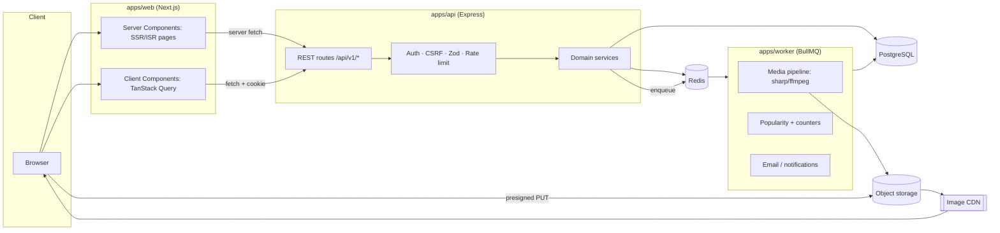

# 07 — Technology Recommendation

> **Superseded (2026-11-12, decisions [A-01…A-09](../DECISION_LOG.md)).** The confirmed stack is **Next.js full-stack (Route Handlers + Server Actions) + Turso/Drizzle + Cloudflare R2 + Tailwind + Vitest/RTL/Playwright**. The Express API, PostgreSQL/Prisma, Redis/BullMQ and Meilisearch recommendations below are kept as historical analysis only. The current evaluation is in [`docs/00-project-assessment/TECHNOLOGY_EVALUATION.md`](../00-project-assessment/TECHNOLOGY_EVALUATION.md).

The target site is a Rails monolith with server-rendered HTML, Vue islands and jQuery (see [00 §4](00-executive-summary.md)). The clone does **not** need to mirror that. Below is a pragmatic, modern, independent stack chosen for the observed requirements: SEO-heavy public pages, image-heavy infinite feeds, auth-gated social actions, and media uploads.

---

## 1. Recommended stack

| Layer | Choice | Why it fits the observed product |
|---|---|---|
| **Web framework (frontend)** | **Next.js 15 (App Router) + React 19 + TypeScript** | Most Dribbble pages are public and SEO-critical: shot pages, tags, `/search/:term`, `/hire/:specialty`, job directories, plus sitemaps. React Server Components give SSR/ISR HTML like the original, with client components only where interactivity is needed (likes, modals, infinite scroll). |
| **Styling** | **Tailwind CSS v4** with design tokens from [02 §1](02-frontend-analysis.md) as CSS variables | The UI is a small token set (one brand pink, one ink colour, pill radii, a 36px grid gap). Tailwind keeps the 58 components consistent without a heavy kit. |
| **Headless UI primitives** | **Radix UI** (Dialog, DropdownMenu, Popover, Tabs, Tooltip, Checkbox, RadioGroup) | Accessible modals, menus and tooltips: the sign-up modal, share and details modals, filter dropdowns and mega-menu. |
| **Icons** | **Lucide React** | Covers heart, bookmark, message-circle, share, info, search, filter, chevron, eye, camera/video, sparkles. |
| **Server state** | **TanStack Query v5** | Infinite queries for feeds (`useInfiniteQuery`), optimistic like/save/follow toggles with rollback, cache invalidation of counters. |
| **Forms** | **React Hook Form + Zod** (shared schemas) | Auth, job-post wizard, filters; the same Zod schemas validate on the API. |
| **Backend API** | **Node.js 22 + Express 5** (separate `api` app), REST + JSON | Simple, explicit REST. Keeping it separate from Next.js lets mobile or other clients reuse it and keeps auth and rate limiting in one place. *(Alternative: Next.js route handlers only, if team size is small. See §4.)* |
| **Validation** | **Zod** (shared `packages/schemas`) | One source of truth for request and response DTOs and the frontend forms. |
| **ORM / DB** | **PostgreSQL 16 + Prisma 6** | Relational social graph (likes, follows, collections), counters, full-text (`tsvector`) and trigram search in one engine. Prisma gives typed models and migrations. |
| **Cache / ephemeral** | **Redis 7** | View de-duplication, rate limiting, OTP throttling, feed page caching, session store (optional). |
| **Background jobs** | **BullMQ** (on Redis) | Image/video processing, popularity recomputation, counter reconciliation, emails, notification fan-out. |
| **Object storage** | **S3-compatible** (AWS S3 / Cloudflare R2 / MinIO locally) with presigned uploads | Shots are large images and videos. Browser → storage direct upload, then the API records the media row. |
| **Image optimisation** | **`sharp`** in a worker for derivatives + dominant colour + palette; **Next/Image** or an image CDN (Cloudflare Images / imgproxy) for on-the-fly `?w=&format=webp` | Mirrors the observed `resize=WxH&format=webp&vertical=center` 4:3 crops, `srcset`, and dominant-colour placeholders. |
| **Video** | **ffmpeg** worker: poster still + small/large MP4 teasers | Matches the observed `still-*.png` + `small-*.mp4` / `large-*.mp4` hover teasers. |
| **Colour palette** | `sharp` + k-means quantisation (e.g. `node-vibrant` or a custom implementation), stored as hex + CIELAB | Drives the palette UI and `?color=` search by colour distance. |
| **Search** | **MVP:** Postgres FTS (`tsvector`) + `pg_trgm`. **Scale:** Meilisearch or OpenSearch behind a `SearchService` interface | Shots, designers, services and tags. Avoids adding infra on day one while keeping a clean swap path. |
| **Auth** | **Email OTP + Google OAuth**, implemented directly (or via Auth.js / Lucia patterns); httpOnly Secure SameSite=Lax session cookie; CSRF token for cookie-auth mutations | Mirrors the observed passwordless OTP and Google sign-in. No password storage needed. |
| **Email** | Resend / Postmark / SES + React Email templates | OTP codes, notifications. |
| **Bot protection** | Cloudflare Turnstile on auth forms + Redis rate limits | Equivalent role to the observed reCAPTCHA + WAF, without the 202-challenge UX. |
| **Payments (later)** | Stripe (Checkout + Billing + Connect for marketplace payouts) | Pro subscriptions, job-post tiers, services. The original loads Stripe.js. |
| **Testing** | Vitest (unit), Supertest (API), Playwright (E2E + visual), MSW (frontend mocks), Testcontainers (Postgres in CI) | See [09 §4](09-implementation-roadmap.md). |
| **Tooling** | pnpm workspaces + Turborepo, ESLint, Prettier, Husky + lint-staged | Monorepo with shared schemas. |
| **Deploy** | Vercel (web) + Fly.io / Render / ECS (api, workers) + managed Postgres and Redis; or everything on Docker Compose for dev | |

## 2. Architecture



### 2.1 Monorepo layout

```
apps/
  web/        Next.js app (routes mirror the page inventory)
  api/        Express REST API
  worker/     BullMQ processors
packages/
  schemas/    Zod schemas + inferred TS types (shared)
  db/         Prisma schema, migrations, seed
  ui/         Design tokens + shared React components
  config/     eslint, tsconfig, tailwind preset
```

### 2.2 API design (clone, proposed; not Dribbble's)

| Method | Path | Notes |
|---|---|---|
| GET | `/api/v1/shots?sort=popular\|recent&category=&tag=&color=&timeframe=&cursor=&limit=24` | Cursor pagination; `exclude[]` for de-dup |
| GET | `/api/v1/shots/:id` | Shot + blocks + palette + author + viewer flags (`isLiked`, `isSaved`) |
| GET | `/api/v1/shots/:id/related?type=more_by\|similar` | |
| POST / DELETE | `/api/v1/shots/:id/like` | Idempotent |
| GET / POST | `/api/v1/shots/:id/comments` | |
| POST | `/api/v1/views` | `{shotIds: []}` batched, 204 |
| POST | `/api/v1/uploads/presign` → `POST /api/v1/shots` | Create a shot from uploaded media |
| GET | `/api/v1/users/:username` (+ `/shots`, `/collections`, `/likes`, `/members`, `/about`) | |
| POST / DELETE | `/api/v1/users/:username/follow` | |
| GET / POST | `/api/v1/collections`, `POST /api/v1/collections/:id/items` | |
| GET | `/api/v1/search?type=shots\|designers\|services&q=` | |
| GET | `/api/v1/tags/:slug` | |
| GET / POST | `/api/v1/jobs`, `GET /api/v1/jobs/:id` | |
| POST | `/api/v1/auth/otp/request`, `/api/v1/auth/otp/verify`, `/api/v1/auth/google`, `/api/v1/auth/logout`, `GET /api/v1/me` | |

Conventions: JSON only; `{ data, meta: { nextCursor } }` envelopes; RFC 7807 problem+json errors; **cursor pagination** (more robust than the original's page numbers and `served_shot_ids` workaround).

## 3. Engineering decisions

1. **Return JSON, not HTML partials.** The original returns `{"results": "<html>"}`. JSON keeps the frontend and API decoupled and testable.
2. **SSR for public pages, client interactivity in islands.** This matches the original's SEO strengths with simpler tooling.
3. **Cursor pagination plus an exclusion list** for popular feeds whose ranking shifts during a session.
4. **Counter caches plus async reconciliation.** Avoids `COUNT(*)` on hot paths.
5. **Batched view logging** (like `/shots/log_views`), deduplicated in Redis.
6. **Media pipeline off the request path.** Uploads go direct to storage; workers produce stills, teasers, palette and dominant colour.
7. **Search behind an interface.** Postgres first, then Meilisearch or OpenSearch when needed.
8. **Auth gate as a reusable pattern.** A `useRequireAuth(intent)` hook opens `AuthGateModal` with `returnTo`, mirroring `/signups/new?intent=&return_to=`.
9. **Reserved usernames.** Root-level `/:username` routes must not collide with app routes.
10. **No microservices.** One API, one worker and one web app are enough. Split only on proven load.

## 4. Libraries deliberately *not* added

- No GraphQL (REST fits the resource shapes).
- No Redux or Zustand at the start (TanStack Query + URL state + React context cover it).
- No component mega-kit (MUI, Chakra) on top of Radix + Tailwind.
- No separate search cluster at MVP.
- No jQuery, Shoelace or web-component layer (the original's legacy mix).

## 5. Security checklist

- httpOnly + Secure + SameSite=Lax session cookie. CSRF token (double-submit or synchroniser) on cookie-auth mutations.
- OTP: 6 digits, hashed at rest, 10-minute TTL, at most 5 attempts, per-email and per-IP send throttles. Turnstile on request.
- Rate limits (Redis sliding window): auth, likes, follows, comments, uploads, search.
- Upload validation: MIME sniffing, size caps (images ≤ 20MB, video ≤ 100MB suggested), dimension caps, EXIF stripping.
- Sanitise rich text (job descriptions, shot text blocks) with an allow-list (DOMPurify / sanitize-html).
- Authorisation checks in services (owner-only edits, private collections, auth-gated `/likes` tab as observed).
- Security headers: CSP, `X-Frame-Options: SAMEORIGIN`, `nosniff` (as the original sends), HSTS.
- Never expose user emails in public APIs unless the profile sets `public_email`.
