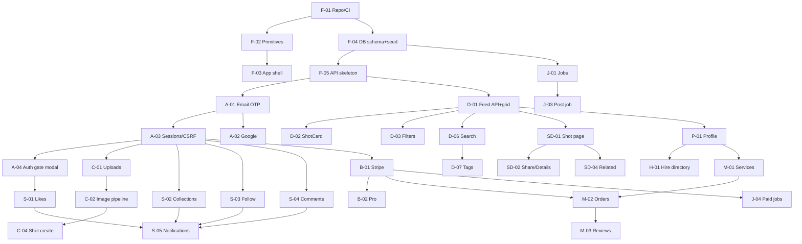

# 08 — Feature Breakdown

**Complexity scale:** S (≤ 2 dev-days) · M (3–5) · L (6–10) · XL (> 10). Estimates are for one experienced full-stack developer on the stack in [07](07-technology-recommendation.md), excluding design polish.
**Evidence:** O = observed working (logged out) · P = partially observed (UI only, logged-out gate) · U = unverified (auth or payment gated).
**Phase:** see [09-implementation-roadmap.md](09-implementation-roadmap.md).

---

## 1. Platform foundation

| ID | Feature | Evidence | Depends on | Complexity | Phase |
|---|---|---|---|---|---|
| F-01 | Monorepo, CI, lint, env, Docker Compose (PG, Redis, MinIO) | — | — | M | 0 |
| F-02 | Design tokens + base primitives (Button, IconButton, Avatar, Badge, Chip, Input, Modal, Dropdown, Tooltip, Tabs) | O | F-01 | M | 0 |
| F-03 | App shell: SiteHeader (desktop + mobile drawer), MegaMenu, AnnouncementBanner, SiteFooter | O | F-02 | M | 0 |
| F-04 | Prisma schema + migrations + realistic seed (users, teams, shots, tags, media placeholders) | — | F-01 | M | 0 |
| F-05 | API skeleton: Express, Zod validation, error format, logging, rate-limit middleware | — | F-01 | M | 0 |

## 2. Identity and access

| ID | Feature | Evidence | Depends on | Complexity | Phase |
|---|---|---|---|---|---|
| A-01 | Email OTP sign-up / sign-in (request, verify, resend, throttle) | P (forms + validation observed) | F-04, F-05, email provider | L | 1 |
| A-02 | Google OAuth sign-in | P (button and One Tap observed) | A-01 | M | 1 |
| A-03 | Sessions, CSRF, `/me`, logout | O (cookie + CSRF patterns) | A-01 | M | 1 |
| A-04 | AuthGateModal with `intent` + `returnTo` | O | A-01, F-02 | S | 1 |
| A-05 | Auth-only route guards (e.g. `/:u/likes`, `/uploads/new`) | O (302 to login) | A-03 | S | 1 |
| A-06 | Onboarding (username, name, avatar, designer/hirer intent) | U | A-01 | M | 2 |
| A-07 | Account settings (profile edit, email, delete) | U | A-03 | M | 2 |

## 3. Content and media

| ID | Feature | Evidence | Depends on | Complexity | Phase |
|---|---|---|---|---|---|
| C-01 | Presigned upload + media records | U (uploader gated) | F-04, F-05, A-03 | M | 2 |
| C-02 | Image pipeline: derivatives (4:3 crops, webp, srcset widths), dominant colour, 7-colour palette | O (outputs observed) | C-01, worker | L | 2 |
| C-03 | Video/GIF pipeline: poster still + small/large teasers | O (outputs observed) | C-01 | L | 3 |
| C-04 | Shot create/edit: title, description, tags, category, ordered content blocks (image/video/text, full-width, loop/autoplay) | U (structure from `shotData`) | C-01, C-02 | XL | 2 |
| C-05 | Shot delete / draft / publish | U | C-04 | S | 2 |
| C-06 | Rebounds (shot replying to a shot) | P (`reboundPath`) | C-04 | M | 4 |

## 4. Discovery and search

| ID | Feature | Evidence | Depends on | Complexity | Phase |
|---|---|---|---|---|---|
| D-01 | Shot feed API (popular/recent, category, cursor) + ShotGrid + infinite scroll | O | F-04, F-05 | L | 1 |
| D-02 | ShotCard (hover overlay, teaser video, badges, abbreviated counts, auth-gated actions) | O | D-01, A-04 | M | 1 |
| D-03 | Filter bar: sort dropdown, category pills (scrollable), Filters panel (tag, colour hex + swatches, timeframe) | O | D-01 | M | 1 |
| D-04 | Popularity scoring job + timeframe ranking (week/month/year/ever) | P (outputs observed) | D-01, S-01 | M | 2 |
| D-05 | Colour search (hex → CIELAB nearest) | O | C-02 | M | 3 |
| D-06 | Full-text shot search `/search/:term` (+ empty state, related terms) | O | D-01 | M | 1 |
| D-07 | Tag pages `/tags`, `/tags/:tag` | O | D-01 | S | 1 |
| D-08 | Header search with type switch (Shots/Designers; Services added in phase 3) + autocomplete | O / P | D-06, P-01 (simple user search) | M | 2 |
| D-09 | Homepage (hero toggle, search block, popular chips, feed, designer marquee) | O | D-01, D-06 | M | 1 |
| D-10 | View logging (batched, deduped) + view counts | O | D-01, Redis | S | 1 |
| D-11 | SEO: metadata, OG images, JSON-LD, sitemaps, programmatic search/tag pages | O (sitemaps) | D-06, D-07 | M | 3 |
| D-12 | Playoffs (challenge threads) | O | C-06 | M | 4 |

## 5. Shot detail

| ID | Feature | Evidence | Depends on | Complexity | Phase |
|---|---|---|---|---|---|
| SD-01 | Shot page SSR: sticky header, content blocks, author card | O | D-01, C-04 (seed ok) | L | 1 |
| SD-02 | Action rail + Share modal (Pinterest, X, copy link with UTMs) + Details modal (stats, tags) | O | SD-01 | M | 1 |
| SD-03 | Colour palette display (+ optional .aco/.ase download) | O | C-02 | S | 2 |
| SD-04 | "More by" + "You might also like" (similar by tags/category) | O | SD-01 | M | 1 |
| SD-05 | Prev/next shot navigation | O (buttons) | SD-01 | S | 2 |
| SD-06 | Mobile layout (inline action row, full-width CTA) | O | SD-01 | S | 1 |

## 6. Social graph

| ID | Feature | Evidence | Depends on | Complexity | Phase |
|---|---|---|---|---|---|
| S-01 | Like / unlike shots (optimistic, counters) | P | A-03, D-02 | M | 1 |
| S-02 | Collections: create, save shot (picker popover), list, detail, privacy | P (pages observed; save gated) | A-03 | L | 2 |
| S-03 | Follow / unfollow + followers/following lists | P | A-03, P-01 | M | 2 |
| S-04 | Comments: list, create, reply, delete, like comment, disable per shot | P (count only) | A-03, SD-01 | L | 2 |
| S-05 | Notifications (like, comment, follow, save) | U | S-01..S-04, worker | L | 3 |
| S-06 | Block user | P ("Blocked" state) | S-03 | S | 3 |
| S-07 | Messaging ("Get in touch") | U | A-03 | XL | 3 |

## 7. Profiles and teams

| ID | Feature | Evidence | Depends on | Complexity | Phase |
|---|---|---|---|---|---|
| P-01 | Profile header + Work tab (recent/popular sort) | O | D-01 | M | 1 |
| P-02 | About tab (bio, location, member since, skills, languages, links, contact copy toast) | O | P-01 | M | 1 |
| P-03 | Collections tab + collection detail | O | S-02 | S | 2 |
| P-04 | Liked Shots tab (auth only) | O (redirect) | S-01, A-05 | S | 2 |
| P-05 | Teams: members tab, "X for Team" attribution, team badge | O | P-01 | M | 2 |
| P-06 | Profile edit (avatar, headline, promo panel, availability) | U | A-07, C-01 | M | 2 |
| P-07 | Services tab (Reviews tab ships with M-03 in phase 4) | O | M-01 | S | 3 |

## 8. Hiring marketplace

| ID | Feature | Evidence | Depends on | Complexity | Phase |
|---|---|---|---|---|---|
| H-01 | Talent directory `/hire` (designer cards, filters: categories, budget, location, rating, available/pro/responds-quickly/agencies, infinite scroll) | O | P-01, D-06 | L | 3 |
| H-02 | Specialty SEO landing pages `/hire/:specialty` | O | H-01, CMS content | M | 4 |
| M-01 | Services: CRUD, listing with filters (category, tags with counts, price, delivery, designer filters, Quick Hire), detail page | O | P-01 | XL | 3 |
| M-02 | Service ordering / checkout ("Hire Now", "Request Service") | U | M-01, payments | XL | 4 |
| M-03 | Reviews and ratings aggregate + profile Reviews tab | O (display) | M-02, P-01 | M | 4 |
| M-04 | Project brief wizard (`/instantmatch`, AI-generated option) | P (first 2 steps) | A-03, LLM provider | XL | 4 |
| M-05 | Brief board (Pro-gated) + proposals | P | M-04, B-01 | XL | 4 |

## 9. Jobs

| ID | Feature | Evidence | Depends on | Complexity | Phase |
|---|---|---|---|---|---|
| J-01 | Job board list + sidebar filters (specialties, location, remote, type) + keyword | O | F-04 | M | 2 |
| J-02 | Job detail (share, company card, apply link, related) | O | J-01 | S | 2 |
| J-03 | Post-a-job 4-step wizard with rich-text editor + validation | P (step 1) | A-03, J-01 | L | 2 |
| J-04 | Paid job tiers (featured/pinned, 7-day highlight) | P (pricing page) | J-03, B-01 | M | 4 |
| J-05 | Job directories (`/:specialty-jobs-in-:place`, `/directories/jobs`) | O | J-01 | M | 4 |

## 10. Monetisation and other

| ID | Feature | Evidence | Depends on | Complexity | Phase |
|---|---|---|---|---|---|
| B-01 | Stripe integration (customers, checkout, webhooks) | U | A-03 | L | 4 |
| B-02 | Pro subscriptions (Lite/Standard/Plus, monthly/annual) + badges + ranking boost | O (pricing) | B-01 | L | 4 |
| B-03 | Boosted shots + ad slots in feeds ("Hide ads • Advertise") | O | D-01, B-01 | L | 5 (optional) |
| X-01 | Blog/Stories + Resources (MDX or headless CMS) | O | F-03 | M | 5 (optional) |
| X-02 | Custom 404 (colour mosaic) | O | D-05 | S | 3 |
| X-03 | Analytics events pipeline (`events`, impressions) | O | F-05 | M | 3 |
| X-04 | Marketing pages (Pro, Hiring, For designers, About, Advertise) | O | F-03 | M | 5 (optional) |
| X-05 | Cookie consent | O | F-03 | S | 3 |

---

## Dependency graph (core path)

## Effort roll-up (rough)

| Phase | Scope | Approx. dev-days |
|---|---|---|
| 0 Foundation | F-01…F-05 | 12–18 |
| 1 Public MVP | A-01…A-05, D-01…D-03, D-06, D-07, D-09, D-10, SD-01, SD-02, SD-04, SD-06, S-01, P-01, P-02 | 45–60 |
| 2 Creator & social | C-01, C-02, C-04, C-05, D-04, D-08, S-02…S-04, P-03…P-06, SD-03, SD-05, A-06, A-07, J-01…J-03 | 55–75 |
| 3 Marketplace I & polish | C-03, D-05, D-11, S-05…S-07, P-07, H-01, M-01, X-02, X-03, X-05 | 55–75 |
| 4 Monetisation & marketplace II | B-01, B-02, M-02…M-05, J-04, J-05, H-02, C-06, D-12 | 70–100 |
| 5 Optional | B-03, X-01, X-04 | 20–30 |
